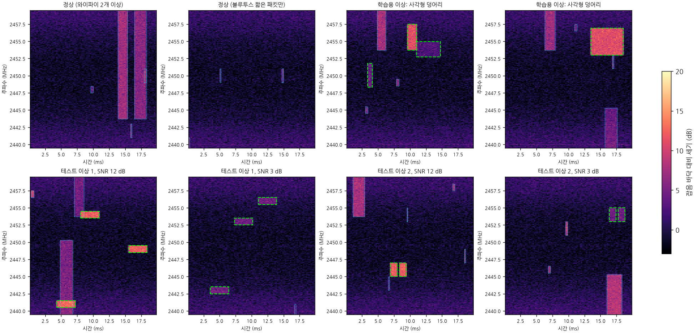
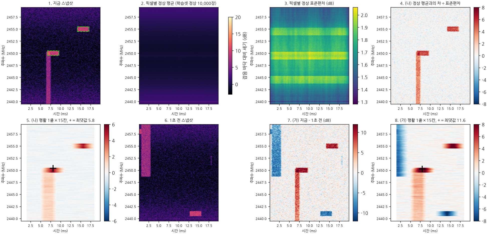
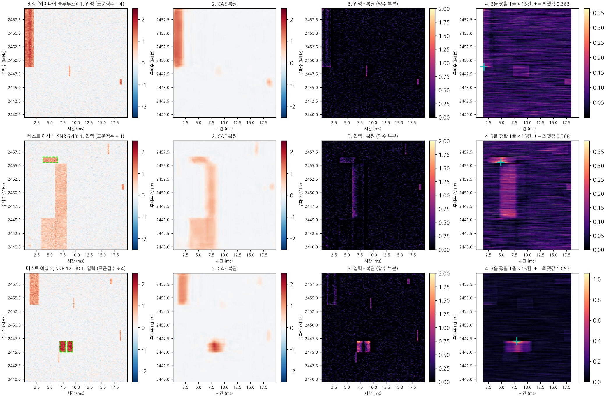
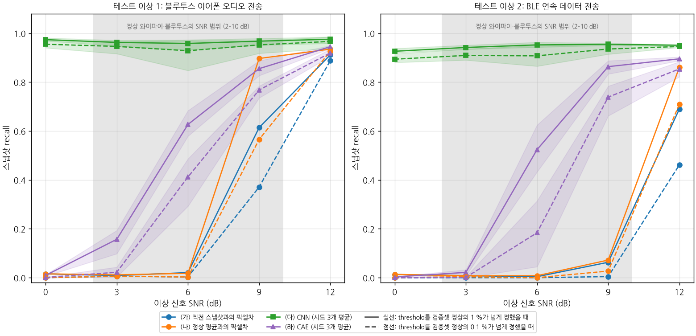
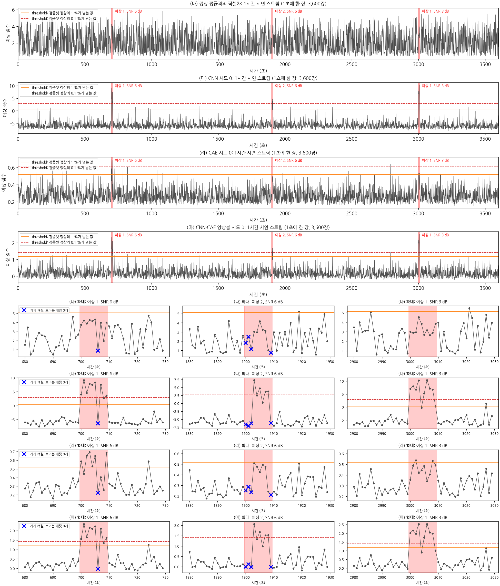
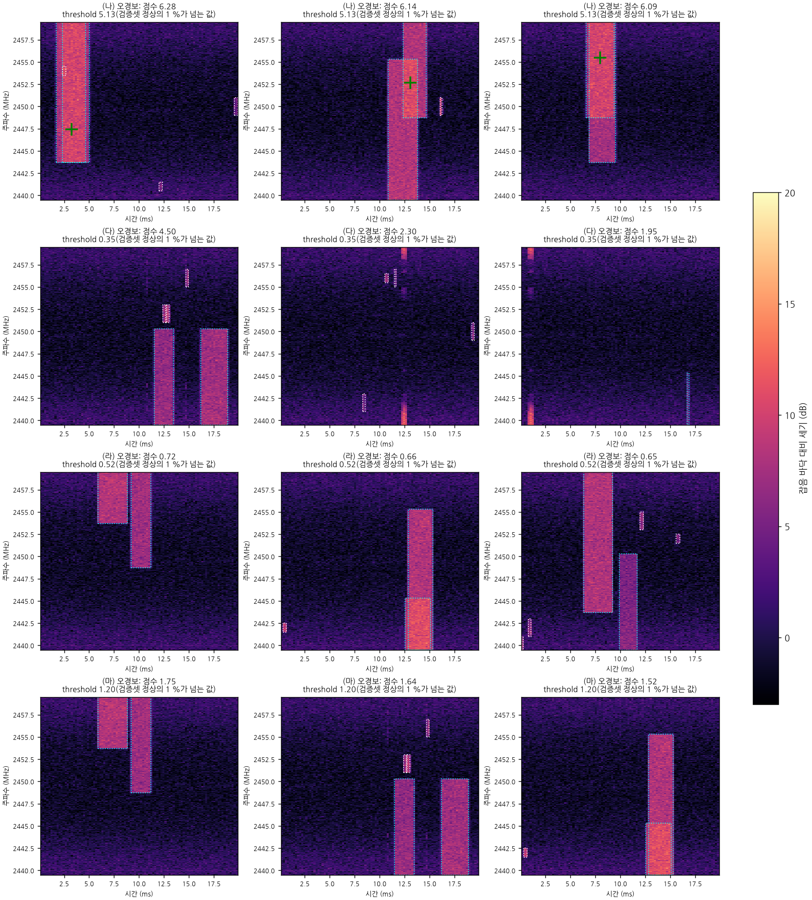

# 시험장 부정행위 기기 신호의 이상 탐지 PoC: 공원 배경 IQ 데이터 기반 합성 평가

작성일: 2026-11-18 · 개정: rev1. 본 문서는 연구 목적, 데이터 구성, 탐지 방법, 실험 결과와 실현 가능성 평가를 정리한다. 선행 연구 조사는 doc/prior_work.md에, 설치 및 코드 사용법은 저장소 루트의 README.ko.md에 제시했다.

## 0. 실험 개요와 주요 결과

수신기가 1초 간격으로 취득하는 스펙트로그램 스냅샷에서, 학습에 사용하지 않은 희귀 블루투스 신호를 탐지할 수 있는지 평가했다. 해당 신호는 시험장 내 부정행위용 기기의 송신을 모사한 합성 신호이다. 비교 방법은 다음 다섯 가지이다.

- (가) 직전 스냅샷 차분: 현재 스냅샷과 직전 스냅샷의 픽셀 차분을 이용하는 베이스라인
- (나) 정상 기준 차분: 정상 데이터의 픽셀별 평균·표준편차를 기준으로 표준화한 편차를 이용하는 베이스라인
- (다) CNN: 정상 스냅샷과 사각형 합성 이상 패턴을 추가한 스냅샷을 구분하도록 학습한 합성곱 신경망 기반 이진 분류 모델
- (라) CAE: 정상 스냅샷만으로 가중치를 학습하고, 재구성 잔차를 이상 점수로 사용하는 합성곱 오토인코더(convolutional autoencoder)
- (마) CNN·CAE 앙상블: 동일 시드의 CNN·CAE 점수를 검증셋 정상 데이터로 스케일링한 후 최댓값을 사용하는 점수 결합 방식

공원에서 드론과 조종기의 전원을 끄고 취득한 IQ 데이터 3초를 배경으로 사용하고, 정상 신호와 이상 신호를 합성했다. 학습셋·검증셋·테스트셋은 배경 IQ 데이터의 시간 구간이 겹치지 않도록 분할했다. 테스트용 이상 신호 두 종류는 학습셋과 검증셋에 포함하지 않았다.

아래 결과는 테스트셋에서 측정했다. 판정 임계값(threshold)은 검증셋 정상 스냅샷 5,000장 중 0.1 %(5장)만 이상 점수가 이를 초과하도록 설정했다. CNN·CAE·앙상블의 성능은 난수 시드 3개에 대한 평균이다.

- 오탐률(false positive rate, FPR): 정상 스냅샷을 이상으로 판정한 비율
- 재현율(recall): 이상 신호가 실제로 관측된 스냅샷 중 이상으로 판정한 비율
- 신호 대 잡음비(signal-to-noise ratio, SNR): 단위 대역폭당 신호 전력과 잡음 전력의 비를 dB로 표현한 값. 정상 와이파이·블루투스 신호의 SNR은 2–10 dB로 설정했다.

**표 0-1. 스냅샷 단위 오탐률과 재현율 (%)**

| 방법 | FPR | 재현율, SNR 0–3 dB | 재현율, SNR 6 dB | 재현율, SNR 9 dB | 재현율, SNR 12 dB |
|---|---:|---:|---:|---:|---:|
| (가) 직전 스냅샷 차분 | 0.09 | 0.0–0.6 | 0.0–0.3 | 0.5–37.1 | 46.1–88.8 |
| (나) 정상 기준 차분 | 0.11 | 0.0–0.6 | 0.0–0.3 | 2.7–56.5 | 70.9–92.6 |
| (다) CNN | 0.30 | 89.4–95.5 | 90.7–92.8 | 93.5–95.2 | 94.6–96.7 |
| (라) CAE | 0.05 | 0.0–2.2 | 18.4–41.2 | 73.9–76.8 | 85.4–91.9 |
| (마) CNN·CAE 앙상블 | 0.28 | 88.9–95.3 | 89.9–93.6 | 93.8–96.0 | 94.4–97.4 |

표의 재현율 범위는 두 이상 신호 유형(이어폰형·BLE형)의 최솟값과 최댓값이다. SNR 0–3 dB 열은 두 SNR 조건을 통합한 범위를 나타낸다. 시드별 FPR 범위는 CNN 0.01–0.65 %, CAE 0.02–0.08 %, 앙상블 0.04–0.57 %였다.

**표 0-2. 10초 이벤트 단위 재현율 (%, 최근 10장 중 2장 이상이 임계값을 초과하면 경보)**

| 방법 | SNR 0–3 dB | SNR 6 dB | SNR 9 dB | SNR 12 dB |
|---|---:|---:|---:|---:|
| (가) 직전 스냅샷 차분 | 0 | 0 | 0–90.0 | 92.5–100 |
| (나) 정상 기준 차분 | 0 | 0 | 0–97.5 | 100 |
| (다) CNN | 100 | 100 | 97.5–100 | 100 |
| (라) CAE | 0 | 30.8–88.3 | 94.2–100 | 100 |
| (마) CNN·CAE 앙상블 | 100 | 100 | 97.5–100 | 100 |

이벤트 재현율은 신호원이 10초간 동작하는 이벤트(스냅샷 10장) 40개 중 경보가 발생한 비율이다. 표의 범위는 두 이상 신호 유형의 결과를 나타낸다. 동일한 경보 규칙을 정상 스트림에 적용했을 때 시간당 오경보 수는 (가)·(나) 각각 0.2회, CNN 평균 0.5회(시드별 0.0–1.3회), CAE 0회, 앙상블 평균 0.4회(시드별 0.0–0.7회)였다.

주요 결과는 다음 여섯 가지이다.

1. **픽셀 차분 베이스라인((가)·(나))은 정상 신호보다 강한 이상 신호에서 탐지 성능을 보였다.** FPR은 약 0.1 %로 낮았으나, SNR 6 dB 이하에서는 재현율이 1 % 미만이었다. 정상 와이파이 버스트도 큰 차분 값을 생성하므로, 낮은 FPR을 유지하려면 임계값이 높아져 약한 이상 신호를 탐지하기 어렵다.
2. **CAE는 픽셀 차분보다 약 3 dB 낮은 SNR에서 탐지가 가능했고, 오경보가 가장 적었다.** SNR 9 dB에서 스냅샷 재현율은 74–77 %, 이벤트 재현율은 94–100 %였다. 반면 SNR 0–3 dB의 스냅샷 재현율은 2.2 % 이하였다. 정상 데이터로 가중치를 학습한 CAE가 정상 신호와 세기가 유사한 이상 신호도 일부 재구성하여 잔차가 작아지는 양상이 관찰되었다(그림 6).
3. **CNN은 SNR 전반에서 FPR 약 0.3 %, 재현율 89–97 %를 보였다.** 이는 신호 세기뿐 아니라 대역폭·지속 시간과 같은 형태적 특징을 활용한 결과로 해석된다. 다만, 학습용 합성 이상 패턴의 크기 범위에 테스트 패킷 크기가 포함되므로, 정상 데이터로만 가중치를 학습한 CAE와 학습 조건이 다르다.
4. **CNN·CAE 앙상블의 성능은 CNN과 유사했다.** 재현율 차이는 1 %p 이내였고, 시드별 시간당 오경보 수의 범위는 CNN의 0.0–1.3회에서 앙상블의 0.0–0.7회로 다소 좁아졌다. 테스트 신호 크기가 CNN의 학습 범위에 포함되어 CAE의 추가 탐지 효과는 제한적이었다. CNN이 학습하지 않은 형태에서 앙상블의 이점이 나타나는지는 이번 실험으로 확인하지 못했다.
5. **단일 스냅샷보다 연속 스냅샷을 집계하는 이벤트 단위 판정이 필요하다.** 순간 수신 대역폭이 20 MHz로 제한되므로 신호원이 동작하더라도 이어폰형 스냅샷의 약 17 %, BLE형의 약 40 %에서는 이상 패킷이 관측되지 않았다. 본 실험에서는 10초 단위 집계 규칙을 적용했다.
6. **합성 환경에서 이상 탐지의 실현 가능성을 확인했다.** 가중치 학습에 정상 데이터만 사용하는 CAE는 SNR 9 dB 이상에서 높은 이벤트 재현율을 보였다. 더 낮은 SNR에서도 높은 재현율을 보인 CNN은 합성 이상 패턴을 학습에 사용했다. 다만, 정상 블루투스를 짧은 패킷으로만 구성하여 두 모델 모두 실제 환경보다 유리한 조건에서 평가되었다. CNN의 테스트 FPR은 배경 구간이 달라지면 검증셋에서 설정한 목표값 0.1 %를 벗어났다. 따라서 다음 단계에서는 실제 교실의 정상 IQ 데이터를 이용한 검증이 필요하다(7장).

## 1. 연구 목적과 검증 질문

본 연구는 시험 중 휴대폰 전원을 끄거나 기기를 수거하여 전파 환경이 비교적 안정적으로 유지되는 상황을 가정한다(doc/prior_work.md 2.3절). 부정행위용 기기 신호는 라벨이 확보된 학습 데이터가 부족하고 발생 빈도도 낮으므로, 정상 데이터의 분포를 학습하고 그 분포에서 벗어난 관측을 식별하는 이상 탐지(anomaly detection)를 적용한다. 이번 개념 검증(proof of concept, PoC)에서는 실제 시험장 데이터 대신 합성 데이터를 사용하여 다음 다섯 질문을 평가한다.

- 질문 1. 픽셀 차분과 임계값만으로 이상 신호를 탐지할 수 있는가?
- 질문 2. 정상 데이터로 가중치를 학습하는 CAE는 픽셀 차분 베이스라인보다 높은 성능을 보이는가?
- 질문 3. 합성 이상 패턴을 학습하는 CNN의 탐지 성능은 어느 정도인가?
- 질문 4. CNN·CAE 점수 앙상블이 단일 모델의 성능을 개선하는가?
- 질문 5. 이상 발생 빈도가 낮은 조건에서도 오경보를 운용 가능한 수준으로 유지할 수 있는가?

## 2. 초기 가설 검토

초기 가설은 정상 스냅샷이 안정적으로 유지되므로 이상 신호가 추가된 영역에서 픽셀 차분이 커지고, 이를 임계값으로 탐지할 수 있다는 것이었다. 이에 따라 단순 차분 기반 방법을 베이스라인으로 설정하고 CNN·CAE와 비교했다. 가설의 세부 항목과 실험 결과는 표 1에 정리했다.

**표 1. 초기 가설에 대한 평가**

| 아이디어 | 판단 | 근거 (이번 PoC) |
|---|---|---|
| 정상 스냅샷의 픽셀 값은 거의 일정하다 | 부분적으로 성립 | 픽셀별 표준편차는 1.3–2.1 dB(중앙값 1.75 dB)로, 개별 픽셀은 일정하지 않다. 와이파이·블루투스가 스냅샷마다 다른 시간·주파수 위치에 나타나기 때문이다. 상대적으로 안정적인 것은 주파수별 평균 특성이므로, 직전 한 장보다 여러 정상 스냅샷의 평균·표준편차를 기준으로 삼는 편이 적절하다. |
| 픽셀 차분이 큰 영역을 이상으로 판정할 수 있다 | 강한 이상 신호에서만 유효 | 정상 와이파이 버스트도 큰 차분 값을 만든다(그림 5 상단). 오탐을 억제하도록 임계값을 높이면 SNR 6 dB 이하 이상 신호의 재현율이 1 % 미만으로 낮아졌다(표 7). |
| 개별 픽셀의 최댓값으로 판정할 수 있다 | 성능 부족 | 평활화 없이 픽셀 최댓값을 사용하면 검증셋 재현율은 약 1 %였다. 주변 셀을 평균하는 평활화 후 최댓값을 사용하면 약 51 %로 높아졌다(표 4). |
| 적절한 임계값을 설정하면 된다 | 목표 오탐률에 따른 보정 필요 | 초당 한 장을 평가할 때 FPR 1 %는 시간당 36장의 정상 스냅샷을 이상으로 판정하는 수준이다. 이상 비율이 0.1 %인 조건에서는 오경보가 경보의 대부분을 차지할 수 있다(표 10). 정상 검증 데이터로 목표 오탐률에 맞게 임계값을 설정하고, 연속 스냅샷 집계 규칙을 함께 적용해야 한다. |
| 단순 모델을 우선하되 CNN도 고려할 수 있다 | 학습 기반 방법의 성능 우세 | CAE는 픽셀 차분보다 약 3 dB 낮은 SNR에서 탐지가 가능했고, CNN은 SNR 0 dB에서도 높은 재현율을 보였다. CNN에는 실제 부정행위 기기 신호 대신 사각형 합성 이상 패턴을 학습시켰다. |

초기 가설 외에 다음 사항도 확인했다.

- **수신 대역폭의 제약:** HackRF는 한 번에 20 MHz만 수신한다. 블루투스 신호는 약 79 MHz 범위에서 주파수 도약을 수행하므로, 기기가 동작해도 이어폰형 스냅샷의 16.6 %, BLE형의 40.2 %에서는 패킷이 관측되지 않았다. 따라서 연속 스냅샷을 집계하는 판정이 필요하다.
- **고정된 전력 스케일:** 이미지별로 밝기를 정규화하면 강한 신호가 포함된 이미지에서 다른 픽셀이 상대적으로 어두워져 차분 값이 왜곡된다. 이를 피하기 위해 잡음 바닥을 0 dB로 하는 고정 전력 스케일을 사용했다. 수신 이득은 고정하는 것을 전제로 한다.
- **실측 배경의 잔류 신호:** 공원 배경에도 외부 신호나 과도 잡음이 포함되어 있다. 길이 0.2–0.4 ms의 짧은 수직 패턴이 초당 2–6회 나타났으며, 20 MHz 대역 전반에 산발적으로 분포했다. 최대 세기는 잡음 바닥보다 13–22 dB 높았다. 주변 와이파이 패킷인지 과도 잡음인지는 확인하지 못했으며, CNN 오경보의 원인 중 하나로 관찰되었다(그림 5).

## 3. 데이터

### 3.1 IQ 데이터 전처리와 스냅샷 생성

수신 장비는 HackRF One이며 중심 주파수는 2,449.5 MHz, 수신 대역폭은 20 MHz(2,439.5–2,459.5 MHz), 샘플링 속도는 20 MS/s(초당 2천만 샘플)이다. 운용 시에는 1초 간격으로 20 ms 길이의 IQ 데이터를 취득한다고 가정한다.

1. **IQ 구간 추출:** 20 ms 길이의 복소 IQ 데이터 400,000샘플을 입력으로 사용한다. IQ 데이터는 수신 신호의 동상·직교 성분을 복소수로 표현한 시계열이다.
2. **STFT:** 길이 8,192샘플의 창을 4,081샘플 간격으로 이동하며 단시간 푸리에 변환(short-time Fourier transform)을 계산한다. 출력 크기는 주파수축 8,192셀 × 시간축 97셀이다.
3. **주파수축 다운샘플링:** 주파수축의 32셀을 평균하여 256 × 97 크기로 축소한다. 셀 크기는 주파수 약 78 kHz, 시간 약 0.2 ms이다. 평균화를 통해 잡음 변동을 줄이면서 대역폭 1 MHz의 블루투스 신호를 약 13셀로 표현할 수 있다.
4. **DC 성분 제거:** HackRF의 중심 주파수에 나타나는 DC 성분을 제거하기 위해 0 Hz 주변 ±100 kHz 구간을 인접 주파수 셀의 값으로 대체한다.
5. **이미지 변환:** 잡음 바닥 대비 전력을 고정 스케일(-6 dB → 0, +34 dB → 255)에 매핑하여 8비트 스냅샷(256 × 97)으로 저장한다.

### 3.2 스펙트로그램 해석



**그림 1. 합성 스펙트로그램 예시.** 가로축은 시간(0–20 ms), 세로축은 주파수(2,439.5–2,459.5 MHz)이며 위쪽이 높은 주파수이다. 색상은 잡음 바닥 대비 전력을 나타내며, 검정색은 잡음 바닥, 밝은 색일수록 높은 전력에 해당한다. 점선은 합성 신호 위치를 설명하기 위해 추가한 것으로 모델 입력에는 포함되지 않는다. 하늘색은 정상 와이파이·블루투스, 연두색은 이상 신호의 위치이다. 상단의 3·4번째 패널은 학습용 사각형 합성 이상 패턴, 하단은 테스트용 블루투스 신호를 나타낸다.

- 와이파이는 주파수축으로 긴 막대 형태이다. 대역폭 16.6 MHz 중 수신 대역에 포함된 부분만 나타나며, 지속 시간은 0.1–3 ms이다.
- 정상 블루투스는 대역폭 1–2 MHz, 지속 시간 0.08–0.4 ms의 짧은 패턴이다.
- 테스트 이상 신호 1(이어폰형)은 대역폭 1 MHz, 지속 시간 2.87 ms로 시간축 방향의 긴 막대 형태이다. SNR 3 dB인 하단 2번째 패널에서는 육안 식별이 어렵다.
- 테스트 이상 신호 2(BLE형)는 대역폭 2 MHz, 지속 시간 1.06 ms인 두 패킷이 인접한 형태이다.

### 3.3 합성 신호 구성

SNR은 단위 대역폭당 신호 전력과 잡음 전력의 비를 dB로 표현한 값이다. SNR 0 dB에서는 신호 전력과 잡음 전력이 같으므로, 신호가 포함된 영역의 총전력은 잡음만 있는 영역보다 약 3 dB 높다.

**표 2. 신호 종류별 설정**

| 신호 | 사용 데이터셋 | 대역폭 (MHz) | 지속 시간 (ms) | 개수·전송 주기 | 주파수 | SNR (dB) |
|---|---|---:|---:|---|---|---|
| 정상 와이파이 | 전체 데이터셋 | 16.6 | 0.1–3 | 스냅샷마다 0–2개 | 수신 대역에 포함된 채널(5–12번) 중 무작위 | 2–8 |
| 정상 블루투스 클래식 | 전체 데이터셋 | 1 | 0.366 | 블루투스 0–4개 중 절반 | 2,440–2,459 MHz 채널 | 3–10 |
| 정상 BLE | 전체 데이터셋 | 2 | 0.08–0.376 | 블루투스 0–4개 중 절반 | 2,440–2,458 MHz 채널 | 3–10 |
| 학습용 이상: 사각형 합성 패턴 | 학습셋, 검증셋 | 0.3–4 | 0.3–6 | 1–4개 | 수신 대역 내 무작위 | 0–12 |
| 테스트 이상 1: 블루투스 이어폰 오디오 전송 모사 | 테스트셋 | 1 | 2.87 | 3.75 ms마다 1개 | 패킷마다 79개 채널(2,402–2,480 MHz) 중 하나 | 0, 3, 6, 9, 12 |
| 테스트 이상 2: BLE 연속 데이터 전송 모사 | 테스트셋 | 2 | 1.06 × 2개 | 7.5 ms마다 한 번(두 패킷 사이 0.33 ms) | 데이터 채널 37개(2,404–2,478 MHz) 중 하나 | 0, 3, 6, 9, 12 |

정상 배경의 신호 밀도는 낮게 설정했다. 스냅샷당 와이파이는 평균 1.0개, 블루투스는 평균 2.0개이며, 합성 신호를 추가하지 않은 스냅샷은 6.5 %이다. 정상 신호 SNR 범위(2–10 dB)와 테스트 이상 신호 SNR 범위(0–12 dB)는 의도적으로 중첩시켰다. 이는 정상 신호보다 약한 이상 신호도 탐지할 수 있는지 평가하기 위한 설정이다.

테스트 이상 신호 1은 스마트폰에서 블루투스 이어폰으로 오디오를 전송하는 상황을 모사한다. 길이 2.87 ms의 3-DH5 패킷을 3.75 ms 간격으로 주파수를 변경하여 전송하도록 구성했다. 테스트 이상 신호 2는 AI 안경이나 BLE 오디오의 연속 데이터 전송을 모사하며, 7.5 ms마다 251바이트·1.06 ms의 패킷 두 개를 전송하도록 구성했다. 두 유형 모두 블루투스 규격의 매개변수에 기반한 합성 신호이며 실제 기기에서 취득한 신호가 아니다.

여기서 “미학습 신호”의 범위는 구분할 필요가 있다. 정상 데이터에는 지속 시간이 0.4 ms를 넘는 협대역 블루투스 패킷이 없으며, 학습용 사각형 합성 이상 패턴에는 주파수 도약 구조가 없다. 다만, 합성 패턴의 대역폭 0.3–4 MHz·지속 시간 0.3–6 ms 범위에 테스트 패킷의 크기가 포함된다. 따라서 CNN에는 프로토콜 구조가 새로운 신호이지만 크기까지 학습 범위를 벗어난 신호는 아니다. CAE의 가중치 학습에는 합성 이상 패턴을 사용하지 않았다.

### 3.4 데이터셋 구성과 분할

배경 IQ 데이터는 D4D 해커톤 당시 공원에서 드론과 조종기의 전원을 모두 끄고 취득한 3초 구간이다. 해당 데이터는 rf-drone-detector 저장소 릴리스에 CC BY 4.0으로 공개되어 있다. 블루투스 형태의 패턴을 제거한 뒤 1초씩 세 파일(data/background/Park02_1·2·3.npy)로 분할했다. 각 스냅샷은 배정된 1초 구간 내에서 무작위 위치의 20 ms를 추출하여 생성한다.

**표 3. 데이터셋 구성 (단위: 장)**

| 데이터셋 | 배경 IQ 구간(3초 중) | 정상 스냅샷 | 이상 스냅샷 | 용도 |
|---|---|---:|---:|---|
| 학습셋 | 0–1초 | 10,000 | 10,000 (합성 이상 패턴) | 정상 데이터: 픽셀별 통계 추정·CAE 학습. 정상·합성 이상 데이터: CNN 학습 |
| 검증셋 | 1–2초 | 5,000 (연속 스트림) | 2,000 (합성 이상 패턴) | 정상 데이터: 임계값·CAE 체크포인트·앙상블 스케일링 결정. 합성 이상 데이터도 사용: 평활화 커널·CNN 체크포인트 선택 |
| 테스트셋 ① 정상 스트림 | 2–3초 | 20,000 | 0 | FPR, 시간당 오경보 수 |
| 테스트셋 ② 이상 이벤트 | 2–3초 | 400 | 4,000 | 스냅샷 재현율, 이벤트 재현율 |
| 테스트셋 ③ 시연 스트림 | 2–3초 | 3,570 | 30 | 점수 시계열 시각화(그림 4) |

데이터셋별 구성은 다음과 같다.

- 테스트셋 ① 정상 스트림은 초당 한 장을 평가할 때 5시간 33분에 해당한다.
- 테스트셋 ②는 이상 유형 2종 × SNR 5단계 × 유형·SNR별 이벤트 40개 × 이벤트당 10장으로 구성한다. 이벤트 직전의 정상 스냅샷 1장은 (가)의 차분 기준으로만 사용하며 성능 평가에서는 제외한다. 이상 스냅샷 4,000장 중 패킷이 1개 이상 관측된 스냅샷은 2,865장이며, 나머지 1,135장에서는 신호원이 동작해도 패킷이 관측되지 않았다.
- 테스트셋 ③ 시연 스트림은 1시간(3,600장) 중 10초 이벤트 3회(30장, 0.8 %)만 이상 상태인 희귀 이벤트 시나리오이다.

**데이터 누출 방지:**

- 학습셋·검증셋·테스트셋은 배경 IQ 데이터의 서로 다른 1초 구간을 사용한다. 분할 간 시간 중첩은 0초이다.
- 테스트용 이상 신호 2종은 학습셋·검증셋에 포함하지 않았다(0장).
- 평활화 커널 크기, CNN·CAE 체크포인트, 판정 임계값은 검증셋으로 결정했다. 테스트셋은 최종 평가에 사용했다. 단, 차분 베이스라인의 경계 처리 방식은 테스트 오경보 분석 후 수정했으며, 해당 경위는 4.2절에 명시했다.
- 데이터셋별로 서로 다른 합성 난수 시드를 사용했다.

### 3.5 폴더 구성

GitHub 저장소 rf-exam-anomaly-poc와 연구 폴더 research/exam_rf는 동일한 디렉터리 구조를 사용한다.

```
rf-exam-anomaly-poc/
├── data/
│   ├── background/           배경 IQ 파일 3개(릴리스에서 다운로드, 480 MB)
│   └── <데이터셋>.*          생성 스냅샷: .npy(이미지), .csv(메타데이터), _boxes.json(합성 위치), 1.3 GB
├── doc/
│   ├── 00_overview.md        원본 개요 문서
│   ├── 00_overview_rev1.md   표현·용어 교정본
│   ├── fig/                  그림 1–6
│   └── prior_work.md         선행 조사
├── models/                   모델: cnn_s0–2.pt, cae_s0–2.pt, pixel_stats.npz, thresholds.json(앙상블 스케일링 정보 포함)
├── results/                  기준 결과: results.md(전체 표), results.json, *_select.json(선택한 설정)
├── runs/                     실행 결과 저장
└── src/
    ├── build_html.py         Markdown → HTML 변환
    ├── cae.py                (라) CAE 학습
    ├── cnn.py                (다) CNN 학습
    ├── common.py             스냅샷 생성, 신호 정의
    ├── compare_results.py    실행 결과와 기준 결과 비교
    ├── ensemble.py           (마) CNN·CAE 앙상블
    ├── evaluate.py           테스트셋 평가, 시각화
    ├── export_models.py      학습 결과를 models/로 내보내기
    ├── make_data.py          데이터셋 생성
    ├── make_demo_iq.py       추론 검증용 IQ 파일 생성
    ├── pixeldiff.py          (가)·(나) 픽셀 차분 베이스라인
    ├── predict.py            추론 파이프라인
    └── run_all.sh            전체 학습·평가 파이프라인
```

데이터셋 파일의 접두사는 다음과 같다.

- 학습셋: train_normal, train_blob
- 검증셋: val_normal, val_blob
- 테스트셋: test_normal(①), test_event(②), test_demo(③)

## 4. 방법

모든 방법은 스냅샷마다 하나의 이상 점수(anomaly score)를 산출하고, 이 점수가 판정 임계값을 초과하면 이상으로 판정한다.

### 4.1 (가) 직전 스냅샷 차분

1. 현재 스냅샷과 1초 전 스냅샷의 dB 값을 입력으로 사용한다.
2. 픽셀별로 현재 값에서 직전 값을 빼 차분 맵을 계산한다.
3. 차분 맵에 크기 r × c(주파수 r셀 × 시간 c셀)의 평균 필터를 적용한다. 커널이 이미지 내부에 완전히 포함되는 위치만 계산하는 유효 영역 평활화를 사용한다.
4. 평활화된 차분 맵의 최댓값을 이상 점수로 사용한다.

### 4.2 (나) 정상 기준 차분

1. 학습셋 정상 스냅샷 10,000장으로 픽셀별 평균과 표준편차를 추정한다(그림 2의 2·3).
2. 각 픽셀에서 정상 평균을 빼고 정상 표준편차로 나누어 z-점수(z-score) 맵을 계산한다. 이는 정상 분포의 평균에서 표준편차의 몇 배만큼 벗어났는지를 나타낸다.
3. (가)와 동일한 평활화 및 최댓값 집계를 적용한다.



**그림 2. 픽셀 차분 계산 과정(테스트 이상 신호 1, SNR 9 dB).** 패널 1은 입력 스냅샷이며 연두색 점선은 이상 신호의 합성 위치이다. 패널 2·3은 학습셋 정상 10,000장의 픽셀별 평균과 표준편차(dB)이다. 표준편차가 높은 주파수 구간은 2,443.7–2,445.3, 2,448.7–2,450.3, 2,453.7–2,455.3 MHz로, 와이파이 채널이 추가로 중첩되어 정상 버스트가 더 자주 나타나는 영역이다. 패널 4는 (나)의 z-점수 맵, 5는 여기에 1셀 × 15셀 평균 필터를 적용한 결과이다. 검정색 +는 최댓값 위치를 나타낸다. 패널 6은 직전 스냅샷, 7은 (가)의 차분 맵(현재 - 직전), 8은 평활화 결과이다. 패널 4·5·7·8에서 빨간색은 양의 편차, 파란색은 음의 편차이다. 패널 5·8의 흰색 경계는 커널이 이미지 밖으로 나가 계산에서 제외한 영역이다. 정상 와이파이 버스트도 큰 양의 차분을 생성하므로, 차분 크기만으로는 정상과 이상을 구분하기 어렵다.

평활화 커널은 주파수축 1·6·13·26셀(0.08·0.5·1·2 MHz)과 시간축 1·2·5·10·15셀(0.2·0.4·1·2·3.1 ms)을 조합한 20개 후보를 탐색했다. 각 후보에 대해 정상 검증 스트림의 목표 FPR을 1 %로 설정하고, 해당 임계값에서 검증셋 합성 이상 패턴 2,000장의 재현율이 가장 높은 커널을 선택했다.

**표 4. 평활화 커널별 합성 이상 패턴의 검증 재현율 (%, 검증 목표 FPR 1 %)**

| 평활화 커널 크기 | (가) 직전 스냅샷 차분 | (나) 정상 기준 차분 |
|---|---:|---:|
| 1셀 × 1셀 (평활화 없음) | 1.0 | 0.9 |
| 1셀 × 5셀 (0.08 MHz × 1 ms) | 42.3 | 33.5 |
| 1셀 × 15셀 (0.08 MHz × 3.1 ms), 선택한 크기 | 45.9 | 51.2 |
| 6셀 × 15셀 (0.5 MHz × 3.1 ms) | 45.8 | 50.8 |
| 26셀 × 15셀 (2 MHz × 3.1 ms) | 33.8 | 37.1 |

시간축으로 긴 커널(15셀)을 적용할수록 재현율이 높아졌다. 정상 블루투스는 지속 시간이 0.4 ms 이하이므로 긴 시간 구간을 평균하면 기여도가 작아진다. 두 차분 방법 모두 1셀 × 15셀 커널을 선택했다.

**평가 절차의 한계:** 초기 구현에서는 이미지 경계를 바깥으로 확장할 때 경계 픽셀 값을 복제했다. 이 방식은 경계에 걸친 짧은 신호의 점수를 과대 추정했다. 해당 현상은 테스트셋 오경보 시각화에서 발견했으며, 검증셋에서도 임계값을 초과한 정상 스냅샷의 88 %가 시간축 양 끝의 2셀 내에서 최댓값을 가졌다. 이후 커널이 이미지 내부에 완전히 포함되는 위치만 계산하도록 수정하고, 커널 크기와 임계값은 검증셋에서 다시 선택했다. 따라서 구현 수정에는 테스트셋 분석이 관여했으나, 수정 후 하이퍼파라미터는 검증셋으로 결정했다.

### 4.3 (다) CNN 기반 이진 분류

- **입력:** (나)에서 계산한 z-점수 맵을 -4–12 범위로 클리핑하고 4로 나눈 1 × 256 × 97 텐서를 사용한다.
- **모델 구조:** 3×3 합성곱 두 개로 구성한 블록을 4개 쌓는다. 블록별 채널 수는 16·32·64·64이며, 블록 사이에는 2×2 최대 풀링을 적용한다. 전역 최대 풀링과 선형층 하나를 거쳐 이상 점수를 산출한다. 학습 가능한 파라미터는 약 14만 6천 개이다.
- **학습:** 정상 스냅샷 10,000장(라벨 0)과 합성 이상 패턴 스냅샷 10,000장(라벨 1)을 구분하도록 이진 교차 엔트로피(binary cross-entropy)를 최소화한다. 옵티마이저는 AdamW이며, 20 에포크, 배치 크기 256으로 학습했다. 한 에포크는 전체 학습셋을 한 번 순회하는 단위이다.
- **데이터 증강:** 스냅샷 내부의 절대적인 신호 발생 시각에 의존하지 않도록 시간축 무작위 순환 이동과 반전을 적용했다.
- **체크포인트 선택:** 매 에포크 검증셋에서 목표 FPR 1 %에 해당하는 임계값을 설정하고, 합성 이상 패턴의 재현율이 가장 높은 체크포인트를 선택했다. 시드 0·1·2에서 선택한 에포크는 각각 16·11·14였으며, 검증 재현율은 99.0·99.5·99.2 %였다.
- **반복 학습:** 난수 시드 0·1·2로 총 세 번 학습했다. GPU 1개에서 시드당 약 7분이 소요되었다.

### 4.4 (라) CAE 기반 재구성 이상 탐지

CAE는 인코더로 입력을 저차원 잠재 표현으로 압축하고, 디코더로 원래 크기의 이미지를 재구성하는 모델이다. 정상 데이터만으로 가중치를 학습하여 정상 패턴은 재구성하고, 학습 분포에서 벗어나는 패턴에는 큰 잔차가 남도록 기대하는 접근이다. 본 실험에서는 입력과 재구성 결과의 차이를 이상 점수로 사용했다.

1. **입력:** CNN과 동일하게 전처리한 z-점수 맵을 사용한다.
2. **인코더:** 스트라이드 2의 3×3 합성곱 4단으로 256 × 97 입력을 16 × 7 크기·16채널의 잠재 텐서로 압축한다. 잠재 표현은 1,792개 값으로, 원래 입력의 약 7 %이다.
3. **디코더:** 2배 업샘플링과 3×3 합성곱을 네 단계 적용하여 256 × 97로 재구성한다. 전체 모델의 파라미터는 약 6만 5천 개이다.
4. **학습:** 정상 스냅샷 10,000장만 사용하여 입력과 재구성 결과 사이의 평균제곱오차(mean squared error, MSE)를 최소화한다. AdamW, 20 에포크, 배치 크기 128로 학습했으며 시간축 증강은 CNN과 동일하다. 합성 이상 패턴은 가중치 학습에 사용하지 않았다.
5. **체크포인트 선택:** 정상 검증셋 5,000장의 재구성 오차가 가장 작은 에포크를 선택했다. 시드 0·1·2에서 선택한 에포크는 각각 19·20·20이었다. 최적 체크포인트가 학습 종료 시점 부근에 있으므로, 학습 기간을 늘렸을 때의 개선 가능성은 추가로 확인할 필요가 있다.
6. **이상 점수:** 입력에서 재구성 결과를 뺀 잔차의 양수 부분을 평활화하고, 그 최댓값을 사용한다. 이상 신호의 추가 에너지가 재구성되지 않으면 양의 잔차가 커진다는 가정에 따른 것이다.
7. **커널 선택:** (가)·(나)와 동일한 검증 기준을 적용했다. 세 시드 모두 1셀 × 15셀을 선택했으며, 검증 재현율은 69.6·77.4·74.3 %였다. 합성 이상 패턴은 이 커널 선택에만 사용했으며, CAE 가중치 학습과 체크포인트 선택에는 사용하지 않았다.

GPU 1개에서 에포크당 약 4초, 시드당 약 1.5분이 소요되었다.



**그림 6. CAE 시드 0의 재구성 예시.** 위에서부터 정상 스냅샷, 테스트 이상 신호 1(SNR 6 dB), 테스트 이상 신호 2(SNR 12 dB)이다. 패널 1은 입력 z-점수 맵을 4로 나눈 값이며, 연두색 점선은 이상 신호 위치이다. 패널 2는 재구성 결과이다. 패널 1·2에서 빨간색은 정상 평균보다 높은 값, 파란색은 낮은 값이다. 패널 3은 입력 - 재구성 결과의 양수 부분, 4는 여기에 1셀 × 15셀 평균 필터를 적용한 결과이다. 밝을수록 양의 잔차가 크다. 패널 4의 하늘색 +는 최댓값 위치이며, 제목의 숫자는 이상 점수이다. 흰색 경계는 계산에서 제외한 영역이다. 둘째 행에서는 CAE가 SNR 6 dB의 이상 신호(2,455.5 MHz의 수평 막대)도 일부 재구성하여 점수 0.388이 정상 예시의 0.363과 유사하다. 셋째 행의 강한 이상 신호는 잔차가 커 점수가 1.057로 높다.

### 4.5 (마) CNN·CAE 앙상블

CNN은 합성 이상 패턴의 형태를 학습하여 약한 신호에도 높은 재현율을 보인다. CAE는 정상 패턴을 재구성하는 방식이므로 CNN의 학습 범위와 다른 형태의 이상에 반응할 가능성이 있다. 두 모델의 상호 보완성을 평가하기 위해 추가 학습 없이 기존 이상 점수를 결합했다.

1. **분위수 기반 점수 스케일링:** CNN·CAE 점수는 서로 척도가 다르므로, 모델별로 `(점수 - 정상 검증 점수의 중앙값) / (정상 검증 점수의 제99백분위수 - 중앙값)`을 계산한다. 변환 후 정상 점수의 중앙값은 0, 상위 1 % 경계에 해당하는 점수는 1이 된다.
2. **최댓값 결합:** 스케일링한 두 점수의 최댓값을 앙상블 이상 점수로 사용한다. 어느 한 모델이라도 정상 분포에서 벗어난 관측으로 판단하면 높은 점수를 부여하는 규칙이다.
3. **임계값 설정:** 다른 방법과 마찬가지로 정상 검증셋의 앙상블 점수만 사용하여 목표 FPR에 해당하는 임계값을 결정한다.
4. **시드 대응:** CNN 시드 k와 CAE 시드 k를 결합하여 앙상블 3개(k = 0, 1, 2)를 구성했다.

점수 결합 규칙은 테스트셋 평가 전에 고정했으며, 결합 가중치는 튜닝하지 않았다. 검증셋의 이상 샘플은 CNN 학습에 사용한 유형과 같은 사각형 패턴이므로, 이 데이터로 가중치를 최적화하면 CNN에 유리한 선택이 될 수 있다. 따라서 앙상블 구성에는 정상 검증 데이터만 사용하여 점수 스케일링과 임계값 설정을 수행했다. 참고로 검증 목표 FPR 1 %에서 앙상블의 합성 이상 패턴 재현율은 시드 0·1·2에서 각각 98.8·99.4·99.1 %였다.

### 4.6 판정 임계값과 평가 지표

- **판정 임계값:** 이상 점수가 이를 초과하면 이상으로 판정한다. 정상 검증 스트림 5,000장에서 목표 FPR 1 %(50장)와 0.1 %(5장)에 해당하는 두 임계값을 설정했다. 이하 “검증 목표 FPR 1 %”와 “검증 목표 FPR 0.1 %”는 이 보정 조건을 뜻하며, 테스트 FPR이 같은 값임을 의미하지 않는다. 테스트셋은 임계값 설정에 사용하지 않았다.
- **오탐률(FPR):** 정상 스냅샷 중 이상으로 판정한 비율이다. 테스트셋 ①의 정상 스냅샷 20,000장으로 계산한다.
- **스냅샷 재현율:** 이상 패킷이 1개 이상 관측된 스냅샷 중 이상으로 판정한 비율이다. 신호원이 동작하더라도 패킷이 관측되지 않은 스냅샷은 이 지표의 분모에서 제외한다.
- **AUROC:** ROC 곡선 아래 면적(area under the receiver operating characteristic curve)으로, 단일 임계값에 의존하지 않는 순위 기반 성능 지표이다. 무작위로 선택한 이상 샘플의 점수가 정상 샘플보다 높을 확률로 해석할 수 있으며, 1은 완전한 구분, 0.5는 무작위 수준에 해당한다.
- **이벤트 재현율:** 신호원이 10초간 동작한 이벤트 중 10장의 스냅샷에서 2장 이상이 임계값을 초과한 이벤트의 비율이다. 이벤트에는 패킷이 관측되지 않은 스냅샷도 포함한다.
- **시간당 오경보 수:** 정상 스트림에서 “최근 10장 중 2장 이상이 임계값 초과”라는 경보 조건이 거짓에서 참으로 바뀐 횟수를 전체 스트림 길이 5.56시간으로 나눈 값이다.
- **정밀도(precision):** 이상으로 판정한 스냅샷 중 실제 이상 스냅샷의 비율이다. 이상 발생 비율을 p로 가정하면 `재현율 × p / (재현율 × p + FPR × (1 - p))`로 산출한다. 이때 재현율과 FPR은 백분율이 아닌 비율로 계산한다.

## 5. 결과

이 절의 수치는 별도 명시가 없는 한 테스트셋 측정값이며, 판정 임계값은 검증셋에서 결정했다. 검증 목표 FPR 1 %의 결과와 AUROC를 포함한 전체 표는 results/results.md에 제시했다.

### 5.1 오탐률과 시간당 오경보 수

검증 목표 FPR 1 %와 0.1 %에서 설정한 임계값을 정상 테스트 스트림 20,000장(5.56시간)에 그대로 적용했다. 테스트 FPR이 목표값에 얼마나 근접하는지를 통해 배경 구간이 바뀌었을 때 임계값의 안정성을 평가했다.

**표 5. 정상 테스트 스냅샷 20,000장에 대한 오탐률(FPR, %)**

| 방법 | 검증 목표 FPR 1 % | 검증 목표 FPR 0.1 % |
|---|---:|---:|
| (가) 직전 스냅샷 차분 | 0.86 | 0.09 |
| (나) 정상 기준 차분 | 0.75 | 0.11 |
| (다) CNN 시드 0 | 0.34 | 0.01 |
| (다) CNN 시드 1 | 2.29 | 0.24 |
| (다) CNN 시드 2 | 1.32 | 0.65 |
| (라) CAE 시드 0 | 0.58 | 0.08 |
| (라) CAE 시드 1 | 0.58 | 0.02 |
| (라) CAE 시드 2 | 0.39 | 0.04 |
| (마) CNN·CAE 앙상블 시드 0 | 0.20 | 0.04 |
| (마) CNN·CAE 앙상블 시드 1 | 2.00 | 0.24 |
| (마) CNN·CAE 앙상블 시드 2 | 1.28 | 0.57 |

**표 6. 정상 테스트 스트림의 시간당 오경보 수 (회, 최근 10장 중 2장 이상이 임계값을 초과하면 경보)**

| 방법 | 검증 목표 FPR 1 % | 검증 목표 FPR 0.1 % |
|---|---:|---:|
| (가) 직전 스냅샷 차분 | 2.7 | 0.2 |
| (나) 정상 기준 차분 | 1.4 | 0.2 |
| (다) CNN 시드 0 | 0.2 | 0.0 |
| (다) CNN 시드 1 | 13.5 | 0.4 |
| (다) CNN 시드 2 | 3.6 | 1.3 |
| (라) CAE 시드 0 | 1.1 | 0.0 |
| (라) CAE 시드 1 | 0.9 | 0.0 |
| (라) CAE 시드 2 | 0.7 | 0.0 |
| (마) CNN·CAE 앙상블 시드 0 | 0.2 | 0.0 |
| (마) CNN·CAE 앙상블 시드 1 | 11.0 | 0.4 |
| (마) CNN·CAE 앙상블 시드 2 | 4.0 | 0.7 |

픽셀 차분과 CAE의 테스트 FPR은 검증 목표값(1 %, 0.1 %)에 가깝거나 더 낮았다. CNN의 테스트 FPR은 시드에 따라 목표값의 0.1–6.5배로 변동했으며, 앙상블도 유사한 변동을 보였으나 범위는 다소 좁았다. 검증 목표 FPR 1 %에서 시드 평균 테스트 FPR은 CNN 1.31 %, 앙상블 1.16 %였다. CNN 점수 분포의 상위 꼬리는 와이파이 중첩이나 실측 배경의 짧은 수직 패턴처럼 드물게 발생하는 정상 장면에 민감한 것으로 보인다. 검증셋과 테스트셋은 서로 다른 1초 배경 구간을 사용하므로 이러한 장면의 구성도 달라질 수 있다. 스냅샷 한 장의 임계값 초과만으로 경보를 발생시키면, 검증 목표 FPR 0.1 %에서 시간당 오경보 수는 (가) 3.1회, (나) 4.0회, CNN 0.2–22.0회, CAE 0.7–2.9회, 앙상블 1.6–19.8회였다.

### 5.2 스냅샷 단위 재현율



**그림 3. 이상 신호 SNR별 스냅샷 재현율.** 가로축은 테스트 이상 신호의 SNR, 세로축은 이상 패킷이 1개 이상 관측된 스냅샷에 대한 재현율이다. 파란색은 (가), 주황색은 (나), 초록색 사각형은 CNN, 보라색 삼각형은 CAE, 빨간색 마름모는 앙상블이다. CNN·CAE·앙상블은 3개 시드의 평균이며, 반투명 영역은 시드별 최솟값–최댓값 범위이다. 실선은 검증 목표 FPR 1 %, 점선은 0.1 %에서 설정한 임계값의 결과이다. 회색 영역은 정상 와이파이·블루투스의 SNR 범위(2–10 dB)를 나타낸다.

**표 7. 테스트 이상 신호 1(이어폰형)의 스냅샷 재현율 (%, 검증 목표 FPR 0.1 %)**

| 방법 | SNR 0 dB | SNR 3 dB | SNR 6 dB | SNR 9 dB | SNR 12 dB |
|---|---:|---:|---:|---:|---:|
| (가) 직전 스냅샷 차분 | 0.0 | 0.6 | 0.3 | 37.1 | 88.8 |
| (나) 정상 기준 차분 | 0.0 | 0.6 | 0.3 | 56.5 | 92.6 |
| (다) CNN, 시드 3개 평균 | 95.5 | 94.6 | 92.8 | 95.2 | 96.7 |
| (라) CAE, 시드 3개 평균 | 0.1 | 2.2 | 41.2 | 76.8 | 91.9 |
| (마) CNN·CAE 앙상블, 시드 3개 평균 | 95.3 | 94.0 | 93.6 | 96.0 | 97.4 |
| 평가한 스냅샷 수 (장) | 319 | 346 | 335 | 329 | 339 |

**표 8. 테스트 이상 신호 2(BLE형)의 스냅샷 재현율 (%, 검증 목표 FPR 0.1 %)**

| 방법 | SNR 0 dB | SNR 3 dB | SNR 6 dB | SNR 9 dB | SNR 12 dB |
|---|---:|---:|---:|---:|---:|
| (가) 직전 스냅샷 차분 | 0.0 | 0.0 | 0.0 | 0.5 | 46.1 |
| (나) 정상 기준 차분 | 0.0 | 0.4 | 0.0 | 2.7 | 70.9 |
| (다) CNN, 시드 3개 평균 | 89.4 | 90.9 | 90.7 | 93.5 | 94.6 |
| (라) CAE, 시드 3개 평균 | 0.0 | 0.1 | 18.4 | 73.9 | 85.4 |
| (마) CNN·CAE 앙상블, 시드 3개 평균 | 88.9 | 90.8 | 89.9 | 93.8 | 94.4 |
| 평가한 스냅샷 수 (장) | 226 | 246 | 245 | 222 | 258 |

각 표의 평가 스냅샷 수는 이벤트 40개 × 10장 = 400장 중 이상 패킷이 1개 이상 관측된 스냅샷 수이다.

- **픽셀 차분:** 이상 신호가 정상 신호의 SNR 범위(2–10 dB)보다 강한 조건에서 재현율이 높아졌다.
- **CAE:** 픽셀 차분보다 약 3 dB 낮은 SNR에서 재현율이 증가하기 시작했다. 이상 신호 1의 SNR 6 dB 재현율은 41.2 %로 픽셀 차분의 0.3 %보다 높았다. 다만 SNR 0–3 dB에서는 2.2 % 이하였으며, SNR 6 dB의 시드별 재현율은 이상 신호 1에서 29.3–48.7 %, 이상 신호 2에서 4.5–31.4 %로 변동이 컸다.
- **CNN:** SNR 전반에서 재현율이 89–97 %였으며, 개별 시드의 최솟값은 84.8 %(이상 신호 1, SNR 6 dB)였다.
- **앙상블:** 모든 조건에서 CNN과의 재현율 차이가 1 %p 이내였다. 이상 신호 1의 SNR 6–12 dB에서는 0.7–0.8 %p 높았고, 다른 조건에서는 유사하거나 다소 낮았다. 이번 평가에서는 CAE 점수 결합에 따른 추가 탐지 효과가 제한적이었다.

AUROC 기준의 차이는 저오탐 영역의 재현율 차이보다 작았다. 이상 신호 1의 SNR 6 dB에서 AUROC는 (나) 0.900, CAE 0.956, CNN 0.992, 앙상블 0.991이었다. 그럼에도 검증 목표 FPR 0.1 %에서 (나)의 재현율이 0에 가까운 이유는 강한 정상 와이파이 버스트가 정상 점수 분포의 상위 꼬리를 형성하여, 낮은 오탐률을 위한 임계값이 높아지기 때문이다.

### 5.3 이벤트 단위 재현율

**표 9. 이벤트 재현율 (%, 유형·SNR별 10초 이벤트 40개, 10장 중 2장 이상 임계값 초과, 검증 목표 FPR 0.1 %)**

| 방법 | 이상 종류 | SNR 0 dB | SNR 3 dB | SNR 6 dB | SNR 9 dB | SNR 12 dB |
|---|---|---:|---:|---:|---:|---:|
| (가) 직전 스냅샷 차분 | 1 (이어폰형) | 0.0 | 0.0 | 0.0 | 90.0 | 100.0 |
| (나) 정상 기준 차분 | 1 (이어폰형) | 0.0 | 0.0 | 0.0 | 97.5 | 100.0 |
| (다) CNN | 1 (이어폰형) | 100.0 | 100.0 | 100.0 | 100.0 | 100.0 |
| (라) CAE | 1 (이어폰형) | 0.0 | 0.0 | 88.3 | 100.0 | 100.0 |
| (마) CNN·CAE 앙상블 | 1 (이어폰형) | 100.0 | 100.0 | 100.0 | 100.0 | 100.0 |
| (가) 직전 스냅샷 차분 | 2 (BLE형) | 0.0 | 0.0 | 0.0 | 0.0 | 92.5 |
| (나) 정상 기준 차분 | 2 (BLE형) | 0.0 | 0.0 | 0.0 | 0.0 | 100.0 |
| (다) CNN | 2 (BLE형) | 100.0 | 100.0 | 100.0 | 97.5 | 100.0 |
| (라) CAE | 2 (BLE형) | 0.0 | 0.0 | 30.8 | 94.2 | 100.0 |
| (마) CNN·CAE 앙상블 | 2 (BLE형) | 100.0 | 100.0 | 100.0 | 97.5 | 100.0 |

이벤트의 스냅샷 10장에는 패킷이 관측되지 않은 스냅샷도 포함한다. CNN·CAE·앙상블의 결과는 3개 시드 평균이며, 앙상블은 모든 조건에서 CNN과 동일했다. CNN이 놓친 이벤트 1개(이상 신호 2, SNR 9 dB)는 패킷이 관측된 스냅샷이 1장뿐이었고, 세 시드 모두 그 스냅샷을 탐지하지 못했다. BLE형은 스냅샷의 약 40 %에서 패킷이 관측되지 않으므로 관측 기회가 부족한 이벤트가 발생할 수 있다. CAE는 SNR 9 dB 이상에서 높은 이벤트 재현율을 보였다.

### 5.4 낮은 이상 발생 비율을 고려한 정밀도

**표 10. 스냅샷 단위 정밀도 (%, 이상 비율 1,000장 중 1장, 검증 목표 FPR 0.1 %, 테스트 이상 신호 1)**

| 방법 | SNR 0 dB | SNR 3 dB | SNR 6 dB | SNR 9 dB | SNR 12 dB |
|---|---:|---:|---:|---:|---:|
| (가) 직전 스냅샷 차분 | 0.0 | 0.6 | 0.3 | 29.2 | 49.7 |
| (나) 정상 기준 차분 | 0.0 | 0.5 | 0.3 | 33.0 | 44.6 |
| (다) CNN, 시드 3개 평균 | 45.5 | 45.5 | 45.4 | 45.6 | 45.7 |
| (라) CAE, 시드 3개 평균 | 0.2 | 6.1 | 49.4 | 63.7 | 67.6 |
| (마) CNN·CAE 앙상블, 시드 3개 평균 | 36.8 | 36.6 | 36.5 | 37.0 | 37.3 |

이상 비율이 1,000장 중 1장으로 낮으면, 높은 재현율만으로 높은 정밀도를 보장할 수 없다. SNR 6 dB 이상에서 CAE의 정밀도가 가장 높았던 것은 낮은 FPR의 영향이다. 앙상블의 정밀도는 CNN보다 낮았으나, 평균 FPR이 높아서 나타난 결과는 아니다(앙상블 0.28 %, CNN 0.30 %). 정밀도는 시드별로 계산한 뒤 평균했으며, CNN 시드 0의 FPR이 0.005 %로 매우 낮아 해당 시드의 정밀도 약 94 %가 CNN 평균을 높였다. 정밀도는 FPR의 비선형 함수이므로 평균 FPR만으로 시드 평균 정밀도의 순서를 판단할 수 없다. 연속 스냅샷 집계 규칙(10장 중 2장)을 적용하면 시간당 오경보 수는 CNN 0–1.3회, 앙상블 0–0.7회로 감소했다(표 6).

### 5.5 1시간 시연 스트림



**그림 4. 1시간 시연 스트림의 이상 점수.** 초당 한 장씩 총 3,600장으로 구성했으며, 빨간색 영역은 10초 길이의 이상 이벤트 3개이다(이상 신호 1·SNR 6 dB, 이상 신호 2·SNR 6 dB, 이상 신호 1·SNR 3 dB). 상단 네 패널은 차례로 (나), CNN 시드 0, CAE 시드 0, 앙상블 시드 0의 전체 점수 시계열이다. 주황색 실선은 검증 목표 FPR 1 %, 빨간색 점선은 0.1 %에서 설정한 임계값이다. 하단 네 패널은 동일한 순서로 이벤트 전후 50초를 확대했다. 파란색 X는 신호원이 동작하지만 관측 패킷이 0개인 스냅샷이다.

- **(나):** 세 이벤트 모두 10장 중 임계값을 초과한 스냅샷이 0장이었다. 이벤트 외 구간의 오탐 스냅샷 수는 검증 목표 FPR 1 %에서 29장, 0.1 %에서 5장이었다.
- **CNN 시드 0:** 검증 목표 FPR 0.1 %에서 이벤트별 10장 중 8·4·8장이 임계값을 초과했다. 이벤트 외 구간의 오탐은 0장이었다. 미탐 스냅샷 10장 중 5장은 관측 패킷이 0개였다.
- **CAE 시드 0:** 검증 목표 FPR 0.1 %에서 첫 번째 이벤트(이상 신호 1, SNR 6 dB)는 10장 중 4장이 임계값을 초과했고, 나머지 두 이벤트는 0장이었다. 이벤트 외 구간의 오탐은 1장이었다.
- **앙상블 시드 0:** 동일한 임계값 보정 조건에서 이벤트별 10장 중 8·4·8장이 임계값을 초과하여 CNN과 같았고, 이벤트 외 구간의 오탐은 1장이었다.

### 5.6 오경보 사례 분석



**그림 5. 정상 테스트 스트림에서 이상 점수가 가장 높았던 스냅샷.** 위에서부터 (나), CNN 시드 0, CAE 시드 0, 앙상블 시드 0의 상위 3개 스냅샷이다. 하늘색 점선은 합성 와이파이, 흰색 점선은 합성 블루투스 위치이다. 첫 번째 행의 초록색 +는 (나)의 최댓값 위치이다.

- **(나):** 높은 전력의 정상 와이파이 버스트에서 오탐했다. 차분 기반 점수는 이러한 정상 변동에도 반응하므로 이상 신호와 구분하기 어렵다.
- **CNN:** 와이파이 두 개와 블루투스가 중첩된 장면, 실측 공원 배경에 포함된 짧은 수직 패턴에서 오탐했다. 후자는 합성 신호가 아니며 발생 원인은 확인하지 못했다(2장).
- **CAE:** 와이파이 버스트 두 개가 중첩되거나 인접한 장면에서 오탐했다. 정상 학습 데이터에서 드문 형태여서 재구성 오차가 커진 것으로 해석된다.
- **앙상블:** 와이파이 중첩과 와이파이·블루투스 중첩 등 CNN·CAE 각각의 오탐 패턴이 나타났다. 최댓값 결합은 어느 한 모델의 높은 점수도 반영하므로 두 모델의 오탐 요인을 함께 수용한다.

### 5.7 추가 진단

- **합성 아티팩트 의존 여부:** 신호원이 동작하지만 관측 패킷이 0개인 스냅샷을 별도로 평가했다. CNN 시드 0이 검증 목표 FPR 1 %에서 이를 이상으로 판정한 비율은 0–0.5 %로, 정상 스트림 FPR 약 0.3 %와 유사했다. 이는 관측 패킷 외의 합성 흔적만으로 이상을 판정한다는 설명을 뒷받침하지 않는다.
- **미탐 패턴:** CNN이 놓친 스냅샷은 대부분 관측 패킷이 1개이며 이미지 경계에서 잘린 경우였다. 관측 면적 비율의 중앙값은 이상 신호 1에서 27 %, 이상 신호 2에서 44 %였다.

## 6. 실현 가능성 평가

합성 환경에서 검증 목표 FPR 0.1 %를 적용한 결과는 다음과 같다.

1. **픽셀 차분 베이스라인은 낮은 오탐률을 유지했으나 약한 신호의 재현율이 낮았다.** 테스트 FPR은 (가) 0.09 %, (나) 0.11 %로 검증 목표 0.1 %와 유사했다. 그러나 SNR 6 dB 이하의 스냅샷 재현율은 0.0–0.6 %, 이벤트 재현율은 0 %였다.
2. **CAE는 정상 데이터로 가중치를 학습하고도 픽셀 차분보다 약 3 dB 낮은 SNR에서 탐지가 가능했다.** 평균 FPR은 0.05 %로 가장 낮았으며, 본 정상 스트림에서 시간당 오경보는 0회였다. SNR 9 dB 이상의 이벤트 재현율은 94–100 %였지만, SNR 0–3 dB의 스냅샷 재현율은 2.2 % 이하였다.
3. **CNN은 SNR 0–12 dB에서 높은 재현율을 보였다.** FPR 0.30 %에서 스냅샷 재현율 89–97 %, 이벤트 재현율 97.5–100 %였으며, 시드별 시간당 오경보 수는 0–1.3회였다.
4. **앙상블의 추가 효과는 제한적이었다.** CNN과의 재현율 차이는 1 %p 이내였으며, 시드별 시간당 오경보 범위는 0.0–1.3회에서 0.0–0.7회로 다소 좁아졌다.
5. **20 MHz 수신 환경에서는 관측 누락을 고려한 이벤트 판정이 필요했다.** 신호원이 동작하더라도 이어폰형 스냅샷의 약 17 %, BLE형의 약 40 %에서는 패킷이 관측되지 않았다. 본 실험은 10초 단위 집계 규칙으로 이를 보완했다.

평가 범위의 한계와 미검증 항목은 다음과 같다.

1. **실제 시험장의 정상 분포:** 합성 정상 블루투스는 모두 0.4 ms 이하의 짧은 패킷이었다. 실제 환경에는 허용된 의료기기(연속혈당측정기 등 BLE), 감독관 기기, 인접 교실의 이어폰처럼 정상 상태에서도 긴 패킷을 발생시키는 신호원이 있을 수 있다. 이러한 신호를 정상에 포함하면 CNN의 형태적 구분 단서가 약해지고 CAE도 긴 패킷을 정상 패턴으로 학습할 수 있다. 이 경우 다중 수신기를 이용한 위치 정보나 신호 지속성 등 추가 특징을 검토해야 한다.
2. **실제 기기 신호와의 차이:** 이상 신호 1·2는 규격 매개변수로 생성한 합성 신호이다. 실제 기기는 패킷 길이·전송 주기·적응형 주파수 도약(adaptive frequency hopping, AFH)에 따른 채널 사용 특성이 다를 수 있다.
3. **학습 범위 밖 형태에 대한 일반화:** CNN의 학습용 사각형 패턴 크기 범위에 테스트 패킷 크기가 포함되었다. AI 안경의 와이파이 직접 연결 등 광대역 신호를 사용하는 기기는 정상 와이파이와 형태가 유사할 수 있어, 이번 실험의 특징만으로 구분하기 어렵다. 앙상블의 일반화 이점도 CNN이 학습하지 않은 형태의 이상으로 평가해야 한다.
4. **배경 다양성과 표본 독립성:** 배경은 한 장소에서 취득한 3초 데이터에 한정된다. 정상 테스트 스냅샷 20,000장도 동일한 1초 구간에서 반복 추출하므로 구간이 서로 중첩되며, 독립적인 현장 관측 20,000장과 동일하게 해석할 수 없다.
5. **임계값의 환경 간 전이:** CNN은 같은 장소의 배경 구간만 달라져도 테스트 FPR이 검증 목표값을 벗어났다. 목표 FPR 0.1 %에서 테스트 FPR은 0.01–0.65 %였다. 새로운 장소로의 전이는 검증하지 않았으므로, 현장 적용 시 시험 직전의 정상 데이터로 임계값을 재보정하는 방안을 검토해야 한다.
6. **CAE 하이퍼파라미터 탐색:** 잠재 공간 크기와 학습 에포크 수는 각각 한 가지 설정만 평가했다. 세 시드 모두 종료 에포크 부근의 체크포인트가 선택되어 추가 학습의 개선 가능성이 있으나, 실제 성능 향상은 확인하지 않았다.
7. **미평가 운용 요인:** 인체 차폐에 따른 신호 감쇠와 좌석 단위 위치 추정은 다루지 않았다.

본 PoC는 합성 환경에서 미학습 신호 유형에 대한 이상 탐지 가능성을 보여 준다. 픽셀 차분은 약한 신호 탐지에 한계가 있었고, CAE·CNN은 연속 스냅샷 집계와 함께 더 높은 탐지 성능을 보였다. 정상 데이터로 가중치를 학습한 CAE는 상대적으로 강한 이상 신호에 효과적이었으며, 합성 이상 패턴을 학습한 CNN은 더 낮은 SNR에서도 높은 재현율을 보였다. 앙상블은 CNN보다 일관된 성능 개선을 보이지 않았다. 실제 시험장으로의 일반화는 정상 환경의 긴 패킷 신호를 포함한 실제 IQ 데이터에서 추가로 검증해야 한다.

## 7. 후속 실험 제안 (진행 전 합의 필요)

1. **실제 정상 데이터 검증:** 빈 교실과 사람이 있는 교실에서 HackRF로 수 시간의 IQ 데이터를 취득하고, 실제 배경으로 기존 파이프라인을 재평가한다. 우선 정상 환경에서 긴 패킷이 발생하는 빈도와 형태를 확인한다.
2. **실제 이상 신호 평가:** 동일 교실에서 블루투스 이어폰의 오디오 재생과 BLE 기기 연결 신호를 거리별로 취득한다. 이 데이터는 테스트셋에만 사용한다.
3. **크기 일반화 평가:** CNN 학습용 합성 패턴과 테스트 패킷의 지속 시간 범위를 분리한다. 예를 들어 학습은 0.3–1.5 ms, 테스트는 2.87 ms로 설정하여 크기까지 학습 범위 밖인 이상을 평가하고, CAE와의 비교에서 학습 정보의 차이를 줄인다.
4. **CAE 튜닝:** 학습 에포크 수와 잠재 공간 크기를 변경하여 SNR 3–6 dB의 재현율 개선 여부를 확인한다.
5. **앙상블의 일반화 평가:** CNN 학습 패턴과 다른 형태의 이상(지속 시간 6 ms 초과, 대역폭 4 MHz 초과 등)을 테스트셋에 추가하여 CNN 대비 앙상블의 추가 탐지 효과를 평가한다.
6. **수신 대역 확장:** 2.4 GHz 대역 전체(83.5 MHz)를 여러 20 MHz 구간으로 순차 스캔하는 방식을 검토한다. 패킷 미관측 비율의 감소 여부는 스캔 주기와 신호 특성을 함께 고려하여 평가해야 한다.

## 8. 실험 재현과 추론 파이프라인

설치, 데이터 다운로드, 실행 명령 및 옵션의 상세 사용법은 README.ko.md에 제시했다. 주요 실행 흐름은 다음과 같다.

학습 파이프라인은 `bash src/run_all.sh`로 실행한다. 데이터 생성, 픽셀 차분 베이스라인, CNN·CAE 학습, 앙상블 구성, 평가·시각화, 기준 결과(results/) 비교를 순서대로 수행하며, GPU 1개에서 약 30분이 소요된다. `bash src/run_all.sh --use-released-models`는 재학습 없이 공개 모델(models/)로 점수를 계산하여 문서의 기준 결과를 재현하는 경로이며, 약 8분이 소요된다.

추론 파이프라인은 `python src/predict.py`로 실행한다. 입력은 1초 간격으로 취득한 20 ms IQ 구간을 연결한 파일 또는 미리 생성한 스냅샷이다. 스펙트로그램 생성, 이상 점수 산출, 스냅샷 판정, “최근 10장 중 2장 이상” 경보 처리를 수행하고 결과를 CSV로 저장한다. 모델은 `--model`로 선택하며, cnn은 CNN, cae는 CAE, ens는 CNN·CAE 앙상블, pixel은 (나) 정상 기준 차분에 해당한다.

저장소를 새로 내려받은 환경에서 두 실행 경로를 수행하고 기준 결과(results/)와 비교한 기록은 다음과 같다.

- **공개 모델을 이용한 재현:** 11개 모델(앙상블 3개 포함) × 52개 지표가 기준 결과와 모두 일치했다.
- **처음부터 재학습:** 픽셀 차분 결과는 일치했다. CNN·CAE·앙상블은 동일 장비에서도 소폭 변동했으나, 3개 시드 평균 재현율의 차이는 2.7 %p 이하였다(표 11). 재학습한 앙상블과 CNN의 재현율 차이도 1.2 %p 이내로, 주요 해석은 유지되었다.
- **학습 비결정성:** GPU 연산은 난수 시드를 고정하더라도 연산 순서 등에 따라 결과가 달라질 수 있다. 이에 따라 검증셋으로 선택하는 CNN 체크포인트도 달라질 수 있으며, 이번 재학습에서는 시드 0과 시드 2의 선택 에포크가 변경되었다.

**표 11. 재학습 결과와 기준 결과의 차이 (3개 시드 평균, 검증 목표 FPR 0.1 %)**

| 모델 | 최대 스냅샷 재현율 차이 (%p) | 최대 이벤트 재현율 차이 (%p) | 테스트 FPR, 기준 (%) | 테스트 FPR, 재학습 (%) | 시간당 경보 수, 기준 (회) | 시간당 경보 수, 재학습 (회) |
|---|---:|---:|---:|---:|---:|---:|
| (다) CNN | 2.7 | 0.0 | 0.30 | 0.27 | 0.5 | 0.4 |
| (라) CAE | 0.5 | 1.7 | 0.05 | 0.05 | 0.0 | 0.0 |
| (마) CNN·CAE 앙상블 | 2.2 | 0.0 | 0.29 | 0.18 | 0.4 | 0.2 |

재현율 차이는 이상 신호 유형·SNR 조건별로 기준 결과와 재학습 결과의 차이를 계산한 뒤, 그중 가장 큰 값을 제시했다. 시간당 경보 수는 표 6과 동일한 집계 규칙(최근 10장 중 2장 이상이 임계값 초과)으로 계산했다.

실험 환경은 Python 3.11, PyTorch 2.14(CUDA 13), NumPy 2.4.6이며, NVIDIA DGX Spark(GB10, ARM CPU) 한 대에서 수행했다.
