# 장소별 정상 IQ 데이터로 학습하는 시험장 무선 신호 이상 탐지

2026-11-19 · rev2. 두 번째 개념 검증(proof of concept, PoC)의 실험 설계와 결과를 정리했다. 공원 배경을 사용한 첫 번째 실험은 `doc/00_overview_rev1.md`에, 선행 연구 조사는 `doc/prior_work.md`에 있다.

## 0. 실험 개요와 주요 결과

시험 전에 현장의 정상 IQ 데이터를 수집해 경량 모델을 학습하고, 같은 환경의 이후 시간 구간에서 이상 신호를 탐지하는 방식을 평가했다. 주 평가는 동일 환경에서 학습과 평가를 수행하며, 환경을 바꿔 모델을 적용했을 때의 오탐률은 별도로 측정했다. 데이터는 실내, 실내(드론 끔), 공원 세 세션에서 가져왔다. 두 실내 세션은 같은 방에서 날짜와 수신 설정을 달리해 수집했다. 표와 그림에서는 기존 데이터셋 명칭을 따른다.

1. 각 환경의 초기 정상 IQ 구간에서 학습용 스펙트로그램 스냅샷을 생성하고 탐지기를 구성했다.
2. 같은 환경의 후속 IQ 구간에 부정행위용 기기의 송신을 모사한 신호를 합성해 테스트 스냅샷을 생성했다.
3. 정상 테스트 스트림의 오탐률과 합성 이상 이벤트의 재현율을 평가했다.

비교 대상은 픽셀 차분 베이스라인 2종과 합성곱 오토인코더 3종이다. 모델 가중치 학습과 정상 기준 통계 산출에는 정상 데이터만 사용했다. 합성 이상 패턴을 학습하는 첫 번째 실험의 CNN과 CNN·CAE 앙상블은 비교 대상에서 제외했다.

- **(가) 직전 스냅샷 차분**은 현재와 직전 스냅샷의 픽셀 값 차이를 사용한다.
- **(나) 정상 기준 차분**은 정상 학습셋의 픽셀별 평균과 표준편차로 입력을 표준화하고, 그 편차를 사용한다.
- **합성곱 오토인코더(convolutional autoencoder, CAE)**는 정상 스냅샷으로 가중치를 학습하고 재구성 잔차에서 이상 점수를 산출한다. 첫 번째 실험과 같은 모델(파라미터 65,265개)과, 파라미터 수를 약 1/3(21,121개) 및 1/10(6,489개)로 줄인 모델을 비교했다.

아래 결과는 모두 테스트셋에서 측정했다. 판정 임계값(threshold)은 환경별 정상 검증 스냅샷 5,000장의 이상 점수 중 상위 0.1 % 값(제99.9백분위수)으로 설정했다. 첫 번째 실험과 같은 기준이다. CAE 결과는 난수 시드 3개의 평균이다.

- **스냅샷 오탐률(false positive rate, FPR)**은 정상 스냅샷을 이상으로 판정한 비율이다.
- **스냅샷 재현율(recall)**은 이상 패킷이 관측된 스냅샷 중 이상으로 판정한 비율이다.
- **경보 규칙**은 초당 한 장을 판정하고, 최근 10초(10장) 중 2장 이상이 이상으로 분류되면 경보를 발생시키는 방식이다. 단발성 오탐이 곧바로 경보로 이어지는 것을 막기 위한 규칙이다.
- **이벤트 재현율**은 신호원이 10초간 동작하는 이벤트 40개 중 경보가 발생한 비율이다. 이벤트는 이상 유형과 신호 대 잡음비 조건별로 구성했다.
- **시간당 오경보 수**는 정상 스트림에서 발생한 경보 횟수를 시간당으로 환산한 값이다. 경보 조건이 연속해서 충족되는 구간은 한 번으로 집계한다.
- **신호 대 잡음비(signal-to-noise ratio, SNR)**는 같은 시간·주파수 셀에서 신호 전력을 배경 잡음 전력과 비교한 값이다. 신호가 포함된 셀의 총전력은 잡음만 있는 셀보다 SNR 0 dB에서 3.0 dB, 12 dB에서 12.3 dB 높다(3.2절).

**표 0-1. 환경별 테스트 오탐률과 시간당 오경보 수 (판정 임계값은 검증셋 정상 이상 점수의 상위 0.1 % 값)**

| 방법 | FPR (%), 실내 | FPR (%), 실내(드론 끔) | FPR (%), 공원 | 시간당 오경보 수 (회), 실내 | 시간당 오경보 수 (회), 실내(드론 끔) | 시간당 오경보 수 (회), 공원 |
|---|---:|---:|---:|---:|---:|---:|
| (가) 직전 스냅샷 차분 | 0.20 | 0.21 | 0.09 | 0.0 | 0.0 | 0.2 |
| (나) 정상 기준 차분 | 0.14 | 0.10 | 0.11 | 0.2 | 0.0 | 0.2 |
| CAE, 파라미터 65,265개 | 1.28 | 0.02 | 0.05 | 4.5 | 0.0 | 0.0 |
| CAE, 파라미터 21,121개 | 1.11 | 0.05 | 0.03 | 4.1 | 0.0 | 0.0 |
| CAE, 파라미터 6,489개 | 1.06 | 0.08 | 0.04 | 3.6 | 0.1 | 0.0 |

정상 테스트 스냅샷 20,000장을 초당 한 장씩 이어진 스트림으로 간주해 경보 규칙을 적용했다. 경보 횟수를 환산 길이인 5.56시간으로 나누면 시간당 오경보 수가 된다. 예를 들어 25회는 시간당 약 4.5회에 해당한다.

**표 0-2. 환경별 이벤트 재현율 (%, SNR 9 dB, 유형별 10초 이벤트 40개)**

| 방법 | 이어폰형, 실내 | 이어폰형, 실내(드론 끔) | 이어폰형, 공원 | BLE형, 실내 | BLE형, 실내(드론 끔) | BLE형, 공원 |
|---|---:|---:|---:|---:|---:|---:|
| (가) 직전 스냅샷 차분 | 82.5 | 80.0 | 90.0 | 0.0 | 0.0 | 0.0 |
| (나) 정상 기준 차분 | 87.5 | 57.5 | 97.5 | 0.0 | 0.0 | 0.0 |
| CAE, 파라미터 65,265개 | 100.0 | 80.8 | 99.2 | 88.3 | 30.0 | 94.2 |
| CAE, 파라미터 21,121개 | 95.8 | 86.7 | 95.8 | 73.3 | 23.3 | 66.7 |
| CAE, 파라미터 6,489개 | 96.7 | 71.7 | 94.2 | 63.3 | 25.0 | 70.0 |

이어폰형은 블루투스 이어폰의 오디오 전송을 모사한 테스트 이상 신호 1이며, BLE형은 BLE 연속 데이터 전송을 모사한 테스트 이상 신호 2이다.

**표 0-3. 학습 환경과 평가 환경을 바꿔 적용한 CAE(파라미터 65,265개)의 테스트 오탐률 (%)**

| 학습 환경 | 평가 환경: 실내 | 평가 환경: 실내(드론 끔) | 평가 환경: 공원 |
|---|---:|---:|---:|
| 실내 | 1.27 | 7.44 | 0.47 |
| 실내(드론 끔) | 2.68 | 0.02 | 0.30 |
| 공원 | 16.90 | 12.46 | 0.05 |

대각선은 학습과 평가에 같은 환경을 사용한 결과다. 모든 조건에 모델의 학습 환경에서 설정한 판정 임계값을 적용했다.

**표 0-4. CAE 모델 규모별 파일 용량, 학습 시간 및 추론 지연 시간**

| 모델 | 학습 가능 파라미터 (개) | 첫 번째 실험 모델 대비 파라미터 | 모델 파일 (KB) | GPU 학습 시간, 20 에포크 (초) | 에포크당 학습 시간 (초) | CPU 코어 1개에서 스냅샷 1장 추론 (ms) |
|---|---:|---:|---:|---:|---:|---:|
| CAE, 파라미터 65,265개 | 65,265 | 1 | 270 | 87 | 4.3 | 8.3 |
| CAE, 파라미터 21,121개 | 21,121 | 1/3.09 | 97 | 47 | 2.3 | 6.6 |
| CAE, 파라미터 6,489개 | 6,489 | 1/10.06 | 38 | 27 | 1.4 | 4.9 |

학습 시간은 환경 3개와 시드 3개의 조합에 대한 평균이다. 환경 간 차이는 0.4초 이내였다. 정상 스냅샷 10,000장으로 학습했으며, 데이터 합성 시간(환경당 약 1분 40초)은 별도로 집계했다. 측정 장비는 NVIDIA DGX Spark(GB10 GPU, ARM CPU)이다. 파라미터 수를 약 10분의 1로 줄였을 때 학습 시간은 약 1/3, CPU 추론 시간은 약 5분의 3으로 줄었다. 실행 시간의 감소 폭은 파라미터 수의 감소 폭보다 작았다. (가)·(나)는 가중치 학습이 필요 없으며, 스냅샷 한 장을 평가하는 데 0.1 ms 미만이 걸렸다.

실험에서 확인한 주요 결과는 다음과 같다.

1. **학습 환경을 바꾸면 CAE의 오탐률이 높아졌다.** 공원에서 학습한 CAE를 두 실내 세션에 적용했을 때 FPR은 2.65–16.90 %였다. 두 실내 세션 사이에서 모델을 교차 적용한 경우에도 1.89–7.44 %였다(표 13). 같은 환경에서 학습한 CAE의 FPR은 0.02–1.28 %였다.
2. **실내 CAE의 오탐은 특정 배경 구간에 집중되었다.** 실내 FPR은 1.06–1.28 %, 시간당 오경보 수는 3.6–4.5회였다. 65,265개 모델의 오탐 스냅샷 중 62–74 %가 테스트 IQ 파일의 210–230 ms와 겹쳤다. 이 구간에서는 2,451 MHz의 짧은 신호가 211·214·217 ms에 반복됐으며, 이상 점수 역시 이 위치에서 최댓값을 보이는 경우가 많았다(5.5절). 학습셋에도 유사한 반복 신호가 있어 이 구간의 점수가 유독 높았던 이유는 확인하지 못했다. 환경당 3–5초의 배경을 반복 사용한 만큼, 특정 구간이 오탐률 추정에 크게 영향을 미쳤다.
3. **실내와 공원에서 CAE는 차분 베이스라인보다 낮은 SNR에서도 이상 신호를 탐지했다.** 이어폰형 SNR 9 dB에서 스냅샷 재현율은 파라미터 65,265개 모델이 75.5–78.7 %, (나)가 39.9–56.2 %였다. 소형 CAE 두 모델은 SNR 6–9 dB에서 대체로 재현율이 낮았다. 공원의 이어폰형 SNR 6 dB에서 모델 규모가 큰 순서대로 39.5 %, 10.1 %, 6.9 %였다. SNR 12 dB에서는 모델 간 차이가 약 12 %p 이내였다.
4. **실내(드론 끔) 세션에서는 재현율이 가장 낮았다.** 이어폰형 SNR 9 dB에서 CAE의 스냅샷 재현율은 30.6–42.5 %였다. 이 환경의 학습 IQ 파일 한 건에는 20 MHz 대역 전반에 걸친 강한 신호가 약 120 ms 포함돼 있었다. 픽셀별 정상 표준편차의 중앙값도 2.56 dB로, 실내 1.99 dB와 공원 1.73 dB보다 높았다. 정상 변동 폭이 커지면 같은 강도의 이상 신호도 표준화 후 편차가 작아질 수 있다.
5. **픽셀 차분 베이스라인은 오탐률이 낮았지만 약한 이상 신호에는 민감도가 낮았다.** FPR은 세 환경에서 0.09–0.21 %였으며, SNR 6 dB 이하의 스냅샷 재현율은 1 % 미만이었다. 공원을 사용한 첫 번째 실험에서도 같은 경향을 보였다.
6. **세 CAE 모두 초당 한 장의 이상 점수를 산출하기에 충분히 빨랐다(표 0-4).** 모델 파일은 270 KB, 97 KB, 38 KB였고, GPU에서 20 에포크를 학습하는 데 각각 87초, 47초, 27초가 걸렸다. CPU 코어 1개를 사용한 스냅샷당 이상 점수 산출 시간은 각각 8.3 ms, 6.6 ms, 4.9 ms였다.
7. **공원에서는 첫 번째 실험과 유사한 결과를 얻었다.** 파라미터 65,265개 CAE의 FPR은 두 실험 모두 0.05 %였고, 스냅샷 재현율 차이는 1.8 %p 이하였다(5.8절). 배경 잡음 정규화 방식을 변경하고 모델을 재학습한 뒤에도 기존 결과와 유사했다.

## 1. 연구 목적과 검증 질문

시험 중 휴대폰 전원이 꺼져 있거나 기기를 수거해 전파 환경이 비교적 안정적이라고 가정했다. 이 조건에서 시험 전 정상 데이터를 학습하고, 시험 중 정상 분포에서 벗어나는 신호를 이상 탐지(anomaly detection)로 식별한다. 부정행위용 기기의 종류와 송신 패턴을 사전에 특정하기 어렵다는 점을 고려해, 가중치는 정상 데이터로만 학습했다.

실험에는 HackRF One으로 취득한 IQ 데이터를 사용했다. 현장 운용 절차는 다음과 같이 가정했다.

1. 시험이 열릴 장소에서 정상 IQ 데이터를 수집한다(예: 10분).
2. 해당 환경의 정상 데이터를 사용해 탐지 모델을 학습한다(예: 10분 이내).
3. 시험 중 같은 수신 설정으로 초당 한 장의 스냅샷을 판정한다.

이번 PoC는 합성 데이터로 아래 질문을 평가한다. 후속 실측에서는 시험장과 유사한 스터디카페 및 방문객 수에 따라 배경 신호가 달라지는 카페로 평가를 확장할 계획이다(7장).

- 질문 1. 학습 환경과 평가 환경이 다르면 오탐률이 얼마나 달라지는가?
- 질문 2. 같은 환경에서 학습하고 평가할 때 두 차분 베이스라인과 CAE의 재현율은 어떻게 다른가?
- 질문 3. CAE 파라미터 수를 약 3분의 1 또는 10분의 1로 줄이면 탐지 성능은 어떻게 달라지는가?
- 질문 4. 모델 규모에 따라 파일 용량, 학습 시간, 추론 지연 시간은 어떻게 달라지는가?

## 2. 첫 번째 실험과의 차이

**표 1. 공원 단일 환경 실험과 환경별 학습 실험의 설계 비교**

| 항목 | 첫 번째 실험 | 두 번째 실험 |
|---|---|---|
| 평가 환경 | 공원 한 곳 | 실내, 실내(드론 끔), 공원 세 세션. 세션별로 초기 데이터로 학습하고 이후 데이터로 평가 |
| 비교 방법 | (가), (나), CNN, CAE, CNN·CAE 앙상블 | (가), (나), CAE 세 종류(파라미터 65,265·21,121·6,489개) |
| 배경 잡음 정규화 | 데이터셋별 IQ 평균 전력을 기준으로 정규화 | 환경별 학습 IQ에서 추정한 잡음 전력을 모든 분할에 공통 적용(3.3절) |
| 테스트셋 | 정상 스트림, 이상 이벤트, 1시간 시연 스트림 | 정상 스트림, 이상 이벤트 |
| 추가 평가 | 없음 | 학습 환경과 평가 환경이 다른 조건의 오탐률, 파일 용량·학습 시간·추론 지연 시간 |

신호 합성, 스냅샷 생성, 평활화 커널 후보는 첫 번째 실험과 동일하다. 판정 임계값도 정상 검증 점수에서 상위 0.1 % 및 1 %에 해당하는 분위수를 사용한다. 환경 변수 `EXAM_SITE`를 지정하면 장소별 설정이 적용된다.

## 3. 데이터

### 3.1 수집 환경과 IQ 데이터 분할

세 세션의 IQ 데이터는 D4D 해커톤 당시 같은 HackRF One으로 드론과 조종기의 전원을 끈 상태에서 수집했다. 샘플링 속도는 20 MS/s, 수신 대역폭은 20 MHz이며 이득은 LNA 16 dB, VGA 16 dB이다. 각 세션에서 먼저 수집한 파일을 학습셋, 다음 파일을 검증셋, 마지막 파일을 테스트셋에 배정했다.

**표 2. 장소별 IQ 데이터와 분할**

| 환경 | 원본 세션 | 취득일 | 중심 주파수 (MHz) | 기저대역 필터 (MHz) | IQ 파일 | 학습셋 | 검증셋 | 테스트셋 |
|---|---|---|---:|---:|---|---|---|---|
| 실내 | 1_nodrone_indoor/20261007_antenna_on | 10-07 | 2,450.0 | 15 | 1초 파일 5개, 약 4초 간격 | 파일 1–3 | 파일 4 | 파일 5 |
| 실내(드론 끔) | 2_neo2_indoor/20261008_drone_off | 10-08 | 2,450.5 | 20 | 1초 파일 5개, 약 4초 간격 | 파일 1–3 | 파일 4 | 파일 5 |
| 공원 | 3_neo2_park/02_telescopic_OFF_near1m | 10-08 | 2,449.5 | 20 | 연속 3초를 1초씩 나눈 파일 3개 | 파일 1 | 파일 2 | 파일 3 |

- 실내와 실내(드론 끔)는 같은 방에서 날짜를 달리해 수집했다. 중심 주파수, 기저대역 필터, 수집 프로그램도 달라 두 세션의 차이에는 전파 환경과 수신 설정이 함께 반영된다.
- 실내(10-07)는 평소 와이파이를 사용할 수 있는 환경으로 기록돼 있다. 두 실내 세션에서 주변 송신 기기의 종류나 상태는 확인하지 않았다.
- 공원은 첫 번째 실험에서 블루투스 형태의 패턴을 제거한 파일을 사용했다. 실내 두 세션에는 별도의 신호 제거를 적용하지 않았다.
- 원본 IQ 파일 경로는 data/background/site_sources.json에 기록했다.

그림 1은 환경별 배경 스펙트로그램 예시다. 부록 A에는 환경별로 36개 패널을 수록했다.

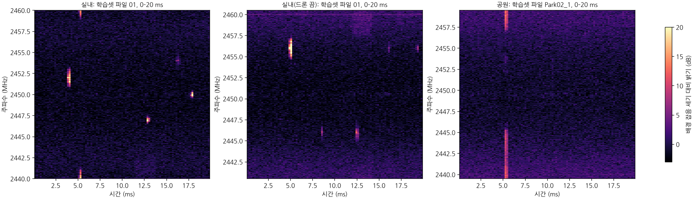

**그림 1. 환경별 배경 스펙트로그램.** 각 환경의 첫 학습 파일에서 처음 20 ms를 추출했다. 가로축은 시간(0–20 ms), 세로축은 주파수이며 위로 갈수록 주파수가 높다. 중심 주파수가 달라 세로축 범위가 0.5 MHz씩 이동한다. 색은 기준 잡음 전력 대비 셀의 전력(dB)을 나타낸다. 두 실내 세션에서는 지속 시간이 약 0.3 ms인 블루투스 형태의 신호가 여러 개 관측된다. 공원의 2,440–2,445 MHz와 2,455–2,459 MHz에 걸친 짧은 수직 패턴은 첫 번째 실험에서도 관측됐으며, 발생 원인은 확인되지 않았다.

### 3.2 스펙트로그램과 SNR

스냅샷 생성 절차는 첫 번째 실험과 같다.

1. **IQ 구간 추출.** 20 ms 길이의 복소 IQ 데이터 400,000샘플을 입력으로 사용한다.
2. **단시간 푸리에 변환(STFT).** 길이 8,192샘플의 창을 4,081샘플 간격으로 이동하며 단시간 푸리에 변환을 계산한다.
3. **주파수축 다운샘플링.** 주파수축의 32셀을 평균하여 256 × 97 크기로 축소한다. 셀 하나는 주파수 약 78 kHz, 시간 약 0.2 ms이다.
4. **DC 성분 제거.** 중심 주파수 주변 ±100 kHz를 인접 셀 값으로 대체한다.
5. **이미지 변환.** 잡음 전력 대비 상대 전력에 고정 스케일(-6 dB → 0, +34 dB → 255)을 적용해 8비트 이미지로 저장한다.

**기준 잡음 전력**은 뚜렷한 신호가 없는 상태에서 수신기 내부 잡음과 주변 배경 잡음이 갖는 평균 전력이다. 잡음 전력으로 정규화하면 신호가 없는 셀이 대체로 0 dB 부근에 놓인다. 합성 신호를 추가하기 전 IQ 데이터에서 셀 전력의 중앙값은 공원 -0.2 dB, 실내 -1.3 dB, 실내(드론 끔) -0.8 dB였다.

**SNR**은 같은 시간·주파수 셀의 신호 전력과 기준 잡음 전력의 비를 dB로 나타낸 값이다. 신호가 포함된 셀에는 잡음 전력도 더해지므로, 선형 전력을 합한 뒤 dB로 환산하면 잡음만 있는 셀과의 차이는 `10 × log10(1 + 10^(SNR/10))`이다. 높은 SNR에서는 이 차이가 SNR에 가까워진다. SNR 0 dB에서는 신호 전력과 잡음 전력이 같아 총전력이 두 배가 되므로 약 3 dB 차이가 난다.

**표 3. SNR에 따른 신호 영역과 배경 영역의 상대 전력 차이 (dB)**

| SNR (dB) | 계산값 | 측정값 (공원 테스트 이상 스냅샷) | 측정에 사용한 스냅샷 (장) |
|---:|---:|---:|---:|
| 0 | 3.0 | 3.0 | 295 |
| 3 | 4.8 | 4.7 | 288 |
| 6 | 7.0 | 6.9 | 290 |
| 9 | 9.5 | 9.5 | 294 |
| 12 | 12.3 | 12.2 | 291 |

각 스냅샷에서 이상 패킷 영역의 평균 상대 전력(dB)과 합성 신호가 없는 영역의 평균 상대 전력(dB)의 차이를 구한 뒤, 차이의 중앙값을 보고했다. 배경 평균을 계산할 때는 실측 신호의 영향을 줄이기 위해 전력이 가장 높은 1 %의 셀을 제외했다. 정상 와이파이·블루투스는 SNR 2–10 dB로 합성했으며, 이는 배경 대비 4.1–10.4 dB의 전력 증가에 해당한다.

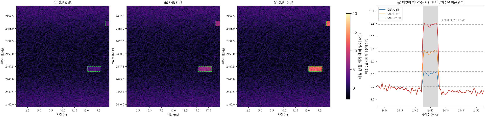

**그림 2. 동일 이상 패킷의 SNR별 스펙트로그램.** 공원 테스트 파일에서 실측 신호가 가장 적은 20 ms 구간(220–240 ms)을 골라 이어폰형 이상을 합성했다. (a)–(c)는 같은 패킷 위치에 SNR 0·6·12 dB를 적용했으며, 정상 와이파이·블루투스는 추가하지 않았다. 연두색 점선은 합성 위치를 나타낸다. 2,446.5–2,447.5 MHz와 15.3–18.2 ms에 걸친 막대는 전체 패킷이며, 오른쪽 위의 짧은 막대는 다음 패킷의 일부다. (d)는 패킷이 나타난 시간(15.3–18.2 ms)의 주파수별 평균 상대 전력이다. 회색 영역은 패킷의 주파수 범위이며, 가로 점선은 0, 3, 7, 12.3 dB를 나타낸다. 인접 배경 대비 패킷 영역의 평균은 각 SNR에서 3.1·7.3·12.7 dB 높았다. SNR 0 dB에서는 육안으로 구분하기 어렵다.

### 3.3 배경 잡음 전력 추정과 정규화

환경별 잡음 전력은 학습 IQ 파일에서 추정했다. 파일별로 IQ의 평균을 뺀 뒤 샘플 전력의 중앙값을 구하고 ln 2(약 0.69)로 나눴다. 복소 가우시안 잡음을 가정하면 샘플 전력은 지수분포를 따르므로 이 값으로 평균 잡음 전력을 추정할 수 있다. 중앙값을 사용하면 짧고 강한 신호가 추정치에 미치는 영향을 줄일 수 있다. 학습 파일이 여러 개이면 파일별 추정치를 평균했다. 추정한 전력의 제곱근으로 IQ 진폭을 나눴으며, 같은 환경의 검증셋과 테스트셋에도 동일한 정규화 계수를 적용했다.

첫 번째 실험에서는 데이터셋별 평균 IQ 전력을 정규화 기준으로 사용했다. 실내(드론 끔)의 학습 파일 2에는 20 MHz 대역 전반을 차지하는 강한 신호가 약 120 ms 포함돼 있었으며, 이 신호는 배경보다 35 dB 이상 강하고 파일 전체 에너지의 95 %를 차지했다. 평균 전력을 기준으로 삼으면 파일 전체의 상대 전력이 약 14 dB 낮아지므로, 중앙값 기반 추정법을 적용했다. 해당 신호는 그 환경의 정상 관측으로 취급해 학습 데이터에 포함했다. 추정법은 배경 파일을 검토한 뒤 결과를 확인하기 전에 결정했으며, 추정 계수는 학습 파일만 사용해 산출했다. 정규화 변경으로 공원 데이터의 상대 전력 표시는 첫 번째 실험보다 약 0.2 dB 높아졌다.

**표 4. 환경별 실측 배경 신호와 정상 스냅샷의 변동성 (IQ 파일을 20 ms 단위로 분할하여 측정)**

| 환경 | 배경보다 10 dB 넘게 높은 셀 비율 (%) | 배경보다 20 dB 넘게 높은 셀 비율 (%) | 최대 상대 전력 (dB) | 픽셀별 정상 표준편차의 중앙값 (dB) |
|---|---:|---:|---:|---:|
| 실내 | 0.25–0.33 | 0.030–0.058 | 29.5–30.1 | 1.99 |
| 실내(드론 끔) | 0.36–1.20 | 0.102–0.760 | 30.9–45.2 | 2.56 |
| 공원 | 0.02–0.03 | 0.000–0.001 | 15.0–21.7 | 1.73 |

앞의 세 지표는 파일별 측정값의 범위다. 실내(드론 끔)의 최댓값(1.20 %, 0.760 %, 45.2 dB)은 모두 강한 광대역 신호가 포함된 학습 파일 2에서 나왔다. 마지막 열은 합성 정상 신호를 포함한 학습 스냅샷 10,000장에서 픽셀별 표준편차를 계산한 뒤 그 중앙값을 구한 것이다. (나)와 CAE는 이때 구한 픽셀별 통계를 입력 표준화에 사용한다. 10 dB를 초과한 셀의 비율은 실내 세션에서 공원보다 대략 한 자릿수에서 수십 배 높았다.

### 3.4 합성 신호 구성

정상 및 이상 신호의 합성 설정은 첫 번째 실험과 같다. 중심 주파수가 달라지면 수신 대역에 포함되는 와이파이·블루투스 채널이 일부 달라진다.

**표 5. 신호 종류별 설정**

| 신호 | 사용 데이터셋 | 대역폭 (MHz) | 지속 시간 (ms) | 개수·전송 주기 | SNR (dB) |
|---|---|---:|---:|---|---|
| 정상 와이파이 | 전체 데이터셋 | 16.6 | 0.1–3 | 스냅샷마다 0–2개 | 2–8 |
| 정상 블루투스 클래식 | 전체 데이터셋 | 1 | 0.366 | 전체 블루투스 신호 0–4개 중 절반 | 3–10 |
| 정상 BLE | 전체 데이터셋 | 2 | 0.08–0.376 | 전체 블루투스 신호 0–4개 중 절반 | 3–10 |
| 평활화 커널 선택용 사각형 패턴 | 검증셋 | 0.3–4 | 0.3–6 | 1–4개 | 0–12 |
| 테스트 이상 1: 블루투스 이어폰 오디오 전송 모사(이어폰형) | 테스트셋 | 1 | 2.87 | 3.75 ms마다 1개, 79개 채널에서 주파수 도약 | 0, 3, 6, 9, 12 |
| 테스트 이상 2: BLE 연속 데이터 전송 모사(BLE형) | 테스트셋 | 2 | 1.06 × 2개 | 7.5 ms마다 전송, 데이터 채널 37개에서 주파수 도약 | 0, 3, 6, 9, 12 |

사각형 합성 패턴은 검증셋에만 포함했으며, 대역폭과 지속 시간을 바꾸어 평활화 커널의 크기를 선택하는 데 사용했다. 테스트 이상 신호는 블루투스 규격 매개변수를 사용해 합성했다. 블루투스는 약 79 MHz 범위에서 주파수를 도약하지만 수신 대역폭은 20 MHz이므로, 신호원이 동작하더라도 20 ms 스냅샷에 이상 패킷이 들어오지 않을 수 있다. 환경별 패킷 미관측 비율은 이어폰형 15.2–17.5 %, BLE형 36.5–40.2 %였다.

### 3.5 데이터셋 구성과 분할

**표 6. 환경별 데이터셋 구성 (단위: 장)**

| 데이터셋 | 배경 IQ 파일 | 정상 | 사각형 패턴을 넣은 것 | 이상 신호를 넣은 것 | 합계 | 용도 |
|---|---|---:|---:|---:|---:|---|
| 학습셋 | 학습셋 파일 | 10,000 | 0 | 0 | 10,000 | (나)의 픽셀별 통계 추정, CAE 학습 |
| 검증셋 | 검증셋 파일 | 5,000 | 2,000 | 0 | 7,000 | 정상: 판정 임계값, CAE 체크포인트 선택. 사각형 패턴: 평활화 커널 크기 선택에만 사용 |
| 테스트셋 ① 정상 스트림 | 테스트셋 파일 | 20,000 | 0 | 0 | 20,000 | FPR, 시간당 오경보 수 |
| 테스트셋 ② 이상 이벤트 | 테스트셋 파일 | 400 | 0 | 4,000 | 4,400 | 이상 4,000장: 이벤트 재현율, 그중 패킷이 보이는 2,865–2,966장: 스냅샷 재현율. 정상 400장: (가)의 비교 기준으로만 사용 |
| 테스트셋 합계 | | 20,400 | 0 | 4,000 | 24,400 | |
| 전체 | | 35,400 | 2,000 | 4,000 | 41,400 | |

사각형 패턴은 기기 신호가 아니라 모양을 정하지 않은 사각형 덩어리이다. 평활화 커널 크기를 고르는 데만 쓰고, 모델 학습과 판정 임계값에는 쓰지 않는다.

- 각 스냅샷은 배정된 IQ 파일에서 시작점을 무작위로 선택한 뒤 20 ms를 추출해 생성했다. 추출 구간은 한 파일 안에 포함된다.
- 테스트셋 ②의 이상 4,000장은 이상 유형 2종 × SNR 5단계 × 조건별 이벤트 40개 × 이벤트당 스냅샷 10장으로 구성했다. 이벤트마다 기기를 켜기 직전의 정상 스냅샷 1장(모두 400장)을 붙였으며, (가)의 차분 기준으로만 사용하고 평가에서는 제외했다.
- 세 환경에 같은 합성 난수 규칙을 적용했다. 배경 IQ 데이터와 중심 주파수는 환경별로 설정했다.

**데이터 누출 방지**

- 학습셋·검증셋·테스트셋은 IQ 파일 단위로 분리했다. 분할 간 원본 시간 구간이 겹치지 않는다.
- 테스트용 이상 신호 두 종류는 테스트셋에만 포함했다.
- 평활화 커널 크기, CAE 체크포인트, 판정 임계값은 각 환경의 검증셋에서 선택했다. 테스트셋은 최종 성능 측정과 사후 오탐 분석(5.5절)에 사용했다.

### 3.6 폴더 구성

다음은 환경별 학습 실험의 데이터, 결과, 실행 코드 위치다.

```
research/exam_rf/
├── data/
│   ├── background/
│   │   ├── indoor/, indoor_droneoff/   실내 두 세션의 배경 IQ 파일 01–05.npy (.cs8 변환, 세션당 763 MB)
│   │   └── site_sources.json           원본 IQ 경로 및 환경별 기준 잡음 전력
│   └── site/<장소>/                     장소별 합성 스냅샷(장소당 약 1.0 GB)
├── models/site/<장소>/                이 실험의 장소 폴더(CAE 9개, 정상 통계, 배경 잡음 세기, 판정 임계값), src/predict.py --site 로 바로 추론
├── doc/
│   ├── 00_overview_ver2.md             환경별 학습 실험 원문
│   ├── 00_overview_rev2.md             환경별 학습 실험 교정본
│   └── fig/site/                       본문 그림 4장, 부록 그림 12장
├── results/site/                      GitHub 저장소에 올린 기준 결과(runs/site/의 결과 표·선택한 설정 복사본, site_sources.json)
├── runs/site/
│   ├── <장소>/                          환경별 모델(cae65k·cae21k·cae6k_s0–2.pt), 점수, 설정, 결과, 실행 기록
│   ├── cross.json                      학습·평가 환경 조합별 오탐률
│   └── results.md                      전체 결과 표(모든 SNR, 판정 임계값 두 가지)
└── src/
    ├── site_setup.py                   환경 설정, IQ 파일 변환, 잡음 정규화
    ├── run_sites.sh                    장소별 실험 전체 실행
    ├── site_evaluate.py                테스트 평가, 모델 효율 측정, 부록 그림 생성
    ├── site_cross.py                   학습·평가 환경 교차 평가
    ├── site_summary.py                 결과 표와 그림 1·3
    ├── site_figures.py                 그림 2(SNR 예시)와 그림 4(실내 오탐 분석)
    ├── site_train.py                   새 장소 학습: 정상 IQ 데이터 → 장소 폴더(모델, 배경 잡음 세기, 판정 임계값)
    ├── export_site_models.py           이 실험의 모델을 장소 폴더 형식으로 내보내기(models/site/)
    └── make_site_demo_iq.py            정상 IQ 파일에 이상 신호를 넣은 시험용 IQ 만들기
```

코드와 폴더에서는 실내를 `indoor`, 실내(드론 끔)를 `indoor_droneoff`, 공원을 `park`로 표기한다. `common.py`, `make_data.py`, `pixeldiff.py`, `cae.py`는 `EXAM_SITE`를 통해 환경별 설정을 적용한다. CAE 모델 크기는 `--size 65k`, `--size 21k`, `--size 6k`로 선택한다. `predict.py`에는 장소 폴더로 추론하는 `--site`를 추가했다(8.1절).

## 4. 방법

모든 탐지 방법은 스냅샷당 하나의 이상 점수(anomaly score)를 산출한다. 점수가 판정 임계값을 초과하면 해당 스냅샷을 이상으로 분류한다. 정상 통계, 모델 가중치, 임계값은 각 방법에 필요한 항목을 환경별로 추정한다.

### 4.1 (가) 직전 스냅샷 차분과 (나) 정상 기준 차분

(가)는 현재 스냅샷에서 1초 전 스냅샷을 빼 차분 맵을 만든다. (나)는 정상 학습 스냅샷 10,000장의 픽셀별 평균과 표준편차로 입력을 표준화해 z-점수 맵을 만든다. 두 방법 모두 각 맵에 r × c 크기의 평균 필터(주파수 r셀 × 시간 c셀)를 적용하고 최댓값을 이상 점수로 사용한다. 주파수축 1·6·13·26셀과 시간축 1·2·5·10·15셀을 조합한 20개 후보 중에서 커널을 선택했다. 각 후보의 임계값은 정상 검증 점수의 상위 1 %에 해당하는 분위수로 설정했다. 그 임계값에서 검증용 사각형 합성 패턴의 재현율이 가장 높은 커널을 채택했다. 환경별 선택 결과는 `runs/site/results.md` 2절에 있으며, 대부분 1셀 × 15셀(0.08 MHz × 3.1 ms)이었다.

### 4.2 합성곱 오토인코더의 구조와 학습

CAE는 입력을 인코더로 잠재 표현에 압축한 뒤 디코더로 원래 해상도의 이미지를 재구성한다. 정상 데이터로만 학습했을 때 입력이 정상 분포에서 벗어나면 재구성 잔차가 커질 수 있다는 가정에 기반한다.

**표 7. 모델 규모별 CAE 구조**

| 모델 | 인코더 채널 수 | 잠재 표현 크기 (값 개수) | 학습 가능 파라미터 (개) | 첫 번째 실험 모델 대비 파라미터 수 | 모델 파일 (KB) |
|---|---|---:|---:|---:|---:|
| CAE, 파라미터 65,265개 | 16·32·64 | 1,792 | 65,265 | 1 | 270 |
| CAE, 파라미터 21,121개 | 8·16·32 | 1,792 | 21,121 | 1/3.09 | 97 |
| CAE, 파라미터 6,489개 | 4·7·14 | 1,792 | 6,489 | 1/10.06 | 38 |

1. **입력.** (나)의 z-점수 맵을 -4–12 범위로 클리핑한 후 4로 나눠 1 × 256 × 97 텐서를 구성한다.
2. **구조.** 인코더는 스트라이드 2의 3×3 합성곱 4단으로 입력을 16채널 × 16 × 7(1,792개 값) 크기의 잠재 텐서로 압축한다. 디코더는 2배 업샘플링과 3×3 합성곱을 4단에 걸쳐 적용해 256 × 97 이미지로 재구성한다. 세 모델은 잠재 표현 크기를 고정하고 인코더·디코더의 채널 수를 달리했다. 따라서 모델 폭이 성능에 미치는 영향을 비교할 수 있다. 파라미터 65,265개 모델은 첫 번째 실험의 CAE와 구조가 같다.
3. **학습.** 정상 학습 스냅샷 10,000장으로 입력과 재구성 사이의 평균제곱오차(mean squared error, MSE)를 최소화했다. AdamW를 사용해 배치 크기 128로 20 에포크를 학습했고, 시간축 순환 이동과 반전으로 데이터를 증강했다. 난수 시드 0·1·2로 학습을 반복했다.
4. **체크포인트 선택.** 정상 검증 스냅샷 5,000장의 재구성 오차가 가장 낮은 에포크를 선택했다. 전체 27개 모델(환경 3개 × 크기 3개 × 시드 3개) 중 20개는 20번째, 7개는 19번째 에포크가 선택됐다.
5. **점수 산출.** 입력에서 재구성 결과를 뺀 잔차의 양수 부분을 평균 필터로 평활화한 뒤 그 최댓값을 이상 점수로 사용한다. 커널 선택 기준은 4.1절과 같다.

### 4.3 판정 임계값과 평가 지표

- **판정 임계값**은 각 환경의 정상 검증 스냅샷 5,000장에서 계산한 이상 점수의 0.999 분위수와 0.99 분위수다. 즉 검증셋 정상 이상 점수의 상위 0.1 % 값과 상위 1 % 값이다. 본문은 0.1 % 설정의 결과를, `runs/site/results.md` 4절은 1 % 설정의 결과를 제시한다. 임계값은 검증셋에서만 설정했다.
- **오탐률(FPR)**은 테스트셋 ①의 정상 스냅샷 20,000장 중 이상으로 판정한 비율이다. 테스트 FPR이 검증셋에서 임계값을 넘은 비율(0.1 %)에 가까운지를 통해, 같은 환경의 다른 시간 구간에서도 임계값이 유효한지 평가한다.
- **스냅샷 재현율**은 이상 패킷이 하나 이상 관측된 스냅샷 중 이상으로 판정한 비율이다. 패킷 미관측 스냅샷은 분모에서 제외한다.
- **경보 규칙**은 최근 10초(10장) 중 2장 이상이 임계값을 초과할 때 경보를 발생시키는 방식이다. 스냅샷은 초당 한 장씩 판정한다.
- **이벤트 재현율**은 이상 유형·SNR별 10초 이벤트 40개 중 경보가 발생한 비율이다. 이벤트 한 개는 스냅샷 10장으로 구성되며 패킷이 관측되지 않은 스냅샷도 포함한다. 10장 중 2장 이상이 이상으로 판정되면 해당 이벤트를 탐지한 것으로 집계한다.
- **시간당 오경보 수**는 정상 테스트 스냅샷 20,000장으로 구성한 5.56시간 상당의 스트림에서 경보 조건이 새로 충족된 횟수를 5.56으로 나눈 값이다. 경보 조건이 연속해서 충족되면 한 번으로 집계한다.
- **환경 간 교차 적용 FPR**은 학습 환경 X의 모델 가중치, 평활화 커널, 임계값, 입력 표준화 통계를 평가 환경 Y의 정상 테스트셋에 적용했을 때의 오탐률이다. IQ 잡음 정규화에는 평가 환경 Y의 학습 IQ에서 추정한 기준 전력을 적용했다. 새 환경에서 배경 잡음 전력을 추정할 수 있다고 가정한 평가다.
- **모델 효율**은 학습 가능한 파라미터 수, 모델 파일 용량, GPU 학습 시간, CPU 추론 지연 시간으로 비교한다. GPU 학습 시간은 20 에포크에 걸린 시간의 환경 3개·시드 3개 평균이다. CPU 추론 지연 시간은 코어 1개에서 스냅샷 한 장의 이상 점수를 계산한 시간으로, 정상 테스트 스냅샷 200장의 중앙값을 사용했다.

## 5. 결과

별도 설명이 없는 수치는 테스트셋에서 얻었다. 판정 임계값은 각 환경의 검증셋 정상 이상 점수의 상위 0.1 % 값이다. CAE 결과는 시드 3개의 평균이며, 괄호는 시드별 최솟값과 최댓값을 나타낸다. SNR 0·3 dB 및 AUROC 결과를 포함한 전체 표는 `runs/site/results.md`에 있다.

### 5.1 환경별 배경 신호 특성

두 실내 세션에서는 블루투스와 형태가 유사한 짧은 신호가 자주 나타난다(그림 1, 표 4, 부록 A). 스펙트로그램에서 확인한 지속 시간은 약 0.2–0.4 ms, 대역폭은 약 1–3 MHz다. 가장 강한 셀은 배경 대비 약 30 dB로, 합성 정상 블루투스의 상대 전력(4.8–10.4 dB, SNR 3–10 dB)을 크게 웃돌았다. 실내(드론 끔)의 학습 파일 2에서는 651–774 ms에 걸쳐 20 MHz 대역 전반을 차지하는 강한 신호가 여러 번 관측됐다(최대 45.2 dB, 그림 A-5의 마지막 패널). 공원에서는 실측 신호가 드물었다.

### 5.2 오탐률과 시간당 오경보 수

**표 8. 테스트셋 정상 스트림 20,000장의 오탐률 (FPR, %)**

| 방법 | 실내 | 실내(드론 끔) | 공원 |
|---|---:|---:|---:|
| (가) 직전 스냅샷 차분 | 0.20 | 0.21 | 0.09 |
| (나) 정상 기준 차분 | 0.14 | 0.10 | 0.11 |
| CAE, 파라미터 65,265개 | 1.28 (1.13–1.46) | 0.02 (0.00–0.04) | 0.05 (0.03–0.08) |
| CAE, 파라미터 21,121개 | 1.11 (0.51–1.63) | 0.05 (0.01–0.10) | 0.03 (0.01–0.07) |
| CAE, 파라미터 6,489개 | 1.06 (0.82–1.20) | 0.08 (0.03–0.11) | 0.04 (0.01–0.06) |

**표 9. 정상 테스트 스트림의 시간당 오경보 수 (회, 5.56시간 상당의 스트림을 시간당으로 환산)**

| 방법 | 실내 | 실내(드론 끔) | 공원 |
|---|---:|---:|---:|
| (가) 직전 스냅샷 차분 | 0.0 | 0.0 | 0.2 |
| (나) 정상 기준 차분 | 0.2 | 0.0 | 0.2 |
| CAE, 파라미터 65,265개 | 4.5 (2.9–5.4) | 0.0 (0.0–0.0) | 0.0 (0.0–0.0) |
| CAE, 파라미터 21,121개 | 4.1 (1.1–6.7) | 0.0 (0.0–0.0) | 0.0 (0.0–0.0) |
| CAE, 파라미터 6,489개 | 3.6 (2.2–4.5) | 0.1 (0.0–0.2) | 0.0 (0.0–0.0) |

실내(드론 끔)와 공원에서 정상 테스트 FPR은 0.00–0.21 %, 시간당 오경보 수는 최대 0.2회였다. 실내의 CAE 3종은 검증셋에서 임계값을 넘은 비율(0.1 %)의 약 10배인 1.06–1.28 %를 기록했으며, 시간당 오경보 수는 3.6–4.5회였다. 같은 실내 데이터에서 (가)·(나)의 FPR은 0.14–0.20 %였다. 오탐이 집중된 구간은 5.5절에서 분석한다. 임계값을 검증셋 정상 이상 점수의 상위 1 % 값으로 낮췄을 때 시간당 오경보 수는 실내 CAE에서 22.9–36.8회, 나머지 두 환경의 전체 방법에서 0.7–3.1회였다.

### 5.3 스냅샷 단위 재현율

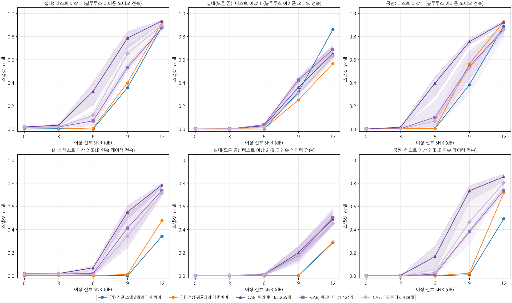

**그림 3. 환경과 SNR에 따른 스냅샷 재현율.** 가로축은 테스트 이상 신호의 SNR, 세로축은 이상 패킷이 하나 이상 관측된 스냅샷의 재현율(0–1)이다. 위는 이어폰형, 아래는 BLE형이며, 왼쪽부터 실내, 실내(드론 끔), 공원이다. 파란색 원은 (가), 주황색 원은 (나)이다. 진보라색 삼각형, 보라색 사각형, 연보라색 마름모는 각각 파라미터 65,265개, 21,121개, 6,489개의 CAE를 나타낸다. CAE 값은 시드 3개의 평균이며, 반투명 띠는 시드별 최솟값에서 최댓값까지의 범위다. 임계값은 각 환경의 검증셋 정상 이상 점수의 상위 0.1 % 값이다.

**표 10. 테스트 이상 신호 1(이어폰형)의 스냅샷 재현율 (%)**

| 방법 | 실내, SNR 6 dB | 실내, SNR 9 dB | 실내, SNR 12 dB | 실내(드론 끔), SNR 6 dB | 실내(드론 끔), SNR 9 dB | 실내(드론 끔), SNR 12 dB | 공원, SNR 6 dB | 공원, SNR 9 dB | 공원, SNR 12 dB |
|---|---:|---:|---:|---:|---:|---:|---:|---:|---:|
| (가) 직전 스냅샷 차분 | 0.0 | 35.7 | 88.4 | 0.0 | 32.0 | 85.9 | 0.3 | 38.3 | 89.1 |
| (나) 정상 기준 차분 | 0.9 | 39.9 | 92.2 | 0.0 | 25.2 | 56.6 | 0.3 | 56.2 | 92.6 |
| CAE, 파라미터 65,265개 | 32.4 | 78.7 | 93.4 | 2.9 | 35.9 | 65.2 | 39.5 | 75.5 | 92.3 |
| CAE, 파라미터 21,121개 | 7.1 | 53.3 | 87.3 | 3.7 | 42.5 | 68.7 | 10.1 | 54.0 | 86.4 |
| CAE, 파라미터 6,489개 | 11.9 | 65.4 | 89.8 | 1.7 | 30.6 | 63.0 | 6.9 | 52.4 | 85.7 |
| 재현율 산출에 포함된 스냅샷 (장) | 338 | 333 | 346 | 326 | 325 | 341 | 335 | 329 | 339 |

**표 11. 테스트 이상 신호 2(BLE형)의 스냅샷 재현율 (%)**

| 방법 | 실내, SNR 6 dB | 실내, SNR 9 dB | 실내, SNR 12 dB | 실내(드론 끔), SNR 6 dB | 실내(드론 끔), SNR 9 dB | 실내(드론 끔), SNR 12 dB | 공원, SNR 6 dB | 공원, SNR 9 dB | 공원, SNR 12 dB |
|---|---:|---:|---:|---:|---:|---:|---:|---:|---:|
| (가) 직전 스냅샷 차분 | 0.4 | 0.0 | 34.3 | 0.0 | 0.0 | 28.5 | 0.0 | 0.9 | 49.2 |
| (나) 정상 기준 차분 | 0.0 | 1.3 | 47.7 | 0.0 | 0.5 | 29.3 | 0.0 | 2.3 | 71.7 |
| CAE, 파라미터 65,265개 | 6.9 | 55.1 | 78.6 | 1.0 | 19.9 | 49.1 | 16.6 | 73.4 | 85.5 |
| CAE, 파라미터 21,121개 | 2.0 | 41.3 | 73.6 | 1.1 | 17.6 | 50.4 | 1.4 | 38.3 | 73.8 |
| CAE, 파라미터 6,489개 | 1.0 | 34.2 | 71.6 | 0.8 | 17.3 | 45.1 | 2.9 | 46.4 | 80.2 |
| 재현율 산출에 포함된 스냅샷 (장) | 256 | 234 | 277 | 245 | 218 | 270 | 245 | 222 | 258 |

표의 평가 스냅샷 수는 조건별 이벤트 40개에서 추출한 400장(이벤트당 10장) 중 이상 패킷이 하나 이상 관측된 장수다. SNR 0·3 dB에서 시드 평균 재현율은 모든 환경·방법에서 3.3 % 이하였다. 실내 CAE의 재현율(1.5–3.3 %)은 같은 환경의 FPR(1.06–1.28 %)과 비슷한 수준이어서, 이 구간에서는 정상과 이상을 구분하는 능력이 제한적이었다.

- **CAE와 픽셀 차분.** 실내와 공원의 파라미터 65,265개 CAE는 차분 베이스라인보다 약 3 dB 낮은 SNR부터 재현율이 높아지기 시작했다. 첫 번째 공원 실험에서도 같은 경향이 나타났다.
- **모델 규모.** 파라미터를 약 3분의 1 또는 10분의 1로 줄이자 실내와 공원에서 SNR 6–9 dB의 재현율이 대체로 낮아졌다. 이어폰형 SNR 9 dB에서 65,265개 모델은 75.5–78.7 %, 소형 모델 두 종은 52.4–65.4 %였다. SNR 12 dB에서는 세 모델 간 격차가 약 12 %p 이내였다. 두 소형 모델의 상대 순위는 조건에 따라 달랐다.
- **실내(드론 끔).** 전반적으로 다른 두 환경보다 재현율이 낮았으며, CAE 규모의 영향도 작았다. (나)의 이어폰형 SNR 12 dB 재현율은 56.6 %로, 다른 환경의 92.2–92.6 %보다 낮았다. 이 세션의 정상 데이터는 픽셀별 표준편차가 가장 컸다(표 4). 큰 표준편차로 입력을 나누는 과정에서 같은 강도의 이상 신호도 z-점수가 작아졌을 가능성이 있다.

### 5.4 이벤트 단위 재현율

**표 12. 이벤트 재현율 (%, 이상 유형·SNR별 10초 이벤트 40개)**

| 방법 | 이상 종류 | 실내, SNR 6 dB | 실내, SNR 9 dB | 실내(드론 끔), SNR 6 dB | 실내(드론 끔), SNR 9 dB | 공원, SNR 6 dB | 공원, SNR 9 dB |
|---|---|---:|---:|---:|---:|---:|---:|
| (가) 직전 스냅샷 차분 | 이어폰형 | 0.0 | 82.5 | 0.0 | 80.0 | 0.0 | 90.0 |
| (나) 정상 기준 차분 | 이어폰형 | 2.5 | 87.5 | 0.0 | 57.5 | 0.0 | 97.5 |
| CAE, 파라미터 65,265개 | 이어폰형 | 76.7 | 100.0 | 4.2 | 80.8 | 87.5 | 99.2 |
| CAE, 파라미터 21,121개 | 이어폰형 | 9.2 | 95.8 | 3.3 | 86.7 | 23.3 | 95.8 |
| CAE, 파라미터 6,489개 | 이어폰형 | 25.8 | 96.7 | 1.7 | 71.7 | 12.5 | 94.2 |
| (가) 직전 스냅샷 차분 | BLE형 | 0.0 | 0.0 | 0.0 | 0.0 | 0.0 | 0.0 |
| (나) 정상 기준 차분 | BLE형 | 0.0 | 0.0 | 0.0 | 0.0 | 0.0 | 0.0 |
| CAE, 파라미터 65,265개 | BLE형 | 7.5 | 88.3 | 0.0 | 30.0 | 25.8 | 94.2 |
| CAE, 파라미터 21,121개 | BLE형 | 1.7 | 73.3 | 0.0 | 23.3 | 0.8 | 66.7 |
| CAE, 파라미터 6,489개 | BLE형 | 0.0 | 63.3 | 0.0 | 25.0 | 3.3 | 70.0 |

SNR 12 dB에서 CAE 3종의 이벤트 재현율은 전체 환경·이상 유형에서 89.2–100 %였다. (가)·(나)는 이어폰형에서 100 %, BLE형에서 55.0–100 %였다. 공원과 실내에서 파라미터 65,265개 CAE는 SNR 9 dB 이상 이벤트의 88.3–100 %를 탐지했다. 실내 정상 스트림의 시간당 오경보 수는 같은 임계값에서 4.5회였다(표 9).

### 5.5 실내 오탐이 집중된 시간·주파수 구간

실내 CAE의 FPR이 검증셋에서 임계값을 넘은 비율(0.1 %)보다 약 10배 높았던 이유를 살펴보기 위해, 오탐 스냅샷의 원본 IQ 추출 위치와 이상 점수가 최대인 시간·주파수 셀을 조사했다. 모델과 임계값을 확정한 뒤 수행한 사후 분석이다.

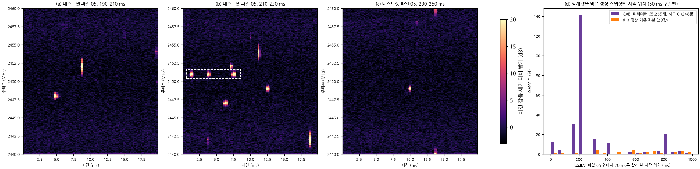

**그림 4. 실내 테스트 파일 5의 배경 신호와 오탐 위치.** (a)–(c)는 합성 신호를 추가하지 않은 190–250 ms 구간의 스펙트로그램이다. 축과 색상 스케일은 그림 1과 같다. (b)의 흰 점선은 CAE 이상 점수의 최댓값이 자주 나타난 영역을 표시한다. 이 안에서 2,451 MHz의 짧은 신호가 211·214·217 ms에 반복된다. 정상 스냅샷은 1초 파일에서 20 ms 구간을 추출해 만든다. (d)는 오탐 스냅샷의 원본 추출 위치를 50 ms 구간별로 집계한 결과다. 보라색은 CAE(65,265개, 시드 0), 주황색은 (나)이며, 범례의 괄호는 방법별 전체 오탐 스냅샷 수다.

- 파라미터 65,265개 CAE의 정상 스냅샷 오탐은 시드 0·1·2에서 각각 248·226·291장이었다. 이 가운데 69·74·62 %가 원본 파일의 210–230 ms 구간과 겹쳤다.
- 시드 0의 오탐 248장 중 171장(69 %)에서 평활화된 잔차의 최댓값이 2,451 MHz, 원본 파일의 210 ms 부근에 나타났다. 이 주파수에서 짧은 신호(지속 시간 0.2–0.5 ms, 배경 대비 22–23 dB)가 2.5–3.6 ms 간격으로 세 차례 관측됐다. CAE가 동일 주파수에서 약 3.1 ms의 잔차를 평균하므로, 반복되는 짧은 신호가 지속 시간 2.87 ms의 이어폰형 협대역 패킷과 비슷한 점수를 유발했을 수 있다.
- 학습셋에서도 20 ms 구간 150개 중 28개(19 %)에서 동일 주파수 셀의 배경 대비 10 dB 초과 신호가 3.1 ms 안에 두 차례 이상 시작했다. 유사 패턴이 학습셋에 포함됐으므로 반복 자체가 이 구간의 높은 점수를 설명하는지는 확인되지 않았다.
- (나)의 오탐 28장은 파일 전체에 분산됐으며, 210–230 ms와 겹치는 사례는 없었다.
- 정상 테스트 스냅샷 20,000장을 동일한 1초 파일에서 반복 추출했기 때문에 한 구간의 배경 신호가 수백 장에 포함됐다. 따라서 실내 CAE의 FPR 1.06–1.28 %에는 이 구간의 영향이 크게 반영돼 있다.

같은 환경에서 학습하더라도 정상 IQ 수집 시간이 짧으면 드문 정상 패턴을 충분히 포함하기 어렵다. 테스트셋에서 같은 구간을 반복 사용하면 특정 패턴이 오탐률 추정에 과도하게 반영될 수 있다. 후속 실측에서는 정상 IQ 데이터를 수 분 이상 확보하고 시간 순서에 따라 학습셋·검증셋·테스트셋을 분리할 계획이다(7장).

### 5.6 학습 환경과 평가 환경 간 오탐률 변화

**표 13. 학습 환경과 평가 환경 조합별 테스트 오탐률 (%)**

| 방법 | 학습 환경 | 평가 환경: 실내 | 평가 환경: 실내(드론 끔) | 평가 환경: 공원 |
|---|---|---:|---:|---:|
| (가) 직전 스냅샷 차분 | 실내 | 0.20 | 0.18 | 0.02 |
| (가) 직전 스냅샷 차분 | 실내(드론 끔) | 0.27 | 0.21 | 0.02 |
| (가) 직전 스냅샷 차분 | 공원 | 1.04 | 0.85 | 0.09 |
| (나) 정상 기준 차분 | 실내 | 0.14 | 0.56 | 0.24 |
| (나) 정상 기준 차분 | 실내(드론 끔) | 0.29 | 0.10 | 0.14 |
| (나) 정상 기준 차분 | 공원 | 0.46 | 0.41 | 0.11 |
| CAE, 파라미터 65,265개 | 실내 | 1.27 | 7.44 | 0.47 |
| CAE, 파라미터 65,265개 | 실내(드론 끔) | 2.68 | 0.02 | 0.30 |
| CAE, 파라미터 65,265개 | 공원 | 16.90 | 12.46 | 0.05 |
| CAE, 파라미터 21,121개 | 실내 | 1.11 | 2.45 | 0.16 |
| CAE, 파라미터 21,121개 | 실내(드론 끔) | 2.25 | 0.05 | 0.55 |
| CAE, 파라미터 21,121개 | 공원 | 6.29 | 2.65 | 0.03 |
| CAE, 파라미터 6,489개 | 실내 | 1.06 | 2.37 | 0.19 |
| CAE, 파라미터 6,489개 | 실내(드론 끔) | 1.89 | 0.08 | 0.14 |
| CAE, 파라미터 6,489개 | 공원 | 8.34 | 4.68 | 0.04 |

대각선은 표 8과 같이 같은 환경에서 학습하고 평가한 조건이다. 점수를 다시 계산한 결과 표 8과의 차이는 0.01 %p 이내였다.

- **공원과 실내 간 교차 적용.** 공원에서 학습한 CAE를 두 실내 세션에 적용하면 FPR이 2.65–16.90 %였다. 실내에서 학습한 CAE를 공원에 적용한 경우는 0.14–0.55 %로, 공원 자체 모델의 0.03–0.05 %보다 높았다.
- **실내 세션 간 교차 적용.** 같은 방의 서로 다른 세션 사이에서 CAE를 교차 적용하면 FPR이 1.89–7.44 %였다. 두 세션의 수신 설정이 달라 결과에는 환경 변화와 설정 변화가 함께 반영된다.
- **픽셀 차분.** (가)·(나)의 교차 적용 FPR은 최대 1.04 %로, 이번 조건에서는 CAE보다 변화 폭이 작았다.
- **해석.** 이번 평가에서 CAE의 오탐률은 학습 환경의 배경 분포가 달라질 때 민감하게 변했다. 이 결과는 현장에 맞춰 정상 데이터를 수집하고 모델과 임계값을 설정하는 접근을 뒷받침한다.

### 5.7 모델 크기와 계산 비용

**표 14. 모델 크기와 계산 시간**

| 방법 | 학습 가능 파라미터 (개) | 모델 파일 (KB) | GPU 학습 시간, 20 에포크 (초) | CPU 코어 1개에서 스냅샷 1장 이상 점수 계산 (ms) |
|---|---:|---:|---:|---:|
| (가) 직전 스냅샷 차분 | 0 | 없음 | 학습 없음 | 0.1 미만 |
| (나) 정상 기준 차분 | 0 | 없음 | 평균·표준편차 계산만 | 0.1 미만 |
| CAE, 파라미터 65,265개 | 65,265 | 270 | 87 | 8.3 |
| CAE, 파라미터 21,121개 | 21,121 | 97 | 47 | 6.6 |
| CAE, 파라미터 6,489개 | 6,489 | 38 | 27 | 4.9 |

학습 시간과 CPU 추론 시간은 NVIDIA DGX Spark(GB10 GPU, ARM CPU)에서 측정한 세 환경의 평균이다. 학습 시간에는 에포크별 검증 재구성 오차 계산이 포함된다. 학습 데이터 합성은 CPU 코어 16개를 사용해 환경당 약 1분 40초가 걸렸으며 별도로 집계했다. CPU 추론 시간에는 z-점수 표준화, CAE 순전파, 잔차 평활화가 포함되며, IQ에서 스펙트로그램을 만드는 시간은 제외했다. 초당 한 장을 처리할 때 파라미터 65,265개 모델의 점수 산출에 필요한 시간은 CPU 코어 1개의 가용 시간 중 1 % 미만이다.

### 5.8 첫 번째 공원 실험과의 비교

**표 15. 공원 데이터의 첫 번째 실험과 두 번째 실험 결과 비교 (판정 임계값은 검증셋 정상 이상 점수의 상위 0.1 % 값)**

| 지표 | 첫 번째 실험 CAE | 두 번째 실험 CAE, 파라미터 65,265개 | 첫 번째 실험 (나) | 두 번째 실험 (나) |
|---|---:|---:|---:|---:|
| 테스트셋 FPR (%) | 0.05 | 0.05 | 0.11 | 0.11 |
| 이어폰형 스냅샷 재현율, SNR 6 dB (%) | 41.2 | 39.5 | 0.3 | 0.3 |
| 이어폰형 스냅샷 재현율, SNR 9 dB (%) | 76.8 | 75.5 | 56.5 | 56.2 |
| 이어폰형 스냅샷 재현율, SNR 12 dB (%) | 91.9 | 92.3 | 92.6 | 92.6 |
| BLE형 스냅샷 재현율, SNR 6 dB (%) | 18.4 | 16.6 | 0.0 | 0.0 |
| BLE형 스냅샷 재현율, SNR 9 dB (%) | 73.9 | 73.4 | 2.7 | 2.3 |
| BLE형 스냅샷 재현율, SNR 12 dB (%) | 85.4 | 85.5 | 70.9 | 71.7 |

두 실험의 CAE는 파라미터 65,265개의 동일한 구조다. 두 번째 실험에서는 배경 잡음 정규화(3.3절)와 20 ms 배경 구간을 선택하는 난수 사용 방식이 달라졌고, 모델을 다시 학습했다. 재현율 차이는 1.8 %p 이하, FPR 차이는 0.01 %p 이하였다.

## 6. 실현 가능성 평가와 한계

환경별 정상 데이터로 학습했을 때의 탐지 성능과 운용상 제약을 정리했다.

1. **환경별 학습에서 오탐률이 낮아졌다.** CAE를 다른 환경에 적용하면 FPR이 최대 16.90 %였다. 같은 환경에서 학습했을 때 공원과 실내(드론 끔)의 FPR은 0.02–0.08 %였다.
2. **파라미터 65,265개 모델이 재현율과 계산 비용 면에서 적합했다.** 실내와 공원의 SNR 9 dB 이상 이벤트 재현율은 88.3–100 %였다. 소형 모델은 SNR 6–9 dB에서 대체로 재현율이 낮았다. 세 모델 모두 파일 용량 270 KB 이하, CPU 스냅샷당 추론 시간 8.3 ms 이하여서, 이번 운용 조건에서는 모델 축소로 얻는 지연 시간의 이점이 작았다.
3. **짧은 정상 IQ 구간을 반복 사용하면 특정 배경 패턴이 오탐률에 크게 반영될 수 있다.** 실내에서는 2,451 MHz에 짧은 신호가 반복되는 구간에 CAE의 오탐이 집중됐다. 이 환경의 FPR은 1.06–1.28 %, 시간당 오경보 수는 3.6–4.5회였다.
4. **정상 데이터의 변동 폭이 큰 세션에서 탐지 성능이 낮았다.** 강한 광대역 신호가 학습셋에 포함된 실내(드론 끔) 세션의 CAE는 SNR 9 dB에서 이벤트 재현율이 23.3–86.7 %였다.
5. **SNR 6 dB 이하의 신호는 스냅샷 단위로 탐지하기 어려웠다.** 이 범위는 합성 정상 블루투스의 SNR 3–10 dB와 일부 겹친다. 이벤트 단위로는 파라미터 65,265개 CAE가 실내와 공원의 이어폰형 SNR 6 dB에서 가장 높은 재현율(76.7–87.5 %)을 보였다.

현장 성능을 해석할 때는 다음 실험 조건을 고려해야 한다.

1. **정상 데이터 길이.** 환경별 배경 IQ는 3–5초로, 현장 운용에서 가정한 10분보다 짧았다. 실내 오탐이 특정 구간에 집중된 사례는 배경 데이터의 길이와 다양성이 오탐률 추정에 영향을 줄 수 있음을 보여 준다(5.5절).
2. **표본 독립성.** 정상 테스트 스냅샷 20,000장은 동일한 1초 파일에서 반복 추출했으며 시간 구간이 서로 겹친다. 여러 스냅샷에서 같은 배경 신호가 관측될 수 있으므로, FPR의 근거가 되는 독립 관측 수는 이미지 장수보다 적다.
3. **수집 세션의 차이.** 두 실내 세션은 같은 방에서 수집했지만 날짜, 중심 주파수, 기저대역 필터(15·20 MHz), 수집 프로그램이 달랐다. 교차 평가(5.6절)에는 이러한 차이가 함께 반영된다. 15 MHz 필터를 사용한 실내 데이터에서도 스펙트로그램 가장자리의 전력 저하는 관찰되지 않았다. 합성 신호는 수신 이후에 더했으므로 해당 필터를 거치지 않았다.
4. **합성 이상 신호.** 두 테스트 이상은 블루투스 규격에 기반해 생성했다. 실제 AI 안경과 스마트폰 사이에서는 블루투스와 와이파이를 함께 사용할 수 있다. 이 경우의 신호 형태와 탐지 성능은 현장 데이터로 검증해야 한다.
5. **교차 적용의 정규화 조건.** 다른 환경의 모델을 적용한 경우에도 IQ 잡음 정규화는 평가 환경에서 추정한 전력을 사용했다. 표 13의 결과는 평가 환경에서 이 기준값을 확보할 수 있다는 가정에 해당한다.
6. **CAE 학습 설정.** 비교 실험에서는 모델 폭을 바꾸고 학습 횟수(20 에포크), 잠재 표현 크기, 커널 후보를 고정했다. 27개 모델 중 20개에서 마지막 에포크가 선택됐다. 소형 모델을 더 오래 학습했을 때 재현율이 개선되는지는 후속 실험에서 확인해야 한다.
7. **정상 신호 분포.** 낮은 SNR의 와이파이·블루투스 합성 설정은 첫 번째 실험과 같다. 실제 시험장에서 정상 신호의 세기와 패턴이 어떤 분포를 보이는지는 검증이 필요하다.

## 7. 후속 실험 제안 (진행 전 합의 필요)

1. **스터디카페 현장 평가.** 정상 IQ를 10분 이상 수집한다. 시간 순서에 따라 학습, 임계값 보정, FPR 평가 구간으로 나눈다. AI 안경과 스마트폰 사이의 통신 활성 여부 및 시점을 기록한 IQ는 별도로 수집해 테스트에만 사용한다.
2. **카페 현장 평가.** 같은 절차를 반복하고 방문객 수와 시각을 기록한다. 방문객 기기가 추가로 발생시키는 통신이 오경보에 미치는 영향을 스터디카페 결과와 비교한다.
3. **정상 데이터 길이의 영향.** 학습·검증에 사용하는 정상 IQ 길이를 1분, 3분, 10분으로 바꿔 FPR과 시간당 오경보 수를 측정한다. 정상 데이터의 길이를 늘렸을 때 5.5절과 같은 오탐이 감소하는지 확인한다.
4. **소형 CAE 학습 연장.** 파라미터 21,121개와 6,489개 모델을 40–60 에포크 학습한다. SNR 6–9 dB에서 파라미터 65,265개 모델과의 재현율 격차가 줄어드는지 평가한다.
5. **수신 범위 확장.** 20 MHz 수신 조건에서 패킷이 관측되지 않은 스냅샷은 이어폰형 15.2–17.5 %, BLE형 36.5–40.2 %였다. 2.4 GHz 대역을 여러 구간으로 나눠 순차적으로 스캔하는 방식을 검토한다.

## 8. 실험 재현

저장소 루트 디렉터리에서 아래 명령을 순서대로 실행하면 두 번째 실험을 재현할 수 있다. 명령의 경로는 저장소 루트 기준이다.

```
python src/site_setup.py            # 실내 두 장소의 .cs8 파일을 data/background/<장소>/01–05.npy로 변환(D4D 원본 IQ 데이터 필요)
bash src/run_sites.sh               # 장소 3곳의 합성·학습·평가, 다른 장소 모델 평가, 결과 표(약 35분)
EXAM_SITE=park python src/site_figures.py snr        # 그림 2
EXAM_SITE=indoor python src/site_figures.py dense    # 그림 4
```

`run_sites.sh`는 환경별로 데이터 합성(약 1분 40초, CPU), 차분 베이스라인 설정(약 20초), CAE 3종 × 시드 3개 학습(약 9분, GPU 1개), 평가 및 부록 그림 생성(약 10초)을 순서대로 실행한다. 세 환경의 실행을 마치면 환경 간 교차 평가(약 2분 30초)와 결과 표 생성을 수행한다. 기존 실행에서 완료한 단계는 건너뛴다. 본문 결과는 2026-11-19 18:13–18:48에 Python 3.11과 PyTorch 2.14(CUDA 13)를 사용해 NVIDIA DGX Spark(GB10, ARM CPU) 한 대에서 산출했다. GPU 연산의 비결정성 때문에 난수 시드가 같아도 재학습 결과가 소폭 달라질 수 있다.

### 8.1 새 장소에 적용

이 실험의 학습·임계값·추론 절차를 실제 장소에 그대로 쓰도록 두 명령으로 묶었다. src/site_train.py는 그 장소에서 기기 없이 취득한 정상 IQ 데이터를 받아, 시간 순서로 학습셋(앞 75 %)과 검증셋(뒤 25 %)을 나눈다. 이어서 배경 잡음 세기 측정, 스냅샷 변환, (나)의 통계와 커널, CAE 학습과 체크포인트·커널 선택, 판정 임계값(검증셋 정상 이상 점수의 상위 0.1 %와 1 % 값) 저장까지 한 번에 수행한다. 실제 장소 데이터에는 그 장소의 정상 신호가 이미 들어 있으므로 합성 정상 신호는 넣지 않는다. 결과는 장소 폴더 하나(site.json, pixel_stats.npz, CAE 가중치)에 저장된다. src/predict.py --site는 새 IQ 데이터를 그 폴더의 배경 잡음 세기로 나누어 학습 때와 같게 전처리한 뒤 판정과 경보를 낸다.

```
python src/site_train.py --out sites/<장소> --normal <정상 IQ 파일> [--layout continuous] [--sizes 65k 21k 6k]
python src/predict.py --site sites/<장소> --iq <시험 중 받은 IQ 파일>
```

실내(10-07) 1초 파일 1–4로 학습하고, 학습에 쓰지 않은 파일 5로 추론해 전 과정을 확인했다. CAE 세 크기의 학습은 스냅샷 만들기 44초를 포함해 217초가 걸렸다.

**표 16. 실제 실내 IQ 데이터로 확인한 학습·추론 결과 (판정 임계값은 검증셋 정상 이상 점수의 상위 0.1 % 값)**

| 시험 | CAE, 파라미터 65,265개 | (나) 정상 기준 차분 |
|---|---|---|
| 파일 5 그대로(정상 20 ms 조각 50개) | 이상 판정 3개, 경보 1번 | 이상 판정 2개, 경보 1번 |
| 파일 5에서 만든 1분(60조각)의 20–29번에 이어폰형 이상 신호(SNR 9 dB)를 넣음 | 이상 구간 경보 21–37초, 정상 구간 오경보 1번(45–50초) | 이상 구간 경보 21–37초, 정상 구간 오경보 2번(9–18초, 46–52초) |

경보는 마지막 이상 판정 뒤 10장이 지나야 꺼지므로 37초까지 이어진다. 정상 구간의 오경보는 학습 데이터가 3초뿐이어서 생긴 것으로, 5.5절과 같은 한계이다. 정상 데이터는 약 30분(최소 10분) 취득한다. 20 ms 조각을 0.1초마다 받으면 30분에 약 18,000장(HackRF .cs8 파일로 약 14 GB), 10분에 6,000장(약 4.8 GB)이 된다. 1초에 한 번만 받으면 판정 임계값을 정할 검증 스냅샷(뒤 25 %, 1,000장 이상 필요)이 모자란다. 이 실험의 모델 27개는 같은 장소 폴더 형식으로 models/site/에 있으며, 실험 결과와 같은 판정을 내는 것을 확인했다(실내 CAE 시드 0의 테스트셋 정상 오탐 248장, (나) 28장).

## 부록 A. 장소별 스펙트로그램 예시

환경별로 그림 4장, 그림당 패널 9개를 수록했다. 가로축은 시간(0–20 ms), 세로축은 주파수이며 위로 갈수록 주파수가 높다. 색은 기준 잡음 전력 대비 상대 전력(dB)을 나타내며, 밝을수록 전력이 높다. 하늘색 점선은 합성 정상 와이파이·블루투스, 연두색 점선은 합성 이상 패킷의 위치를 나타낸다. 점선은 그림에만 추가했다. 점선으로 표시되지 않은 밝은 패턴은 실측 배경에 포함된 신호다.

- **실측 배경(그림 A-1, A-5, A-9).** 각 환경의 전체 IQ 파일에서 추출 시점이 고르게 분포하도록 8개 구간을 골랐다. 마지막 패널은 가장 강한 신호가 포함된 20 ms 구간이다. 패널 제목에는 분할, 파일 번호, 파일 내 시간 범위를 표시했다.
- **정상 스냅샷(그림 A-2, A-6, A-10).** 정상 테스트 스트림에서 무작위로 고른 9장이다. 패널 제목의 숫자는 합성 정상 와이파이와 블루투스의 개수를 나타낸다.
- **이상 스냅샷(그림 A-3, A-4, A-7, A-8, A-11, A-12).** 위에서부터 SNR 12, 6, 0 dB이다. 각 행의 세 이벤트에서 패킷이 처음 관측된 스냅샷을 하나씩 선택했다. 패널 제목의 “보이는 패킷”은 수신 대역에 들어온 이상 패킷 수다.

### 실내 배경

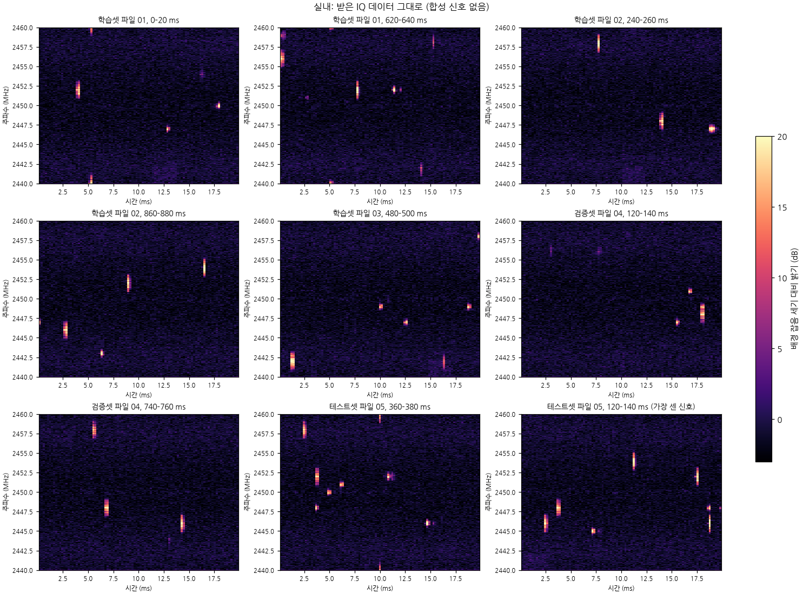

**그림 A-1. 실내 배경의 실측 스펙트로그램.** 모든 패널에서 블루투스 형태의 짧은 수직 패턴이 관측된다. 여러 패턴이 색상 스케일의 상한(20 dB)을 초과해 밝게 표시된다.

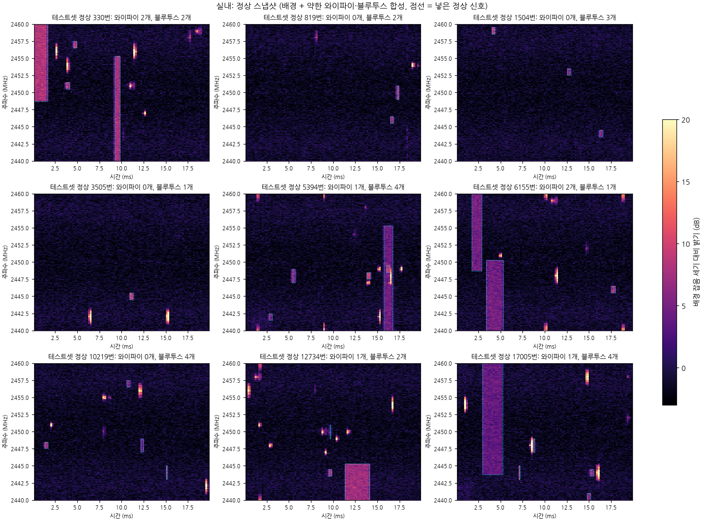

**그림 A-2. 실내 배경의 정상 테스트 스냅샷.** 합성 정상 신호(하늘색 점선)는 실측 신호보다 약하다. 합성 신호의 SNR은 2–10 dB이며, 해당 영역의 상대 전력은 배경 대비 4.1–10.4 dB 높다. 와이파이는 주파수축으로 길게, 블루투스는 상대적으로 좁게 나타난다.

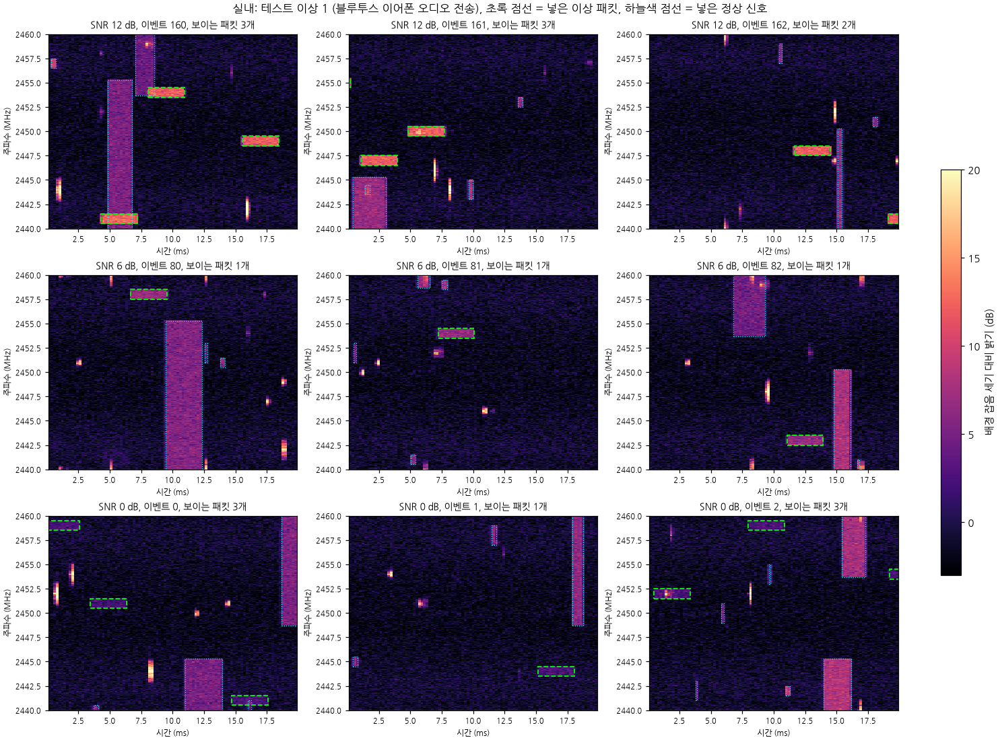

**그림 A-3. 실내 배경의 이어폰형 이상 신호.** 패킷은 대역폭 1 MHz, 지속 시간 2.87 ms의 수평 패턴이다. SNR 12 dB(위)에서는 뚜렷하며, 0 dB(아래)에서는 육안으로 구분하기 어렵다.

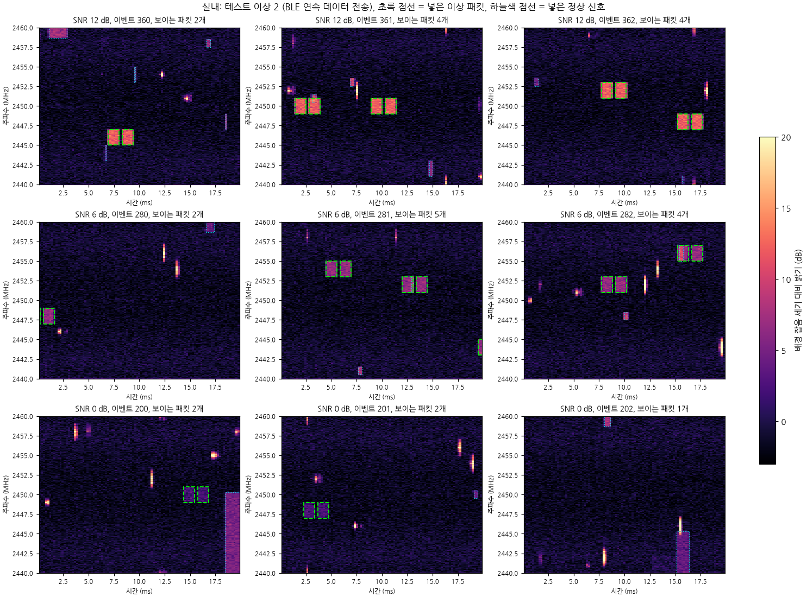

**그림 A-4. 실내 배경의 BLE형 이상 신호.** 대역폭 2 MHz, 지속 시간 1.06 ms인 패킷 두 개가 0.33 ms 간격으로 나타난다.

### 실내 배경(드론 끔)

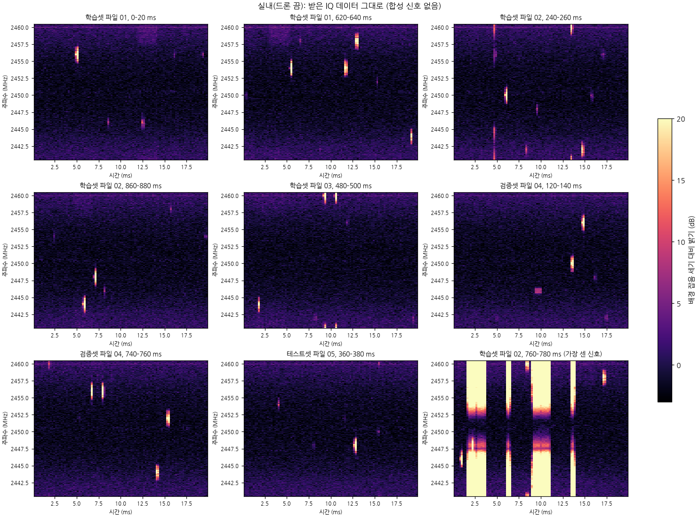

**그림 A-5. 실내(드론 끔) 배경의 실측 스펙트로그램.** 다른 실내 세션과 유사한 짧은 수직 패턴이 관측된다. 마지막 패널(학습 파일 2, 760–780 ms)에는 20 MHz 전반을 차지하는 신호가 있으며, 상대 전력이 색상 스케일 상한(20 dB)을 초과해 흰색으로 표시됐다. 2,460 MHz 부근에는 모든 패널의 시간축에 걸쳐 얇은 수평 패턴이 나타난다. 해당 패턴의 출처는 확인하지 않았다.


**그림 A-6. 실내(드론 끔) 배경의 정상 테스트 스냅샷.**

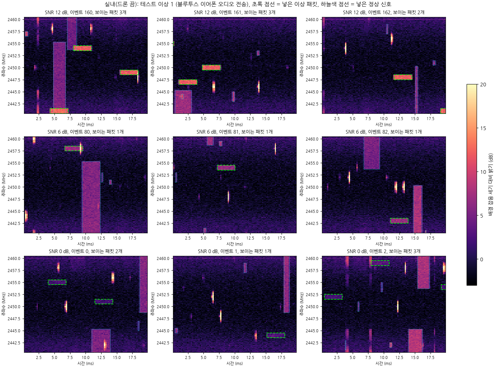

**그림 A-7. 실내(드론 끔) 배경의 이어폰형 이상 신호.**

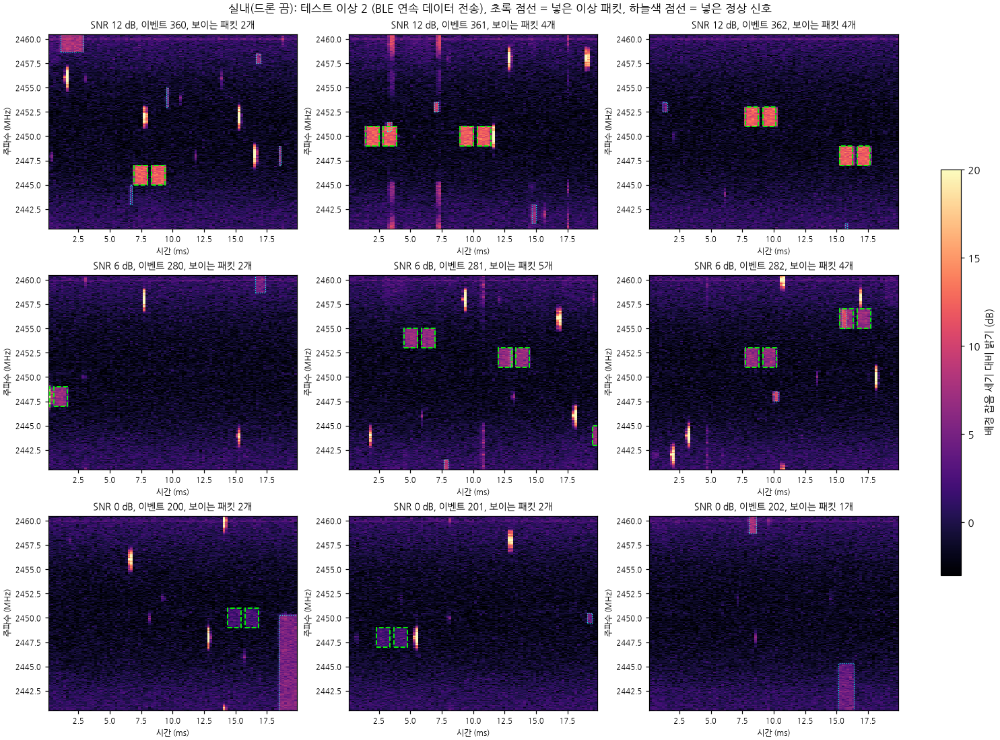

**그림 A-8. 실내(드론 끔) 배경의 BLE형 이상 신호.**

### 공원 배경

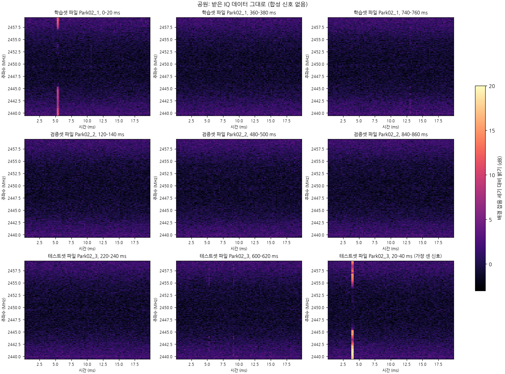

**그림 A-9. 공원 배경의 실측 스펙트로그램.** 공원에서는 실측 신호가 드물었다. 첫 패널과 마지막 패널에서 대역 대부분에 걸쳐 나타나는 짧은 수직 패턴은 첫 번째 실험에서도 관측됐다. 발생 원인은 확인되지 않았다. 주파수 대역 위아래 끝의 0.6 MHz는 중앙부보다 상대 전력이 2.6–2.9 dB 높다.

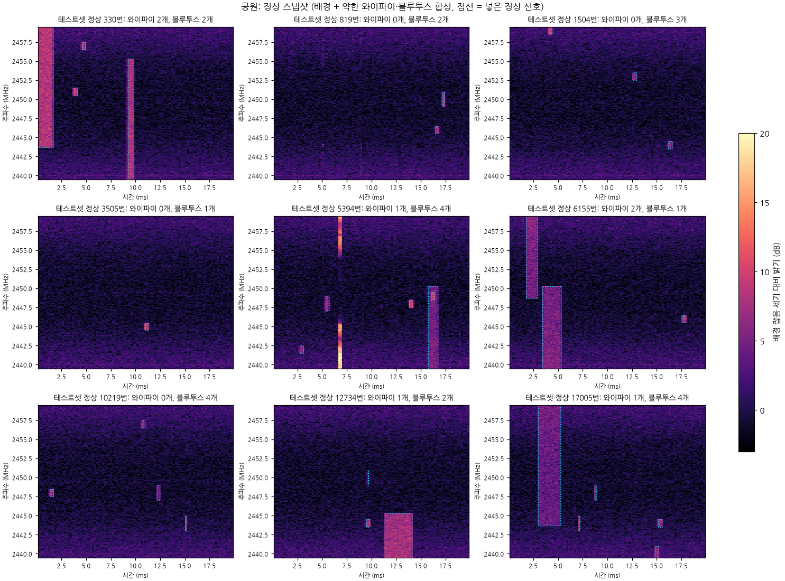

**그림 A-10. 공원 배경의 정상 테스트 스냅샷.**

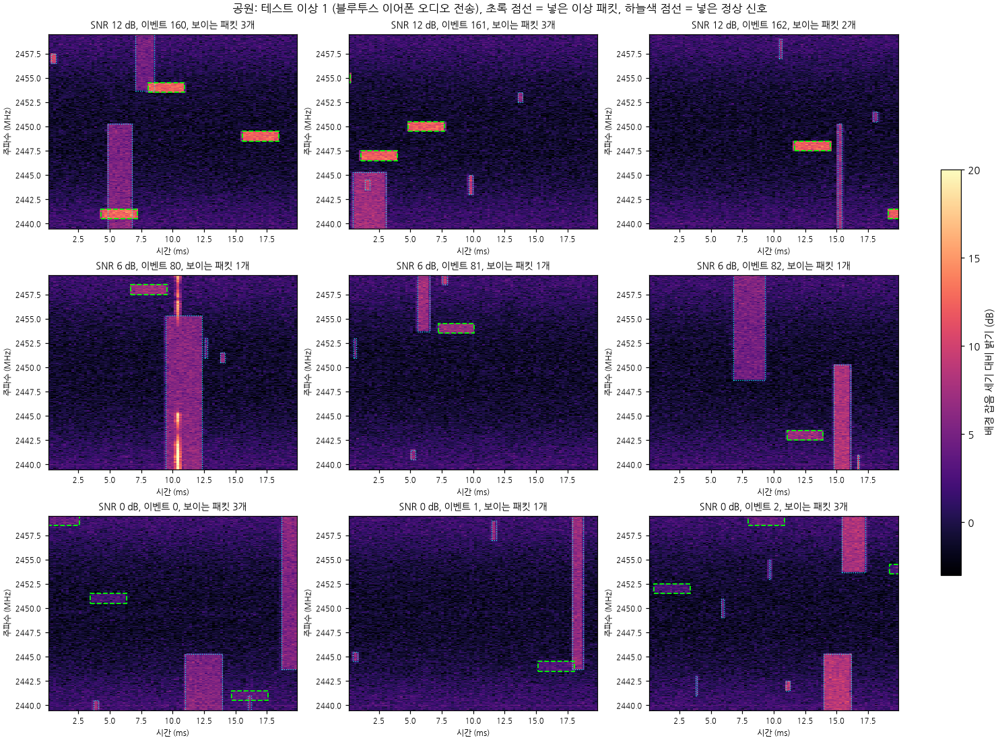

**그림 A-11. 공원 배경의 이어폰형 이상 신호.**

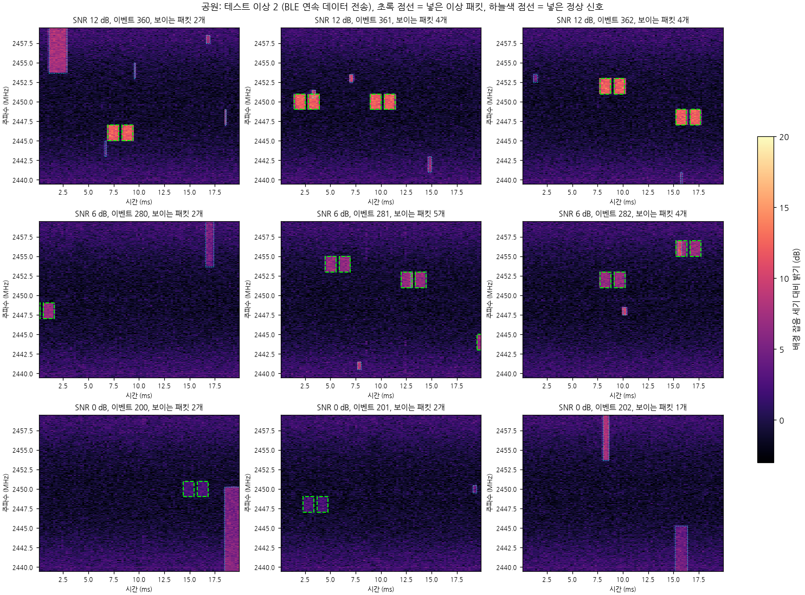

**그림 A-12. 공원 배경의 BLE형 이상 신호.**
