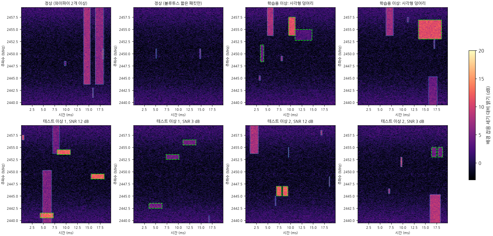
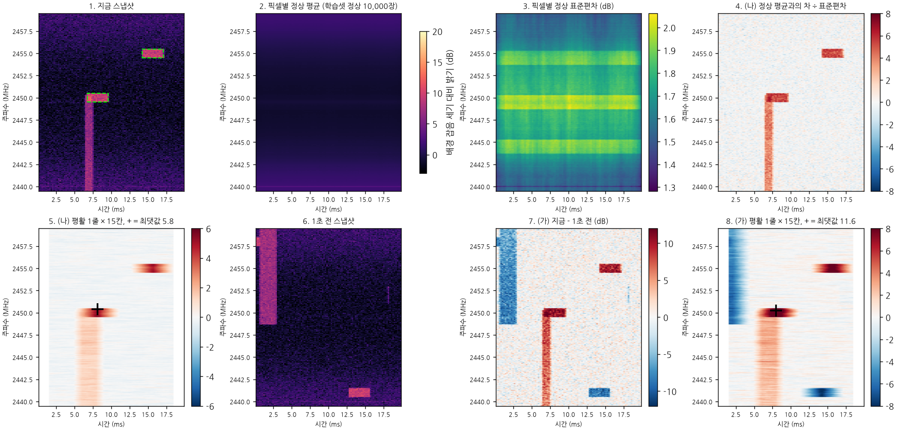
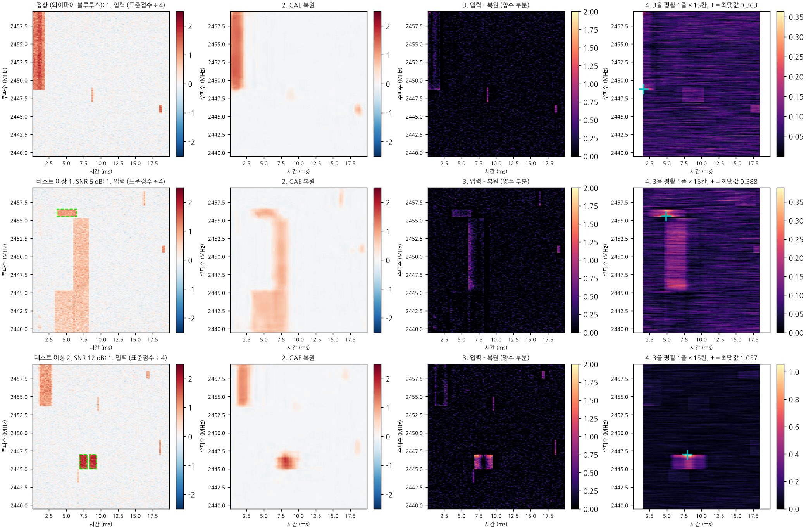
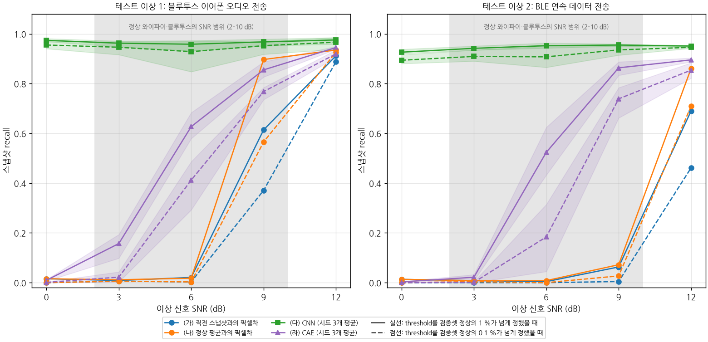
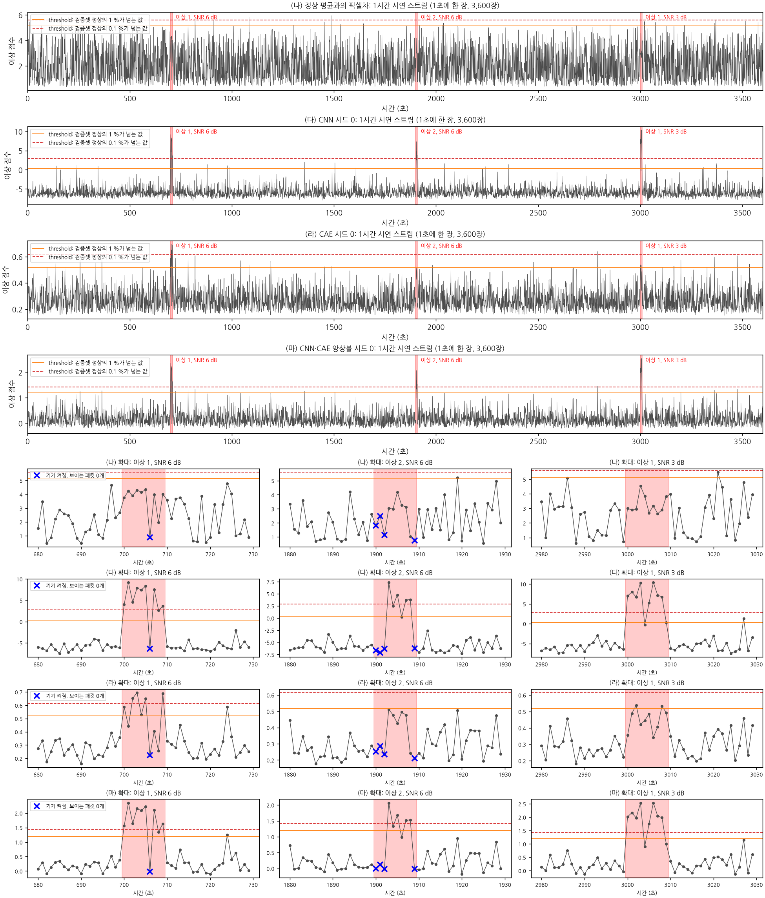
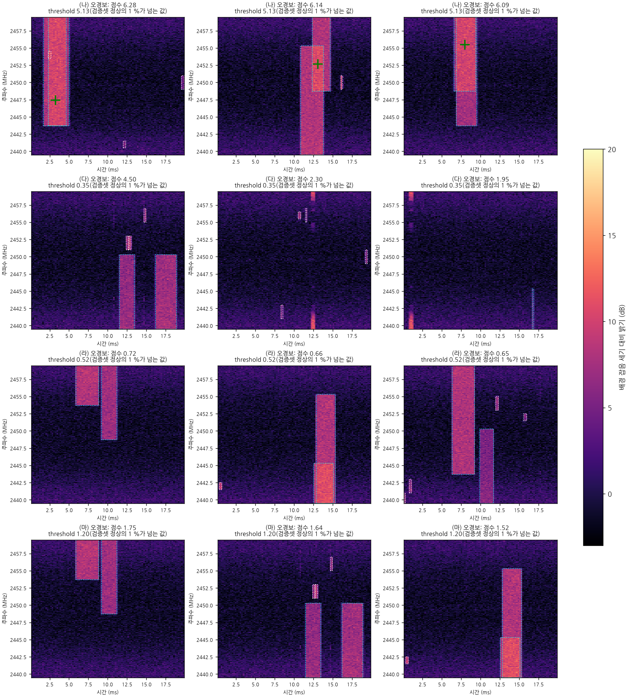

# 시험장 부정 기기 신호 이상 탐지 PoC: 공원 배경 합성 스냅샷

작성 2026-11-18. 이 문서 하나로 목적, 데이터, 방법, 결과, 판단을 알 수 있게 썼습니다. 이 아이디어의 선행 조사는 doc/prior_work.md에, 코드 사용법은 저장소 맨 위의 README.ko.md에 있습니다.

## 0. 한눈에 보기

수신기가 1초에 한 번씩 찍는 스펙트로그램 스냅샷에서, 아주 드물게 나타나는 처음 보는 블루투스 신호(부정 기기 흉내)를 찾을 수 있는지 확인했습니다. 비교한 방법은 다섯 가지입니다.

- (가) 직전 스냅샷과의 픽셀차
- (나) 정상 평균과의 픽셀차
- (다) CNN: 정상 스냅샷과, 정상 스냅샷에 사각형 덩어리를 합성한 스냅샷을 구분하도록 학습한 분류 모델
- (라) CAE(합성곱 오토인코더): 정상 스냅샷만 학습하고, 복원하지 못한 부분을 이상으로 보는 모델
- (마) CNN·CAE 앙상블: 같은 시드의 CNN 점수와 CAE 점수를 검증셋 정상으로 같은 눈금에 맞춘 뒤, 둘 중 큰 값을 쓰는 방법

공원에서 받은 무신호 IQ 데이터 3초를 배경 노이즈로 쓰고, 그 위에 신호를 합성했습니다. 학습셋·검증셋·테스트셋은 배경 노이즈의 시간이 겹치지 않고, 테스트용 이상 신호는 학습셋과 검증셋에 한 장도 없습니다.

아래 숫자는 테스트셋에서 잰 값입니다. threshold는 이상 점수가 이 값을 넘으면 이상으로 판정하는 경계이고, 검증셋 정상 스냅샷 5,000장 중 0.1 %(5장)만 넘도록 정했습니다. CNN, CAE, 앙상블은 시드 3개의 평균입니다.

- FPR: 정상 스냅샷을 이상으로 잘못 판정한 비율
- recall: 이상 스냅샷(부정 기기 신호가 보이는 스냅샷)을 이상으로 판정한 비율
- SNR: 이상 신호가 잡음보다 몇 dB 센지. 정상 와이파이·블루투스는 SNR 2–10 dB로 넣었습니다.

**표 0-1. 스냅샷 한 장으로 판단할 때 FPR과 recall (%)**

| 방법 | FPR | recall, SNR 0–3 dB | recall, SNR 6 dB | recall, SNR 9 dB | recall, SNR 12 dB |
|---|---:|---:|---:|---:|---:|
| (가) 직전 스냅샷과의 픽셀차 | 0.09 | 0.0–0.6 | 0.0–0.3 | 0.5–37.1 | 46.1–88.8 |
| (나) 정상 평균과의 픽셀차 | 0.11 | 0.0–0.6 | 0.0–0.3 | 2.7–56.5 | 70.9–92.6 |
| (다) CNN | 0.30 | 89.4–95.5 | 90.7–92.8 | 93.5–95.2 | 94.6–96.7 |
| (라) CAE | 0.05 | 0.0–2.2 | 18.4–41.2 | 73.9–76.8 | 85.4–91.9 |
| (마) CNN·CAE 앙상블 | 0.28 | 88.9–95.3 | 89.9–93.6 | 93.8–96.0 | 94.4–97.4 |

칸 설명: recall의 범위는 이상 신호 2종(이어폰형, BLE형)의 값 중 낮은 값과 높은 값입니다. SNR 0–3 dB 칸은 두 단계를 함께 본 범위입니다. FPR은 시드에 따라 CNN이 0.01–0.65 %, CAE가 0.02–0.08 %, 앙상블이 0.04–0.57 %였습니다.

**표 0-2. 10초 단위로 판단할 때 이벤트 recall (%), 최근 10장 중 2장 이상이 이상이면 경보**

| 방법 | SNR 0–3 dB | SNR 6 dB | SNR 9 dB | SNR 12 dB |
|---|---:|---:|---:|---:|
| (가) 직전 스냅샷과의 픽셀차 | 0 | 0 | 0–90.0 | 92.5–100 |
| (나) 정상 평균과의 픽셀차 | 0 | 0 | 0–97.5 | 100 |
| (다) CNN | 100 | 100 | 97.5–100 | 100 |
| (라) CAE | 0 | 30.8–88.3 | 94.2–100 | 100 |
| (마) CNN·CAE 앙상블 | 100 | 100 | 97.5–100 | 100 |

칸 설명: 이벤트 recall은 부정 기기가 10초(스냅샷 10장) 켜진 경우 40번 중 경보가 울린 비율입니다. 범위는 이상 신호 2종의 값입니다. 같은 규칙으로 정상 스트림에서 1시간에 울린 오경보는 (가)·(나) 0.2번, CNN 평균 0.5번(시드에 따라 0.0–1.3번), CAE 0번, 앙상블 평균 0.4번(시드에 따라 0.0–0.7번)이었습니다.

결론은 여섯 가지입니다.

1. **픽셀차((가)·(나))는 이상 신호가 정상 신호보다 셀 때만 찾습니다.** FPR은 0.1 %로 낮지만, SNR 6 dB 이하에서는 recall이 1 % 미만입니다. 정상 와이파이도 픽셀차가 크게 나와서, FPR을 0.1 %로 맞추면 threshold가 정상 와이파이보다 높아집니다.
2. **CAE는 픽셀차보다 약 3 dB 약한 신호까지 찾고, 오경보는 가장 적습니다.** SNR 9 dB에서 recall은 74–77 %이고 10초 단위로는 94–100 %입니다. 하지만 SNR 0–3 dB에서는 recall이 2 % 이하입니다. 정상만 배운 모델이라 정상 신호와 세기가 비슷한 이상 신호는 그럴듯하게 복원해 버립니다(그림 6).
3. **CNN은 SNR과 거의 상관없이 FPR 0.3 %에서 recall 89–97 %입니다.** 세기가 아니라 모양(폭과 길이)으로 구분하기 때문입니다. 다만 학습에 쓴 사각형 덩어리의 크기 범위가 테스트 패킷 크기를 포함해서, 정상만 배운 CAE보다 유리한 조건입니다.
4. **CNN과 CAE를 합친 앙상블은 CNN과 거의 같았습니다.** recall 차이는 1 %p 안쪽이고, 1시간 오경보는 시드에 따라 0.0–0.7번으로 CNN(0.0–1.3번)보다 조금 덜 흔들렸습니다. 이번 테스트 이상 신호는 CNN이 학습한 사각형의 크기 범위 안에 있어서, CAE가 보탤 몫이 거의 없었습니다. 앙상블의 이득은 CNN이 못 본 모양의 신호에서 나와야 하는데, 이번에는 그런 신호로 재지 못했습니다.
5. **스냅샷 한 장이 아니라 10초 단위로 판단해야 합니다.** 수신기가 20 MHz만 봐서, 부정 기기가 켜져 있어도 스냅샷의 17 %(이어폰형)·40 %(BLE형)에는 아무것도 안 보입니다.
6. **Feasibility: 합성 조건에서는 됩니다.** 처음 보는 신호를 찾는다는 조건을 그대로 지키면 CAE가 맞고, 정상 신호보다 센 신호(SNR 9 dB 이상)는 10초 단위로 거의 다 잡습니다. 정상 신호만큼 약한 신호까지 잡으려면 CNN처럼 이상 신호의 모양을 학습시켜야 합니다. 정상 블루투스를 짧은 신호로만 만든 합성 데이터라 두 모델 모두 쉬운 조건이었고, CNN의 FPR은 배경이 바뀌면 검증셋에서 정한 비율(0.1 %)에서 벗어났습니다. 다음 단계는 실제 교실의 정상 IQ 데이터입니다(7장).

## 1. 목적과 질문

시험 중에는 휴대폰을 끄거나 걷어 가므로 시험장의 전파 환경이 비교적 일정합니다(doc/prior_work.md 2.3절). 부정 기기 신호는 라벨이 붙은 데이터가 없고 아주 드물게 나타납니다. 그래서 평소 모습을 배우고 벗어난 것을 찾는 이상 탐지가 맞는 틀입니다. 이번 PoC(개념 검증)는 실제 시험장 데이터 없이 합성 데이터로 다음 다섯 가지를 확인합니다.

- 질문 1. 정상 스냅샷과의 픽셀차와 threshold만으로 부정 기기 신호를 찾을 수 있는가?
- 질문 2. 정상만 학습하는 CAE는 픽셀차보다 얼마나 나은가?
- 질문 3. 이상 모양을 합성해 학습하는 CNN은 얼마나 나은가?
- 질문 4. CNN과 CAE를 합치면 더 나아지는가?
- 질문 5. 아주 드물게 나타난다는 점을 감안해도, 오경보가 운영할 수 있는 수준인가?

## 2. 처음 아이디어 검토

처음 아이디어는 이랬습니다. "정상 스냅샷은 거의 일정하니, 이상 신호가 더해진 스냅샷과 픽셀차를 구하면 그 영역 값이 높게 나온다. 적당한 threshold로 찾는다. 간단한 모델이 좋지만 CNN도 될 것 같다." 항목별로 나눠 이번 PoC 결과로 확인했습니다.

**표 1. 처음 아이디어의 항목별 판단**

| 아이디어 | 판단 | 근거 (이번 PoC) |
|---|---|---|
| 정상 스냅샷은 거의 값이 일정하다 | 절반만 맞음 | 픽셀 하나는 일정하지 않습니다. 정상 스냅샷의 픽셀별 표준편차는 1.3–2.1 dB(중앙값 1.75 dB)입니다. 와이파이·블루투스는 스냅샷마다 다른 시각과 주파수에 나옵니다. 일정한 것은 주파수별 평균이라서, 비교 기준은 직전 한 장보다 정상 여러 장의 평균·표준편차가 낫습니다. |
| 픽셀차를 구하면 이상 영역 값이 높게 나온다 | 이상 신호가 정상 신호보다 셀 때만 맞음 | 정상 와이파이도 픽셀차가 크게 나옵니다(그림 5 위). threshold가 그보다 높아야 해서 SNR 6 dB 이하 이상 신호는 recall이 1 % 미만이었습니다(표 7). |
| 픽셀 하나로 판단한다 | 안 됨 | 평활 없이 픽셀 하나의 최댓값을 쓰면 검증셋 recall이 1 %였습니다. 주변 칸을 평균(평활)한 뒤 최댓값을 쓰면 51 %로 올라갑니다(표 4). |
| 적당한 threshold를 정한다 | 오경보율로 정해야 함 | 1초에 한 장씩 보면 FPR 1 %는 1시간에 36장의 오경보입니다. 이상이 0.1 %로 드물면 경보의 대부분이 오경보입니다(표 10). threshold는 정상 스냅샷만으로, 정상의 몇 %를 이상으로 볼지 정해서 맞추고, 연속 스냅샷 규칙을 함께 써야 합니다. |
| 간단한 모델이 좋지만 CNN도 된다 | 학습한 모델 둘 다 픽셀차보다 나음 | 정상만 배우는 CAE는 픽셀차보다 약 3 dB 약한 신호까지 찾았습니다. 이상 모양을 배우는 CNN은 SNR 0 dB 신호까지 찾았습니다. CNN은 부정 기기 신호의 학습 데이터가 없어서 사각형 덩어리를 합성해 학습했습니다. |

아이디어에 없던 것 중 이번에 확인한 것도 있습니다.

- 수신 폭: HackRF는 한 번에 20 MHz만 봅니다. 블루투스는 79 MHz 범위를 옮겨 다니므로, 기기가 켜져 있어도 스냅샷의 16.6 %(이어폰형)와 40.2 %(BLE형)에는 패킷이 하나도 안 보였습니다. 연속 스냅샷으로 판단해야 합니다.
- 밝기 눈금: 스냅샷마다 밝기를 맞추면, 센 신호가 들어온 스냅샷은 나머지 픽셀이 어두워져 픽셀차가 엉뚱하게 나옵니다. 그래서 배경 잡음 세기(신호가 없는 픽셀의 평균 밝기)를 0 dB로 하는 고정 눈금을 썼습니다. 수신 이득을 고정한다는 전제입니다.
- 공원 배경도 완전한 무신호는 아닙니다. 배경 IQ 데이터에 0.2–0.4 ms짜리 짧은 세로 선이 1초에 2–6번 있습니다. 20 MHz 전체에 띄엄띄엄 걸쳐 있고, 가장 센 곳은 배경 잡음 세기보다 13–22 dB 셉니다. 정체(주변 와이파이의 짧은 패킷인지, 순간 잡음인지)는 확인하지 못했습니다. CNN 오경보의 원인 중 하나였습니다(그림 5).

## 3. 데이터

### 3.1 스냅샷 만드는 흐름 (입력에서 출력까지)

수신 조건은 HackRF One, 가운데 주파수 2,449.5 MHz, 폭 20 MHz(2,439.5–2,459.5 MHz), 20 MS/s(1초에 2천만 개 표본)입니다. 수신기가 1초에 한 번, 20 ms씩 받는다고 가정합니다.

1. 입력은 IQ 데이터 20 ms(400,000 표본)입니다. IQ 데이터는 수신기가 받은 전파를 복소수 숫자로 바꾼 것입니다.
2. 8,192 표본씩 4,081 표본 간격으로 잘라 주파수 성분을 구합니다(단시간 푸리에 변환). 주파수 8,192칸 × 시간 97칸이 나옵니다.
3. 주파수 32칸씩 평균해 256줄 × 97칸으로 줄입니다. 한 줄은 78 kHz, 한 칸은 0.2 ms입니다. 평균하면 잡음의 흔들림이 줄고, 폭 1 MHz 블루투스는 13줄로 충분히 보입니다.
4. 0 Hz 근처 ±100 kHz 줄에는 HackRF 자체 신호가 있어서, 바로 바깥 줄 값으로 채웁니다.
5. 출력은 8비트 이미지(256 × 97)입니다. 배경 잡음 세기를 0 dB로 둔 밝기를 고정 눈금(-6 dB = 0, +34 dB = 255)으로 저장합니다.

### 3.2 그림 읽는 법



**그림 1. 데이터 예시.** 가로는 시간(0–20 ms), 세로는 주파수(2,439.5–2,459.5 MHz, 위가 높은 주파수)입니다. 밝기는 배경 잡음 세기보다 몇 dB 센지를 나타냅니다. 오른쪽 색 막대에서 검정이 배경 잡음이고 밝을수록 셉니다. 점선은 신호를 넣은 위치를 우리가 덧그린 표시이고, 모델 입력에는 없습니다. 하늘색 점선은 정상 와이파이·블루투스, 연두색 점선은 이상 신호입니다. 위 줄 3·4번째의 연두색은 학습용 사각형 덩어리이고, 아래 줄은 테스트용 블루투스입니다.

- 와이파이는 세로로 긴 막대입니다. 폭 16.6 MHz 중 창에 보이는 부분만 나오고, 길이는 0.1–3 ms입니다.
- 정상 블루투스는 아주 짧은 세로 선입니다. 폭은 1–2 MHz, 길이는 0.08–0.4 ms입니다.
- 테스트 이상 1(이어폰형)은 가로로 긴 막대입니다. 폭은 1 MHz, 길이는 2.87 ms입니다. SNR 3 dB(아래 줄 2번째)는 눈으로 겨우 보입니다.
- 테스트 이상 2(BLE형)는 폭 2 MHz, 길이 1.06 ms 막대 두 개가 붙어 있습니다.

### 3.3 넣은 신호

SNR은 같은 픽셀 안에서 신호의 세기가 배경 잡음 세기보다 몇 dB 센지입니다. SNR 0 dB 신호가 있는 곳은 잡음만 있는 곳보다 약 3 dB 밝습니다.

**표 2. 신호 종류별 설정**

| 신호 | 들어간 셋 | 폭 (MHz) | 길이 (ms) | 개수와 주기 | 주파수 | SNR (dB) |
|---|---|---:|---:|---|---|---|
| 정상 와이파이 | 모든 셋 | 16.6 | 0.1–3 | 스냅샷마다 0–2개 | 창에 보이는 채널(5–12번) 중 무작위 | 2–8 |
| 정상 블루투스 클래식 | 모든 셋 | 1 | 0.366 | 블루투스 0–4개 중 절반 | 2,440–2,459 MHz 채널 | 3–10 |
| 정상 BLE | 모든 셋 | 2 | 0.08–0.376 | 블루투스 0–4개 중 절반 | 2,440–2,458 MHz 채널 | 3–10 |
| 학습용 이상: 사각형 덩어리 | 학습셋, 검증셋 | 0.3–4 | 0.3–6 | 1–4개 | 창 안 무작위 | 0–12 |
| 테스트 이상 1: 블루투스 이어폰 오디오 전송 흉내 | 테스트셋 | 1 | 2.87 | 3.75 ms마다 1개 | 패킷마다 79개 채널(2,402–2,480 MHz) 중 하나 | 0, 3, 6, 9, 12 |
| 테스트 이상 2: BLE 연속 데이터 전송 흉내 | 테스트셋 | 2 | 1.06 × 2개 | 7.5 ms마다 한 번(두 패킷 사이 0.33 ms) | 데이터 채널 37개(2,404–2,478 MHz) 중 하나 | 0, 3, 6, 9, 12 |

읽는 법: 정상 와이파이·블루투스는 아주 작게 넣었습니다. 스냅샷당 평균 와이파이 1.0개, 블루투스 2.0개이고, 아무 신호도 없는 스냅샷이 6.5 %입니다. 정상 신호의 SNR 범위(2–10 dB)는 테스트 이상의 SNR 범위(0–12 dB)와 일부러 겹치게 두었습니다. 이상 신호가 정상 신호보다 약할 때도 찾는지 보려고 그렇게 했습니다.

테스트 이상 1은 휴대폰이 블루투스 이어폰으로 소리를 보낼 때 쓰는 긴 패킷(3-DH5, 2.87 ms)을 3.75 ms마다 채널을 바꿔 보내는 모습입니다. 테스트 이상 2는 AI 안경이나 BLE 오디오가 7.5 ms마다 긴 데이터 패킷(251바이트, 1.06 ms) 두 개를 보내는 모습입니다. 두 이상 모두 블루투스 규격의 숫자로 만든 흉내이고, 실제 기기에서 받은 신호가 아닙니다.

"처음 보는 신호"의 범위도 밝혀 둡니다. 정상 데이터에는 0.4 ms보다 긴 좁은 블루투스 패킷이 없고, 학습용 사각형 덩어리에는 채널을 옮겨 다니는 구조가 없습니다. 하지만 학습용 사각형의 크기 범위(폭 0.3–4 MHz, 길이 0.3–6 ms)가 테스트 패킷의 크기를 포함합니다. CNN에게는 크기까지 처음 보는 신호가 아닙니다. CAE는 사각형 덩어리를 학습에 쓰지 않았습니다.

### 3.4 데이터셋 나누기

배경 노이즈는 D4D 해커톤 때 공원에서 드론·조종기를 모두 끄고 받은 IQ 데이터 3초입니다. 이 데이터는 rf-drone-detector 저장소 릴리스에 CC BY 4.0으로 공개되어 있습니다. 블루투스 모양 덩어리를 지운 뒤 1초씩 세 파일(data/background/Park02_1·2·3.npy)로 나눴습니다. 스냅샷마다 1초 안에서 무작위 위치의 20 ms를 잘라 씁니다.

**표 3. 데이터셋 구성 (단위: 장)**

| 셋 | 배경 노이즈 (3초 중) | 정상 스냅샷 | 이상 스냅샷 | 쓰임 |
|---|---|---:|---:|---|
| 학습셋 | 0–1초 | 10,000 | 10,000 (사각형 덩어리) | 픽셀별 평균·표준편차와 CAE 학습은 정상만, CNN 학습은 정상과 덩어리 |
| 검증셋 | 1–2초 | 5,000 (연속 스트림) | 2,000 (사각형 덩어리) | threshold, CAE 에포크, 앙상블 눈금은 정상만, 평활 크기와 CNN 에포크는 덩어리도 씀 |
| 테스트셋 ① 정상 스트림 | 2–3초 | 20,000 | 0 | FPR, 시간당 경보 수 |
| 테스트셋 ② 이상 이벤트 | 2–3초 | 400 | 4,000 | 스냅샷 recall, 이벤트 recall |
| 테스트셋 ③ 시연 스트림 | 2–3초 | 3,570 | 30 | 시간 흐름 그림(그림 4) |

칸 설명:

- 테스트셋 ①은 1초에 한 장이면 5시간 33분 길이입니다.
- 테스트셋 ②는 이상 종류 2 × SNR 5단계 × 이벤트 40개 × 10장입니다. 이벤트마다 바로 앞에 정상 스냅샷 1장을 두었습니다. (가) 방법의 "직전 스냅샷"으로만 쓰고 평가에는 넣지 않습니다. 이상 스냅샷 4,000장 중 이상 신호가 1개 이상 보이는 스냅샷은 2,865장입니다. 나머지 1,135장은 기기가 켜져 있지만 아무것도 안 보입니다.
- 테스트셋 ③은 1시간(3,600장) 중 10초 이벤트 3번(30장, 0.8 %)만 이상입니다. 아주 드물게 중간에 이상이 들어가는 상황을 그대로 만든 것입니다.

누출 확인:

- 세 셋의 배경 노이즈는 3초 중 서로 다른 1초입니다(겹치는 시간 0초).
- 테스트 이상 2종은 학습셋·검증셋에 0장입니다.
- 평활 크기, CNN·CAE 에포크, threshold는 모두 검증셋으로 정했습니다. 테스트셋은 마지막 평가에만 썼습니다.
- 합성 난수의 시드는 데이터셋마다 다릅니다.

### 3.5 폴더 구성

GitHub 저장소(rf-exam-anomaly-poc)와 연구 폴더(research/exam_rf)는 구성이 같습니다.

```
rf-exam-anomaly-poc/
├── data/
│   ├── background/           배경 노이즈 IQ 파일 3개(릴리스에서 내려받음, 480 MB)
│   └── <데이터셋>.*          만든 스냅샷: .npy(이미지), .csv(스냅샷 정보), _boxes.json(넣은 신호 위치), 1.3 GB
├── doc/
│   ├── 00_overview_ver1.md   이 문서
│   ├── 00_overview_rev1.md   이 문서의 표현·용어 교정본
│   ├── fig/                  그림 1–6
│   └── prior_work.md         선행 조사
├── models/                   학습된 모델: cnn_s0–2.pt, cae_s0–2.pt, pixel_stats.npz, thresholds.json(앙상블 눈금 포함)
├── results/                  이 문서의 기준 결과: results.md(전체 표), results.json, *_select.json(고른 설정)
├── runs/                     실행하면 생기는 결과
└── src/
    ├── build_html.py         이 문서를 html로 만들기
    ├── cae.py                (라) CAE 학습
    ├── cnn.py                (다) CNN 학습
    ├── common.py             스냅샷 만들기, 신호 정의
    ├── compare_results.py    내 결과와 기준 결과 비교
    ├── ensemble.py           (마) CNN·CAE 앙상블
    ├── evaluate.py           테스트셋 평가, 그림
    ├── export_models.py      학습 결과를 models/로 내보내기
    ├── make_data.py          데이터셋 만들기
    ├── make_demo_iq.py       추론 시험용 IQ 파일 만들기
    ├── pixeldiff.py          (가)(나) 픽셀차
    ├── predict.py            추론 파이프라인
    └── run_all.sh            학습 파이프라인(처음부터 다시)
```

데이터셋 파일 이름은 다음과 같습니다.

- 학습셋: train_normal, train_blob
- 검증셋: val_normal, val_blob
- 테스트셋: test_normal(①), test_event(②), test_demo(③)

## 4. 방법

다섯 방법 모두 스냅샷 한 장마다 이상 점수 하나를 내고, 점수가 threshold를 넘으면 이상으로 판정합니다.

### 4.1 (가) 직전 스냅샷과의 픽셀차

1. 입력은 지금 스냅샷과 1초 전 스냅샷(dB)입니다.
2. 픽셀마다 지금 값에서 1초 전 값을 뺍니다.
3. 픽셀마다 주변 r줄 × c칸 상자 안 값의 평균을 구합니다(평활). 상자가 이미지 안에 완전히 들어가는 위치만 봅니다.
4. 평활한 지도의 최댓값이 이상 점수입니다.

### 4.2 (나) 정상 평균과의 픽셀차

1. 학습셋 정상 스냅샷 10,000장으로 픽셀별 평균과 표준편차를 구해 둡니다(그림 2의 2·3).
2. 입력 스냅샷의 픽셀마다 정상 평균을 빼고 정상 표준편차로 나눕니다(표준점수). 정상에서 표준편차 몇 배만큼 벗어났는지를 뜻합니다.
3. 평활과 최댓값은 (가)와 같습니다.



**그림 2. 픽셀차 계산 과정(테스트 이상 1, SNR 9 dB 한 장).** 1은 입력 스냅샷이고 연두색 점선이 이상 신호를 넣은 위치입니다. 2·3은 학습셋 정상 10,000장의 픽셀별 평균(dB)과 표준편차(dB)입니다. 표준편차가 가로 띠로 큰 곳은 2,443.7–2,445.3, 2,448.7–2,450.3, 2,453.7–2,455.3 MHz입니다. 와이파이 채널이 하나 더 겹쳐 정상 와이파이가 더 자주 지나가는 주파수입니다. 4는 (나)의 표준점수이고, 5는 그것을 1줄 × 15칸으로 평활한 것입니다. 검은 +가 최댓값 위치입니다. 6은 1초 전 스냅샷, 7은 (가)의 차(지금 - 1초 전), 8은 그것을 평활한 것입니다. 4·5·7·8에서 빨강은 양수(더 셈), 파랑은 음수(더 약함)입니다. 5·8의 흰 가장자리는 상자가 이미지 밖으로 나가서 보지 않는 위치입니다. 세로로 긴 와이파이 버스트도 빨갛게 나와서, 픽셀차는 정상 신호와 이상 신호를 헷갈립니다.

평활 크기는 줄 1·6·13·26(0.08·0.5·1·2 MHz)과 칸 1·2·5·10·15(0.2·0.4·1·2·3.1 ms)를 조합한 20개 중에서 골랐습니다. 검증셋 정상 스트림으로 FPR 1 %가 되는 threshold를 정하고, 그 threshold에서 검증셋 사각형 덩어리 2,000장을 가장 많이 찾는 크기를 골랐습니다.

**표 4. 평활 크기별 검증셋 사각형 덩어리 recall (%), threshold는 검증셋 정상의 1 %가 넘게 정한 값**

| 평활 크기 | (가) 직전 스냅샷과의 픽셀차 | (나) 정상 평균과의 픽셀차 |
|---|---:|---:|
| 1줄 × 1칸 (평활 없음) | 1.0 | 0.9 |
| 1줄 × 5칸 (0.08 MHz × 1 ms) | 42.3 | 33.5 |
| 1줄 × 15칸 (0.08 MHz × 3.1 ms), 고른 크기 | 45.9 | 51.2 |
| 6줄 × 15칸 (0.5 MHz × 3.1 ms) | 45.8 | 50.8 |
| 26줄 × 15칸 (2 MHz × 3.1 ms) | 33.8 | 37.1 |

읽는 법: 시간 방향으로 길게(15칸) 평균할수록 좋아졌습니다. 정상 블루투스는 0.4 ms 이하로 짧아서 긴 상자 안에서 묽어집니다. 두 방법 모두 1줄 × 15칸을 골랐습니다.

공정성 메모: 처음에는 이미지 가장자리 밖을 가장자리 값으로 채워 평활했습니다. 그러자 가장자리에 걸린 짧은 신호의 점수가 부풀었습니다. 테스트셋 오경보 그림에서 이것을 발견했고, 검증셋에도 같은 현상이 있었습니다. threshold를 넘은 검증셋 정상 스냅샷의 88 %가 앞뒤 2칸에서 최댓값이 나왔습니다. 그래서 상자가 이미지 안에 들어가는 위치만 보도록 고쳤습니다. 고친 뒤 평활 크기와 threshold는 다시 검증셋으로만 정했습니다.

### 4.3 (다) CNN

- 입력은 (나)의 표준점수 지도입니다. -4–12로 자르고 4로 나눈 1 × 256 × 97 이미지입니다.
- 구조는 3×3 합성곱 두 개를 한 단으로 4단을 쌓고(채널 16·32·64·64, 단 사이 2×2 최대 풀링), 전체 최대 풀링 뒤 선형층 하나로 이상 점수를 냅니다. 가중치는 14만 6천 개입니다.
- 학습셋 정상 10,000장(정답 0)과 사각형 덩어리 10,000장(정답 1)을 구분하도록 이진 교차 엔트로피로 학습했습니다. AdamW, 20 에포크, 배치 크기 256입니다. 에포크는 학습셋 전체를 한 번 다 보는 단위입니다.
- 스냅샷 안에서 신호가 언제 나오는지는 뜻이 없어서, 시간축을 무작위로 돌리거나(순환 이동) 뒤집어 학습 데이터를 늘렸습니다.
- 에포크마다 검증셋에서 recall을 재고 가장 높은 에포크를 골랐습니다. 여기서 recall은 검증셋 정상의 1 %가 넘게 정한 threshold에서 검증셋 사각형 덩어리를 찾은 비율입니다. 시드 0·1·2에서 16·11·14 에포크를 골랐고, 검증 recall은 99.0·99.5·99.2 %였습니다.
- 학습 난수의 초기값(시드)을 0·1·2로 바꿔 세 번 학습했습니다. GPU 1개에서 시드당 약 7분 걸렸습니다.

### 4.4 (라) CAE (합성곱 오토인코더)

CAE는 입력을 작은 크기로 줄였다가(인코더) 다시 원래 크기로 되돌리는(디코더) 모델입니다. 정상 스냅샷만으로 학습하면 정상에 흔한 모양은 잘 되돌리고, 처음 보는 모양은 잘 못 되돌립니다. 그 차이를 이상 점수로 씁니다.

1. 입력은 CNN과 같은 표준점수 지도입니다.
2. 인코더는 보폭 2인 3×3 합성곱 4단으로 256 × 97 이미지를 16 × 7 크기, 채널 16개로 줄입니다. 숫자 1,792개로 입력의 7 %입니다.
3. 디코더는 두 배로 키우고 3×3 합성곱을 하는 단계를 4번 거쳐 256 × 97로 되돌립니다. 가중치는 모두 6만 5천 개입니다.
4. 학습셋 정상 10,000장만으로, 입력과 복원의 평균제곱오차를 줄이도록 학습했습니다. AdamW, 20 에포크, 배치 크기 128이고 시간축 증강은 CNN과 같습니다. 사각형 덩어리는 학습에 쓰지 않았습니다.
5. 에포크는 검증셋 정상 5,000장의 복원 오차가 가장 작은 것을 골랐습니다(시드 0·1·2에서 19·20·20). 마지막 에포크 근처가 가장 좋아서, 더 오래 학습하면 나아질 수 있습니다.
6. 이상 점수는 입력에서 복원을 뺀 값의 양수 부분을 평활한 뒤 구한 최댓값입니다. 이상 신호는 에너지를 더하므로 입력이 복원보다 커집니다.
7. 평활 크기는 (가)(나)와 같은 규칙으로 골랐고, 세 시드 모두 1줄 × 15칸이었습니다(검증 recall 69.6·77.4·74.3 %). 사각형 덩어리는 이 선택에만 썼습니다.

GPU 1개에서 에포크당 약 4초, 시드당 약 1.5분 걸렸습니다.



**그림 6. CAE(시드 0) 복원 예시.** 세 줄은 위에서부터 정상 스냅샷(와이파이·블루투스 있음), 테스트 이상 1(SNR 6 dB), 테스트 이상 2(SNR 12 dB)입니다. 1은 입력 표준점수 지도(÷ 4)이고 연두색 점선이 이상 신호를 넣은 위치입니다. 2는 CAE가 복원한 이미지입니다. 1·2에서 빨강은 정상 평균보다 셈, 파랑은 약함을 뜻합니다. 3은 입력 - 복원의 양수 부분, 4는 그것을 1줄 × 15칸으로 평활한 지도입니다. 3·4는 밝을수록 복원하지 못한 부분이 큽니다. 4의 하늘색 +가 최댓값 위치이고, 제목의 숫자가 이상 점수입니다. 4의 흰 가장자리는 상자가 이미지 밖으로 나가서 보지 않는 위치입니다. 둘째 줄을 보면 CAE가 SNR 6 dB인 이상 신호(2,455.5 MHz의 가로 막대)도 일부 복원해서, 점수(0.388)가 첫째 줄 정상 스냅샷의 점수(0.363)와 비슷합니다. 셋째 줄처럼 신호가 세면 복원하지 못한 부분이 커서 점수(1.057)가 크게 나옵니다.

### 4.5 (마) CNN·CAE 앙상블

CNN은 이상 모양을 배워 약한 신호까지 찾고, CAE는 정상만 배워서 학습 때 못 본 모양에도 반응할 수 있습니다. 둘을 합치면 서로의 빈틈을 메울 수 있을지 보려고 앙상블을 만들었습니다. 다시 학습하지 않고, 이미 계산한 두 모델의 점수를 합칩니다.

1. 두 점수를 같은 눈금으로 맞춥니다. CNN 점수와 CAE 점수는 단위가 달라 그대로 비교할 수 없습니다. 모델마다 (점수 - 검증셋 정상 점수의 중앙값) ÷ (검증셋 정상의 1 %가 넘는 값 - 중앙값)으로 바꿉니다. 그러면 두 모델 모두 정상의 중앙값이 0, 정상의 1 %가 넘는 값이 1이 됩니다.
2. 눈금을 맞춘 두 값 중 큰 값을 앙상블 점수로 씁니다. 둘 중 하나라도 정상에서 드물다고 보면 이상으로 봅니다.
3. threshold는 다른 방법과 같이 검증셋 정상 스냅샷의 앙상블 점수로 정합니다.
4. CNN 시드 k와 CAE 시드 k를 짝지어 앙상블 3개(k = 0, 1, 2)를 만들었습니다.

결합 규칙은 테스트셋을 보기 전에 정했고, 두 모델의 가중치는 고르지 않았습니다. 검증셋의 이상 데이터는 사각형 덩어리뿐인데, CNN이 바로 그것으로 학습했습니다. 그래서 그것으로 가중치를 고르면 CNN 쪽으로 쏠립니다. 검증셋은 정상 스냅샷으로 눈금과 threshold를 맞추는 데만 썼습니다. 참고로 검증셋 사각형 덩어리 recall은 시드 0·1·2에서 98.8·99.4·99.1 %였습니다(검증셋 정상의 1 %가 넘게 정한 threshold).

### 4.6 threshold와 평가 지표

- threshold: 이상 점수가 이 값을 넘으면 이상으로 판정하는 경계입니다. 검증셋 정상 스트림 5,000장의 점수로 두 가지를 정했습니다. 하나는 정상의 1 %(50장)가 넘는 값이고, 다른 하나는 정상의 0.1 %(5장)만 넘는 값입니다. 표와 그림에는 어느 쪽을 썼는지 "검증셋 정상의 1 %가 넘게 정한 threshold"처럼 적었습니다. 테스트셋으로는 정하지 않았습니다.
- FPR(오경보율): 정상 스냅샷 중 이상으로 판정한 비율입니다. 테스트셋 ① 20,000장으로 잽니다.
- recall(검출률): 이상 스냅샷 중 이상으로 판정한 비율입니다. 이상 신호가 1개 이상 보이는 스냅샷만 셉니다.
- AUROC: threshold 없이, 이상 스냅샷의 점수가 정상 스냅샷의 점수보다 클 확률입니다. 1이면 완벽하고 0.5면 무작위입니다.
- 이벤트 recall: 기기가 10초 켜진 이벤트(10장, 아무것도 안 보이는 스냅샷 포함) 중 2장 이상이 threshold를 넘은 이벤트의 비율입니다.
- 시간당 경보 수: 정상 스트림에서 "최근 10장 중 2장 이상"이 새로 참이 되는 횟수를 5.56시간으로 나눈 값입니다.
- 정밀도: 경보 중 진짜 이상의 비율입니다. 이상 스냅샷 비율 p를 가정해 recall × p ÷ (recall × p + FPR × (1 - p))로 구합니다.

## 5. 결과

모든 숫자는 테스트셋에서 잰 것이고, threshold는 검증셋에서 정한 값입니다. 전체 표(검증셋 정상의 1 %가 넘게 정한 threshold의 결과와 AUROC 포함)는 results/results.md에 있습니다.

### 5.1 오경보

검증셋 정상의 1 % 또는 0.1 %가 넘게 정한 threshold를 테스트셋 ① 정상 스트림 20,000장(5.56시간)에 그대로 적용했습니다. 테스트셋에서도 정상의 1 % 또는 0.1 % 근처만 넘어야, 정한 threshold가 다른 배경에서도 통한다는 뜻입니다.

**표 5. 테스트셋 정상 스냅샷 20,000장 중 이상으로 잘못 판정한 비율(FPR, %)**

| 방법 | threshold를 검증셋 정상의 1 %가 넘게 정했을 때 | threshold를 검증셋 정상의 0.1 %가 넘게 정했을 때 |
|---|---:|---:|
| (가) 직전 스냅샷과의 픽셀차 | 0.86 | 0.09 |
| (나) 정상 평균과의 픽셀차 | 0.75 | 0.11 |
| (다) CNN 시드 0 | 0.34 | 0.01 |
| (다) CNN 시드 1 | 2.29 | 0.24 |
| (다) CNN 시드 2 | 1.32 | 0.65 |
| (라) CAE 시드 0 | 0.58 | 0.08 |
| (라) CAE 시드 1 | 0.58 | 0.02 |
| (라) CAE 시드 2 | 0.39 | 0.04 |
| (마) CNN·CAE 앙상블 시드 0 | 0.20 | 0.04 |
| (마) CNN·CAE 앙상블 시드 1 | 2.00 | 0.24 |
| (마) CNN·CAE 앙상블 시드 2 | 1.28 | 0.57 |

**표 6. 테스트셋 정상 스트림에서 1시간에 울린 경보 수 (회), 최근 10장 중 2장 이상이 이상이면 경보**

| 방법 | threshold를 검증셋 정상의 1 %가 넘게 정했을 때 | threshold를 검증셋 정상의 0.1 %가 넘게 정했을 때 |
|---|---:|---:|
| (가) 직전 스냅샷과의 픽셀차 | 2.7 | 0.2 |
| (나) 정상 평균과의 픽셀차 | 1.4 | 0.2 |
| (다) CNN 시드 0 | 0.2 | 0.0 |
| (다) CNN 시드 1 | 13.5 | 0.4 |
| (다) CNN 시드 2 | 3.6 | 1.3 |
| (라) CAE 시드 0 | 1.1 | 0.0 |
| (라) CAE 시드 1 | 0.9 | 0.0 |
| (라) CAE 시드 2 | 0.7 | 0.0 |
| (마) CNN·CAE 앙상블 시드 0 | 0.2 | 0.0 |
| (마) CNN·CAE 앙상블 시드 1 | 11.0 | 0.4 |
| (마) CNN·CAE 앙상블 시드 2 | 4.0 | 0.7 |

읽는 법: 픽셀차와 CAE는 테스트셋 FPR이 검증셋에서 정한 비율(1 %, 0.1 %) 근처이거나 그보다 낮았습니다. CNN은 시드에 따라 그 비율의 0.1–6.5배로 흔들렸습니다. 앙상블은 CNN의 흔들림을 이어받았지만 폭이 조금 줄었습니다. 검증셋 정상의 1 %가 넘게 정한 threshold에서 평균 FPR이 CNN은 1.31 %, 앙상블은 1.16 %였습니다. CNN 점수의 가장 높은 쪽은 배경에 섞인 드문 장면(와이파이 겹침, 배경의 짧은 세로 선)에 좌우되는데, 검증셋과 테스트셋은 배경이 다른 1초라 그 장면이 다른 것으로 봅니다. 스냅샷 한 장만 넘어도 경보를 내면, 검증셋 정상의 0.1 %가 넘게 정한 threshold에서 1시간에 (가) 3.1회, (나) 4.0회, CNN 0.2–22.0회, CAE 0.7–2.9회, 앙상블 1.6–19.8회입니다.

### 5.2 스냅샷 recall



**그림 3. 이상 신호 세기(SNR)별 스냅샷 recall.** 가로는 테스트 이상 신호의 SNR, 세로는 이상 신호가 1개 이상 보이는 스냅샷 중 이상으로 판정한 비율입니다. 파랑은 (가), 주황은 (나), 초록 네모는 CNN, 보라 세모는 CAE, 빨강 마름모는 앙상블입니다. CNN, CAE, 앙상블은 시드 3개의 평균이고, 옅은 띠는 시드 3개의 최소–최대입니다. 실선은 threshold를 검증셋 정상의 1 %가 넘게 정했을 때, 점선은 0.1 %가 넘게 정했을 때입니다. 회색 띠는 정상 와이파이·블루투스의 SNR 범위(2–10 dB)입니다.

**표 7. 테스트 이상 1(이어폰형) 스냅샷 recall (%), threshold는 검증셋 정상의 0.1 %가 넘게 정한 값**

| 방법 | SNR 0 dB | SNR 3 dB | SNR 6 dB | SNR 9 dB | SNR 12 dB |
|---|---:|---:|---:|---:|---:|
| (가) 직전 스냅샷과의 픽셀차 | 0.0 | 0.6 | 0.3 | 37.1 | 88.8 |
| (나) 정상 평균과의 픽셀차 | 0.0 | 0.6 | 0.3 | 56.5 | 92.6 |
| (다) CNN, 시드 3개 평균 | 95.5 | 94.6 | 92.8 | 95.2 | 96.7 |
| (라) CAE, 시드 3개 평균 | 0.1 | 2.2 | 41.2 | 76.8 | 91.9 |
| (마) CNN·CAE 앙상블, 시드 3개 평균 | 95.3 | 94.0 | 93.6 | 96.0 | 97.4 |
| 평가한 스냅샷 수 (장) | 319 | 346 | 335 | 329 | 339 |

**표 8. 테스트 이상 2(BLE형) 스냅샷 recall (%), threshold는 검증셋 정상의 0.1 %가 넘게 정한 값**

| 방법 | SNR 0 dB | SNR 3 dB | SNR 6 dB | SNR 9 dB | SNR 12 dB |
|---|---:|---:|---:|---:|---:|
| (가) 직전 스냅샷과의 픽셀차 | 0.0 | 0.0 | 0.0 | 0.5 | 46.1 |
| (나) 정상 평균과의 픽셀차 | 0.0 | 0.4 | 0.0 | 2.7 | 70.9 |
| (다) CNN, 시드 3개 평균 | 89.4 | 90.9 | 90.7 | 93.5 | 94.6 |
| (라) CAE, 시드 3개 평균 | 0.0 | 0.1 | 18.4 | 73.9 | 85.4 |
| (마) CNN·CAE 앙상블, 시드 3개 평균 | 88.9 | 90.8 | 89.9 | 93.8 | 94.4 |
| 평가한 스냅샷 수 (장) | 226 | 246 | 245 | 222 | 258 |

읽는 법: 평가한 스냅샷 수는 이벤트 40개 × 10장 = 400장 중 이상 신호가 1개 이상 보이는 스냅샷 수입니다.

- 픽셀차는 이상 신호가 정상 신호의 세기 범위(2–10 dB)를 넘어야 잡혔습니다.
- CAE는 픽셀차보다 약 3 dB 약한 쪽에서부터 잡기 시작합니다. 이상 1의 SNR 6 dB에서 recall이 41.2 %로, 픽셀차(0.3 %)보다 높습니다. 하지만 SNR 0–3 dB에서는 2.2 % 이하입니다. 시드별로는 SNR 6 dB에서 이상 1이 29.3–48.7 %, 이상 2가 4.5–31.4 %로 크게 흔들렸습니다.
- CNN은 SNR과 거의 관계없이 89–97 %였고, 시드별 최솟값은 84.8 %(이상 1, SNR 6 dB)였습니다.
- 앙상블은 CNN과의 차이가 모든 칸에서 1 %p 안쪽이었습니다. 이상 1의 SNR 6–12 dB에서는 0.7–0.8 %p 높았고, 나머지 칸은 비슷하거나 조금 낮았습니다. CAE가 보탠 이상 스냅샷이 거의 없었다는 뜻입니다.

AUROC로 보면 차이가 덜 납니다. 이상 1의 SNR 6 dB에서 (나)는 0.900, CAE는 0.956, CNN은 0.992, 앙상블은 0.991입니다. 그런데도 검증셋 정상의 0.1 %가 넘게 정한 threshold에서 (나)의 recall이 0에 가까운 것은, 오경보를 아주 적게 허용하면 가장 센 정상 와이파이 버스트가 threshold를 정하기 때문입니다.

### 5.3 이벤트 recall

**표 9. 이벤트 recall (%), 이벤트 40개(10초씩), 10장 중 2장 이상, threshold는 검증셋 정상의 0.1 %가 넘게 정한 값**

| 방법 | 이상 종류 | SNR 0 dB | SNR 3 dB | SNR 6 dB | SNR 9 dB | SNR 12 dB |
|---|---|---:|---:|---:|---:|---:|
| (가) 직전 스냅샷과의 픽셀차 | 1 (이어폰형) | 0.0 | 0.0 | 0.0 | 90.0 | 100.0 |
| (나) 정상 평균과의 픽셀차 | 1 (이어폰형) | 0.0 | 0.0 | 0.0 | 97.5 | 100.0 |
| (다) CNN | 1 (이어폰형) | 100.0 | 100.0 | 100.0 | 100.0 | 100.0 |
| (라) CAE | 1 (이어폰형) | 0.0 | 0.0 | 88.3 | 100.0 | 100.0 |
| (마) CNN·CAE 앙상블 | 1 (이어폰형) | 100.0 | 100.0 | 100.0 | 100.0 | 100.0 |
| (가) 직전 스냅샷과의 픽셀차 | 2 (BLE형) | 0.0 | 0.0 | 0.0 | 0.0 | 92.5 |
| (나) 정상 평균과의 픽셀차 | 2 (BLE형) | 0.0 | 0.0 | 0.0 | 0.0 | 100.0 |
| (다) CNN | 2 (BLE형) | 100.0 | 100.0 | 100.0 | 97.5 | 100.0 |
| (라) CAE | 2 (BLE형) | 0.0 | 0.0 | 30.8 | 94.2 | 100.0 |
| (마) CNN·CAE 앙상블 | 2 (BLE형) | 100.0 | 100.0 | 100.0 | 97.5 | 100.0 |

읽는 법: 이벤트 10장에는 아무것도 안 보이는 스냅샷도 그대로 들어 있습니다. CNN, CAE, 앙상블은 시드 3개의 평균이고, 앙상블은 CNN과 모든 칸이 같았습니다. CNN이 놓친 이벤트 1개(이상 2, SNR 9 dB)는 10장 중 이상 신호가 보이는 스냅샷이 1장뿐이었고, 시드 3개 모두 그 1장도 놓쳤습니다. BLE형은 스냅샷의 40 %에서 아무것도 안 보여서 이런 이벤트가 생깁니다. CAE는 SNR 9 dB부터 10초 단위로 거의 다 잡았습니다.

### 5.4 드물게 나타난다는 점을 반영한 정밀도

**표 10. 스냅샷 한 장으로 경보할 때의 정밀도 (%), 스냅샷 1,000장 중 1장이 이상이라고 가정, threshold는 검증셋 정상의 0.1 %가 넘게 정한 값, 테스트 이상 1**

| 방법 | SNR 0 dB | SNR 3 dB | SNR 6 dB | SNR 9 dB | SNR 12 dB |
|---|---:|---:|---:|---:|---:|
| (가) 직전 스냅샷과의 픽셀차 | 0.0 | 0.6 | 0.3 | 29.2 | 49.7 |
| (나) 정상 평균과의 픽셀차 | 0.0 | 0.5 | 0.3 | 33.0 | 44.6 |
| (다) CNN, 시드 3개 평균 | 45.5 | 45.5 | 45.4 | 45.6 | 45.7 |
| (라) CAE, 시드 3개 평균 | 0.2 | 6.1 | 49.4 | 63.7 | 67.6 |
| (마) CNN·CAE 앙상블, 시드 3개 평균 | 36.8 | 36.6 | 36.5 | 37.0 | 37.3 |

읽는 법: 스냅샷 1,000장 중 1장만 이상이면, 스냅샷 한 장으로 낸 경보의 절반 이상은 오경보입니다. SNR 6 dB 이상에서는 CAE의 정밀도가 가장 높은데, FPR이 가장 낮아서입니다. 앙상블은 CNN보다 낮게 나왔지만, 평균 FPR이 높아서는 아닙니다(앙상블 0.28 %, CNN 0.30 %). 시드마다 정밀도를 구해 평균했는데, CNN 시드 0은 FPR이 0.005 %로 거의 0이라 그 시드의 정밀도(94 %)가 CNN 평균을 끌어올렸습니다. 연속 스냅샷 규칙(10장 중 2장)을 쓰면 오경보는 1시간에 CNN 0–1.3번, 앙상블 0–0.7번으로 줄어듭니다(표 6).

### 5.5 1시간 시연 스트림



**그림 4. 1시간 시연 스트림의 이상 점수.** 1초에 한 장씩 3,600장이고, 빨간 띠 3개가 부정 기기가 10초씩 켜진 이벤트입니다(이상 1 SNR 6 dB, 이상 2 SNR 6 dB, 이상 1 SNR 3 dB). 위 네 줄은 1시간 전체이고, 차례로 (나), CNN 시드 0, CAE 시드 0, 앙상블 시드 0의 점수입니다. 주황 실선은 검증셋 정상의 1 %가 넘게 정한 threshold, 빨간 점선은 0.1 %가 넘게 정한 threshold입니다. 아래 네 줄은 같은 순서로 이벤트 앞뒤 50초를 확대한 것입니다. 파란 X는 기기가 켜져 있지만 보이는 패킷이 0개인 스냅샷입니다.

- (나)는 세 이벤트 모두 10장 중 threshold를 넘은 스냅샷이 0장입니다. 이벤트 밖 오경보는 1 %가 넘게 정한 threshold에서 29장, 0.1 %가 넘게 정한 threshold에서 5장입니다.
- CNN 시드 0은 검증셋 정상의 0.1 %가 넘게 정한 threshold에서 이벤트마다 10장 중 8·4·8장이 넘었고, 이벤트 밖 오경보는 0장입니다. 넘지 못한 10장 중 5장은 보이는 패킷이 0개인 스냅샷입니다.
- CAE 시드 0은 검증셋 정상의 0.1 %가 넘게 정한 threshold에서 첫째 이벤트(이상 1, SNR 6 dB)만 10장 중 4장이 넘었고, 나머지 두 이벤트는 0장입니다. 이벤트 밖 오경보는 1장입니다.
- 앙상블 시드 0은 같은 threshold에서 이벤트마다 10장 중 8·4·8장이 넘어 CNN과 같았고, 이벤트 밖 오경보는 1장입니다.

### 5.6 오경보 예시



**그림 5. 테스트셋 정상 스트림에서 점수가 가장 높았던 정상 스냅샷.** 위에서부터 (나), CNN 시드 0, CAE 시드 0, 앙상블 시드 0의 상위 3장입니다. 하늘색 점선은 정상 와이파이, 흰 점선은 정상 블루투스를 넣은 위치입니다. 첫 줄의 초록 +는 (나)의 최댓값 위치입니다.

- (나)의 오경보는 모두 센 정상 와이파이 버스트입니다. 픽셀차는 세기만 보므로 정상 와이파이와 이상 신호를 구분하지 못합니다.
- CNN의 오경보는 와이파이 두 개와 블루투스가 겹친 장면, 그리고 합성 신호가 아닌 실제 공원 배경의 짧은 세로 선입니다(2장에서 말한 정체를 모르는 선).
- CAE의 오경보는 와이파이 버스트 두 개가 겹치거나 맞붙은 장면입니다. 정상 데이터에 드문 모양이라 CAE가 잘 복원하지 못합니다.
- 앙상블의 오경보는 CAE와 CNN이 각각 잘못 잡은 장면(와이파이가 겹친 장면, 와이파이 두 개와 블루투스가 겹친 장면)입니다. 둘 중 큰 값을 쓰므로 두 모델의 오경보를 함께 이어받습니다.

### 5.7 결과 확인

- CNN이 합성 과정의 다른 흔적을 잡는 것이 아닌지 확인했습니다. 기기는 켜져 있지만 보이는 패킷이 0개인 스냅샷을 CNN(시드 0, threshold는 검증셋 정상의 1 %가 넘게 정한 값)이 이상으로 판정한 비율은 0–0.5 %였습니다. 정상 스트림 FPR(0.3 %)과 같은 수준입니다.
- CNN이 놓친 스냅샷은 대부분 보이는 패킷이 1개이고, 그 패킷이 그림 가장자리에서 잘린 경우였습니다. 보이는 넓이의 중앙값이 이상 1에서 27 %, 이상 2에서 44 %였습니다.

## 6. Feasibility 판단

밝혀진 것은 다음과 같습니다(합성 조건, threshold는 검증셋 정상의 0.1 %가 넘게 정한 값).

1. **픽셀차((가)·(나))는 FPR은 낮지만 약한 신호의 recall이 나오지 않습니다.** 테스트셋 FPR은 0.09·0.11 %로, 검증셋에서 정한 0.1 %와 거의 같았습니다. 하지만 SNR 6 dB 이하에서는 스냅샷 recall 0.0–0.6 %, 이벤트 recall 0 %였습니다.
2. **CAE는 정상만 배우고도 픽셀차보다 약 3 dB 약한 신호까지 찾습니다.** FPR은 0.05 %로 가장 낮고, 오경보는 1시간에 0번이었습니다. SNR 9 dB 이상에서는 이벤트 recall 94–100 %입니다. SNR 0–3 dB에서는 recall이 2.2 % 이하입니다.
3. **CNN은 FPR 0.30 %에서 SNR 0–12 dB 전체에 걸쳐 스냅샷 recall 89–97 %, 이벤트 recall 97.5–100 %였습니다.** 오경보는 1시간에 0–1.3번입니다.
4. **앙상블은 이번 테스트에서 CNN과 거의 같았습니다.** recall 차이는 1 %p 안쪽이고, 1시간 오경보의 시드별 범위가 0.0–1.3번에서 0.0–0.7번으로 조금 좁아졌습니다.
5. **수신 폭 20 MHz에서는 10초 단위 판단이 필요합니다.** 기기가 켜져 있어도 스냅샷의 17 %(이어폰형)·40 %(BLE형)에는 아무것도 안 보입니다.

못 잰 것은 다음과 같습니다.

1. 실제 시험장의 정상 상태. 이번 정상 블루투스는 모두 0.4 ms 이하의 짧은 패킷이었습니다. 실제 시험장에 허용 의료기기(연속혈당측정기 등 BLE), 감독관 기기, 옆 교실 이어폰처럼 정상인데 긴 패킷이 있으면, CNN은 모양 단서가 약해지고 CAE는 그런 패킷도 정상으로 배우게 됩니다. 이때는 위치(수신기 여러 대)나 지속 시간 같은 다른 단서가 필요합니다.
2. 실제 부정 기기 신호. 이상 1·2는 규격 숫자로 만든 흉내입니다. 실제 패킷 길이와 주기, 혼잡한 채널을 피하는 블루투스 기능(AFH)은 다를 수 있습니다.
3. 처음 보는 크기와 모양. CNN의 학습용 사각형 크기 범위가 테스트 패킷 크기를 포함했습니다. 와이파이처럼 넓은 신호를 쓰는 부정 기기(AI 안경의 와이파이 직접 연결 등)는 정상 와이파이와 모양이 같아서, 이번 방법들로는 구분할 근거가 없습니다. 앙상블이 CNN보다 나은지도 CNN이 못 본 모양의 신호가 있어야 잴 수 있습니다.
4. 배경의 다양성. 배경은 한 장소 3초뿐이고, 테스트셋 20,000장도 같은 1초에서 잘라 써서 서로 겹칩니다.
5. threshold를 다른 장소로 옮겼을 때. CNN은 배경이 바뀌면 FPR이 검증셋에서 정한 비율에서 벗어났습니다. 검증셋 정상의 0.1 %가 넘게 정했는데, 테스트셋에서는 0.01–0.65 %가 넘었습니다. 현장에서는 시험 직전에 받은 정상 데이터로 threshold를 다시 정해야 합니다.
6. CAE 설정. 잠재 공간 크기와 학습 길이를 한 가지씩만 시험했습니다. 세 시드 모두 마지막 에포크 근처가 가장 좋아서, 더 오래 학습하면 나아질 수 있습니다.
7. 사람 몸에 의한 신호 약화와 좌석 위치 추정은 다루지 않았습니다.

정리하면, 합성 조건에서 처음 보는 신호를 찾는 일은 됩니다. 단순 픽셀차로는 부족하고 CAE나 CNN과 10초 단위 판단이 필요합니다. 정상만 배우는 CAE는 정상 신호보다 센 신호까지, 이상 모양을 배우는 CNN은 그보다 약한 신호까지 찾았습니다. 두 모델을 합친 앙상블은 이번 테스트에서 CNN과 거의 같았습니다. 실제로 되는지는 실제 교실의 정상 데이터에 긴 패킷 신호가 얼마나 있는지에 달려 있습니다.

## 7. 다음 단계 제안 (진행 전 합의 필요)

1. 실제 정상 데이터: 빈 교실과 사람이 있는 교실에서 HackRF로 정상 IQ 데이터를 몇 시간 받아, 배경만 바꿔 같은 코드를 다시 돌립니다. 실제 정상에 긴 패킷 신호가 얼마나 있는지가 첫 확인 사항입니다.
2. 실제 이상 데이터: 같은 교실에서 블루투스 이어폰 오디오 재생과 BLE 기기 연결을 거리별로 받아, 테스트셋으로만 씁니다.
3. 크기까지 처음 보는 이상: CNN의 학습용 사각형 길이를 테스트 패킷과 겹치지 않게(예를 들어 학습 0.3–1.5 ms, 테스트 2.87 ms) 나눠 다시 학습합니다. CAE와 같은 조건에서 비교하려는 것입니다.
4. CAE 개선: 학습 에포크를 늘리고, 잠재 공간 크기를 바꿔 SNR 3–6 dB의 recall이 오르는지 봅니다.
5. 앙상블 확인: CNN 학습용 사각형과 모양이 다른 이상 신호(6 ms보다 긴 신호, 4 MHz보다 넓은 신호 등)를 테스트에 더해, 앙상블이 CNN보다 나은지 봅니다.
6. 수신 폭: 2.4 GHz 전체(83.5 MHz)를 여러 20 MHz 구간으로 돌아가며 보면, 아무것도 안 보이는 스냅샷 비율을 줄일 수 있습니다.

## 8. 재현과 추론

자세한 사용법(설치, 데이터 받기, 명령과 옵션)은 README.ko.md에 있습니다. 여기서는 순서만 적습니다.

학습 파이프라인은 `bash src/run_all.sh` 하나로 돌아갑니다. 데이터 만들기, 픽셀차, CNN 학습, CAE 학습, 앙상블, 평가와 그림, 기준 결과(results/)와의 비교를 차례로 하고, GPU 1개에서 약 30분 걸립니다. `bash src/run_all.sh --use-released-models`는 CNN·CAE를 학습하지 않고, 저장소에 넣어 둔 학습된 모델(models/)로 점수를 계산합니다. 약 8분 걸리고, 이 문서의 숫자를 그대로 재현할 때 씁니다.

추론 파이프라인은 `python src/predict.py`입니다. 입력은 1초마다 받은 20 ms IQ 조각을 이어 붙인 파일이나 이미 만든 스냅샷입니다. 스펙트로그램 만들기, 이상 점수, 스냅샷 판정, "최근 10장 중 2장 이상" 경보까지 한 번에 하고 결과를 CSV로 저장합니다. 모델은 `--model`로 고릅니다. cnn은 CNN, cae는 CAE, ens는 CNN·CAE 앙상블, pixel은 (나) 픽셀차입니다.

이 저장소를 새로 받은 상태에서 두 경로를 돌려 기준 결과(results/)와 비교했습니다.

- 학습된 모델로 재현: 11개 모델(앙상블 3개 포함) × 52개 지표가 모두 같았습니다.
- 처음부터 다시 학습: 픽셀차는 같았습니다. CNN·CAE·앙상블은 같은 장비에서도 숫자가 조금 달라졌지만, 시드 3개 평균의 recall 차이는 2.7 %p 이하였습니다(표 11). 다시 학습한 모델에서도 앙상블 recall은 CNN과 1.2 %p 안쪽으로 같았고, 결론은 바뀌지 않았습니다.
- GPU 학습은 시드를 고정해도 연산 순서 때문에 결과가 조금씩 달라집니다. 그래서 CNN이 검증셋으로 고르는 에포크도 다시 학습할 때마다 달라질 수 있습니다. 이번에는 시드 0과 시드 2의 에포크가 바뀌었습니다.

**표 11. 처음부터 다시 학습했을 때 기준 결과와의 차이 (시드 3개 평균), threshold는 검증셋 정상의 0.1 %가 넘게 정한 값**

| 모델 | 스냅샷 recall 차이 중 가장 큰 값 (%p) | 이벤트 recall 차이 중 가장 큰 값 (%p) | 테스트셋 FPR, 기준 결과 (%) | 테스트셋 FPR, 다시 학습 (%) | 정상 스트림 1시간 경보 수, 기준 결과 (회) | 정상 스트림 1시간 경보 수, 다시 학습 (회) |
|---|---:|---:|---:|---:|---:|---:|
| (다) CNN | 2.7 | 0.0 | 0.30 | 0.27 | 0.5 | 0.4 |
| (라) CAE | 0.5 | 1.7 | 0.05 | 0.05 | 0.0 | 0.0 |
| (마) CNN·CAE 앙상블 | 2.2 | 0.0 | 0.29 | 0.18 | 0.4 | 0.2 |

recall 차이는 이상 신호 종류와 SNR 조건마다 기준 결과와 다시 학습한 결과의 차이를 구하고, 그중 가장 큰 값을 적었습니다. 1시간 경보 수는 표 6과 같은 방식(최근 10장 중 2장 이상이 이상이면 경보)으로 셌습니다.

환경은 Python 3.11, PyTorch 2.14(CUDA 13), numpy 2.4.6이고, NVIDIA DGX Spark(GB10, ARM CPU) 한 대에서 돌렸습니다.
