# 시험장 부정행위 기기 신호의 이상 탐지 PoC: 장소별 정상 데이터 학습

작성일: 2026-11-19 · ver2. 본 문서는 두 번째 실험인 장소별 학습 실험의 목적, 데이터 구성, 탐지 방법, 실험 결과와 한계를 정리한다. 첫 번째 실험(공원 배경 하나로 학습한 실험)은 doc/00_overview_ver1.md와 그 교정본 doc/00_overview_rev1.md에, 선행 연구 조사는 doc/prior_work.md에 있다.

## 0. 실험 개요와 주요 결과

이상 탐지 모델을 적용할 장소에서 정상 IQ 데이터를 먼저 취득하고, 그 데이터만으로 해당 장소 전용의 가벼운 모델을 학습한 뒤, 같은 장소에서 추론하는 방식이 성립하는지 평가했다. 일반화 성능은 요구하지 않는다. 장소는 IQ 데이터를 보유한 세 곳(실내, 실내(드론 끔), 공원)이며, 장소마다 같은 절차를 독립적으로 반복했다.

1. 그 장소의 정상 IQ 데이터 앞부분으로 정상 스냅샷을 합성하고 모델을 학습한다.
2. 같은 장소의 뒷부분 IQ 데이터에 부정행위 기기와 같은 형태의 신호를 넣어 테스트 스냅샷을 합성한다.
3. 학습한 모델로 테스트 스냅샷을 추론한다.

비교 방법은 정상 데이터만 사용하는 다음 다섯 가지이다. 첫 번째 실험의 CNN과 CNN·CAE 앙상블은 학습에 합성 이상 패턴을 사용하므로 이번 실험에서 제외했다.

- (가) 직전 스냅샷 차분: 현재 스냅샷과 직전 스냅샷의 픽셀 차분을 이용하는 베이스라인
- (나) 정상 기준 차분: 정상 데이터의 픽셀별 평균·표준편차를 기준으로 표준화한 편차를 이용하는 베이스라인
- CAE 세 종류: 정상 스냅샷만으로 가중치를 학습하고 재구성 잔차를 이상 점수로 사용하는 합성곱 오토인코더(convolutional autoencoder). 첫 번째 실험과 같은 크기(파라미터 65,265개), 약 1/3 크기(21,121개), 약 1/10 크기(6,489개)를 비교했다.

결과 수치는 모두 테스트셋에서 측정했다. 판정 임계값(threshold)은 장소마다 검증셋 정상 스냅샷 5,000장의 이상 점수 중 상위 0.1 % 값으로 정했다. 0.1 %는 첫 번째 실험에서 정한 기준을 그대로 사용했다. CAE의 수치는 난수 시드 3개의 평균이다.

- 오탐률(false positive rate, FPR): 기기가 없는 정상 스냅샷을 이상으로 잘못 판정한 비율
- 재현율(recall): 이상 신호가 스펙트로그램에 실제로 보이는 스냅샷 중 이상으로 판정한 비율
- 경보 규칙: 1초에 한 장씩 판정하다가, 최근 10초(10장) 가운데 2장 이상이 이상으로 판정되면 경보를 울린다. 한 장만 잘못 판정했을 때는 경보가 울리지 않게 하려는 규칙이다.
- 이벤트 재현율: 기기를 10초 동안 켠 상황 40번 가운데 경보가 울린 비율
- 시간당 오경보 수: 기기가 없는 정상 상태에서 경보가 1시간에 몇 번 울리는지 센 값. 경보 조건이 몇 초 동안 이어져도 한 번으로 센다.
- 신호 대 잡음비(signal-to-noise ratio, SNR): 같은 픽셀 안에서 신호의 세기가 배경 잡음 세기보다 몇 dB 센지를 나타낸 값. 신호가 있는 픽셀은 배경 픽셀보다 SNR 0 dB에서 3.0 dB, 12 dB에서 12.3 dB 밝다(3.2절).

**표 0-1. 장소별 테스트셋 오탐률과 시간당 오경보 수 (판정 임계값은 그 장소 검증셋 정상 이상 점수의 상위 0.1 % 값)**

| 방법 | FPR (%), 실내 | FPR (%), 실내(드론 끔) | FPR (%), 공원 | 시간당 오경보 수 (회), 실내 | 시간당 오경보 수 (회), 실내(드론 끔) | 시간당 오경보 수 (회), 공원 |
|---|---:|---:|---:|---:|---:|---:|
| (가) 직전 스냅샷 차분 | 0.20 | 0.21 | 0.09 | 0.0 | 0.0 | 0.2 |
| (나) 정상 기준 차분 | 0.14 | 0.10 | 0.11 | 0.2 | 0.0 | 0.2 |
| CAE, 파라미터 65,265개 | 1.28 | 0.02 | 0.05 | 4.5 | 0.0 | 0.0 |
| CAE, 파라미터 21,121개 | 1.11 | 0.05 | 0.03 | 4.1 | 0.0 | 0.0 |
| CAE, 파라미터 6,489개 | 1.06 | 0.08 | 0.04 | 3.6 | 0.1 | 0.0 |

시간당 오경보 수는 테스트셋 정상 스냅샷 20,000장(1초에 한 장이면 5.56시간)에 경보 규칙을 적용해 경보가 울린 횟수를 5.56으로 나눈 값이다. 예를 들어 5.56시간 동안 25번 울리면 시간당 4.5회이다.

**표 0-2. 장소별 이벤트 재현율 (%, 이상 신호 SNR 9 dB, 기기를 10초 켠 상황 40번 가운데 경보가 울린 비율)**

| 방법 | 이어폰형, 실내 | 이어폰형, 실내(드론 끔) | 이어폰형, 공원 | BLE형, 실내 | BLE형, 실내(드론 끔) | BLE형, 공원 |
|---|---:|---:|---:|---:|---:|---:|
| (가) 직전 스냅샷 차분 | 82.5 | 80.0 | 90.0 | 0.0 | 0.0 | 0.0 |
| (나) 정상 기준 차분 | 87.5 | 57.5 | 97.5 | 0.0 | 0.0 | 0.0 |
| CAE, 파라미터 65,265개 | 100.0 | 80.8 | 99.2 | 88.3 | 30.0 | 94.2 |
| CAE, 파라미터 21,121개 | 95.8 | 86.7 | 95.8 | 73.3 | 23.3 | 66.7 |
| CAE, 파라미터 6,489개 | 96.7 | 71.7 | 94.2 | 63.3 | 25.0 | 70.0 |

이어폰형은 테스트 이상 신호 1(블루투스 이어폰 오디오 전송 모사), BLE형은 테스트 이상 신호 2(BLE 연속 데이터 전송 모사)이다.

**표 0-3. 다른 장소에서 학습한 CAE(파라미터 65,265개)를 그대로 사용했을 때의 테스트셋 오탐률 (%)**

| 모델을 학습한 장소 | 시험한 장소: 실내 | 시험한 장소: 실내(드론 끔) | 시험한 장소: 공원 |
|---|---:|---:|---:|
| 실내 | 1.27 | 7.44 | 0.47 |
| 실내(드론 끔) | 2.68 | 0.02 | 0.30 |
| 공원 | 16.90 | 12.46 | 0.05 |

대각선 칸은 그 장소에서 학습한 경우이다. 판정 임계값은 모델을 학습한 장소의 검증셋으로 정한 값을 그대로 사용했다.

**표 0-4. CAE 크기별 모델 파일 크기와 계산 시간**

| 모델 | 학습 파라미터 (개) | 첫 번째 실험 모델 대비 파라미터 | 모델 파일 (KB) | GPU 학습 시간, 20 에포크 (초) | 에포크당 학습 시간 (초) | CPU 코어 1개로 스냅샷 1장 판정 (ms) |
|---|---:|---:|---:|---:|---:|---:|
| CAE, 파라미터 65,265개 | 65,265 | 1 | 270 | 87 | 4.3 | 8.3 |
| CAE, 파라미터 21,121개 | 21,121 | 1/3.09 | 97 | 47 | 2.3 | 6.6 |
| CAE, 파라미터 6,489개 | 6,489 | 1/10.06 | 38 | 27 | 1.4 | 4.9 |

학습 시간은 장소 3곳 × 시드 3개의 평균이며, 장소 사이 차이는 0.4초 이내였다. 학습은 정상 스냅샷 10,000장으로 했고, 학습 데이터 합성 시간(장소당 약 1분 40초)은 포함하지 않았다. 측정 장비는 NVIDIA DGX Spark(GB10 GPU, ARM CPU)이다. 파라미터를 1/10로 줄이면 학습 시간은 약 1/3, CPU 판정 시간은 약 3/5로 줄었다. 시간은 파라미터 수에 비례해 줄지 않았다. (가)·(나)는 학습 과정이 없고, 스냅샷 1장 판정에 0.1 ms 미만이 걸렸다.

주요 결과는 다음 일곱 가지이다.

1. **장소마다 정상 데이터로 따로 학습해야 한다.** 조용한 공원에서 학습한 CAE를 실내 두 곳에 그대로 쓰면 FPR이 2.65–16.90 %로 올랐다. 같은 장소에서 학습한 CAE의 FPR은 0.02–1.28 %였다. 실내 두 장소끼리 모델을 바꿔 써도 FPR은 1.89–7.44 %였다(표 13). 장소별 학습이라는 이번 설계의 전제를 뒷받침하는 결과이다.
2. **같은 장소 안에서도 실제 신호 장면 하나가 오탐률을 좌우했다.** 실내에서 CAE의 FPR은 1.06–1.28 %, 시간당 오경보 수는 3.6–4.5회였다. 임계값을 넘은 정상 스냅샷의 62–74 %는 테스트셋 IQ 파일의 210–230 ms 구간을 포함했다. 이 구간의 2,451 MHz에서는 실제 짧은 신호가 211·214·217 ms에 같은 주파수로 되풀이되었고, CAE 이상 점수의 최댓값도 이 위치에 있었다(5.5절). 비슷한 반복은 학습셋에도 있었으므로, 이 장면만 높은 점수를 받은 이유는 확인하지 못했다. 배경 IQ 데이터가 장소당 3–5초뿐이라 오탐률이 장면 몇 개에 크게 흔들렸다.
3. **CAE는 픽셀 차분보다 약한 신호를 탐지했고, 그 차이는 파라미터 65,265개 모델에서 가장 컸다.** 실내와 공원에서 이어폰형 SNR 9 dB의 스냅샷 재현율은 CAE(65,265개)가 75.5–78.7 %, (나)가 39.9–56.2 %였다. 작은 CAE 두 종류는 SNR 6–9 dB에서 재현율이 낮아졌다. 공원 이어폰형 SNR 6 dB에서 65,265개 모델은 39.5 %, 21,121개 모델은 10.1 %, 6,489개 모델은 6.9 %였다. SNR 12 dB에서는 세 모델의 차이가 12 %p 이하였다.
4. **실내(드론 끔)는 재현율이 가장 낮았다.** 이어폰형 SNR 9 dB의 스냅샷 재현율은 CAE 세 종류가 30.6–42.5 %로, 다른 두 장소보다 낮았다. 이 장소의 학습셋 파일 하나에는 20 MHz 전체를 덮는 아주 강한 신호가 약 120 ms 들어 있다. 이 신호 때문에 픽셀별 정상 표준편차의 중앙값이 2.56 dB로 커졌고(실내 1.99 dB, 공원 1.73 dB), 같은 이상 신호도 정상 변동과 구분하기 어려워진 것으로 해석한다.
5. **픽셀 차분 베이스라인은 첫 번째 실험과 같이 정상 신호보다 강한 이상 신호에서만 탐지했다.** FPR은 세 장소 모두 0.09–0.21 %로 낮았지만, SNR 6 dB 이하의 스냅샷 재현율은 1 % 미만이었다.
6. **모델은 모두 가벼웠다(표 0-4).** CAE 모델 파일은 270 KB, 97 KB, 38 KB이고, GPU에서 20 에포크 학습에 87초, 47초, 27초가 걸렸다. CPU 코어 1개에서 스냅샷 1장의 이상 점수를 계산하는 데 8.3 ms, 6.6 ms, 4.9 ms가 걸렸으므로, 1초에 한 장을 판정하는 운용에는 충분하다.
7. **공원 결과는 첫 번째 실험과 거의 같았다.** 공원 CAE(65,265개)의 FPR은 첫 번째 실험과 같은 0.05 %였고, 스냅샷 재현율 차이는 1.8 %p 이하였다(5.8절). 배경 세기 맞추기 방식을 바꾸고 다시 학습해도 첫 번째 실험의 결론은 유지되었다.

## 1. 연구 목적과 검증 질문

시험장은 시험 중 휴대폰 전원을 끄거나 기기를 수거하므로 전파 환경이 거의 변하지 않는다고 가정한다. 이 가정에서는 시험 전에 그 장소의 정상 상태를 학습하고, 시험 중 그 상태에서 벗어난 신호를 찾는 이상 탐지(anomaly detection)가 적합하다. 부정행위 기기는 AI 안경, 블루투스 이어폰 등 종류가 다양하고 기기별 신호 형태를 미리 알 수 없으므로, 이상 신호의 형태를 학습에 사용하지 않는다.

운용 흐름은 다음과 같이 가정한다. 이번 실험에서는 RF 수신기(HackRF One)로 취득한 IQ 데이터를 사용했다.

1. 시험 장소에서 정상 IQ 데이터를 취득한다(예: 10분).
2. 그 데이터로 장소 전용 모델을 학습한다(예: 10분 이내).
3. 시험 중 같은 수신 설정으로 1초에 한 장씩 스냅샷을 판정한다.

이후 실측은 스터디카페(시험장과 가장 비슷한 환경)와 조용한 카페(사람이 많으면 배경 신호가 많아지는 환경)에서 같은 흐름으로 진행할 계획이다(7장). 이번 PoC는 그 전에 합성 데이터로 다음 네 질문을 평가한다.

- 질문 1. 장소마다 따로 학습해야 하는가? 다른 장소에서 학습한 모델을 그대로 쓰면 오탐률이 얼마나 달라지는가?
- 질문 2. 장소별로 학습했을 때 픽셀 차분과 CAE는 각 장소에서 얼마나 탐지하는가?
- 질문 3. CAE의 크기를 1/3, 1/10로 줄이면 탐지 성능이 얼마나 떨어지는가?
- 질문 4. 학습과 추론에 드는 계산은 얼마나 가벼운가?

## 2. 첫 번째 실험에서 바뀐 점

**표 1. 첫 번째 실험과 두 번째 실험의 설정 비교**

| 항목 | 첫 번째 실험 | 두 번째 실험(이번 실험) |
|---|---|---|
| 장소 | 공원 한 곳 | 실내, 실내(드론 끔), 공원 세 곳. 장소마다 따로 학습하고 같은 장소에서 시험 |
| 비교 방법 | (가), (나), CNN, CAE, CNN·CAE 앙상블 | (가), (나), CAE 세 종류(파라미터 65,265·21,121·6,489개) |
| 배경 세기 맞추기 | 데이터셋마다 IQ 데이터의 평균 전력으로 나눔 | 학습셋 IQ 파일에서 잰 배경 잡음 세기 하나로 그 장소의 모든 데이터를 나눔(3.3절) |
| 테스트셋 | 정상 스트림, 이상 이벤트, 1시간 시연 스트림 | 정상 스트림, 이상 이벤트 |
| 추가 평가 | 없음 | 다른 장소 모델의 오탐률, 모델 크기·학습 시간·추론 시간 |

정상 신호와 이상 신호의 합성 방식, 스냅샷 생성 방식, 평활화 커널 후보, 판정 임계값 기준(검증셋 정상 이상 점수의 상위 0.1 %와 1 %)은 첫 번째 실험과 같다. 이번 실험의 코드는 첫 번째 실험 코드를 그대로 두고, 환경 변수 EXAM_SITE로 장소를 지정했을 때만 장소별 설정이 적용되도록 추가했다.

## 3. 데이터

### 3.1 장소와 IQ 데이터

세 장소 모두 D4D 해커톤 때 같은 HackRF One으로 드론과 조종기의 전원을 끈 상태에서 취득한 IQ 데이터이다. 샘플링 속도는 20 MS/s, 수신 대역폭은 20 MHz, 이득은 LNA 16 dB와 VGA 16 dB로 같다. 장소마다 IQ 파일을 취득 순서대로 나누어, 앞 파일은 학습셋, 그다음 파일은 검증셋, 마지막 파일은 테스트셋에 배정했다.

**표 2. 장소별 IQ 데이터와 분할**

| 장소 | 원본 세션 | 취득일 | 중심 주파수 (MHz) | 기저대역 필터 (MHz) | IQ 파일 | 학습셋 | 검증셋 | 테스트셋 |
|---|---|---|---:|---:|---|---|---|---|
| 실내 | 1_nodrone_indoor/20261007_antenna_on | 10-07 | 2,450.0 | 15 | 1초 파일 5개, 약 4초 간격 | 파일 1–3 | 파일 4 | 파일 5 |
| 실내(드론 끔) | 2_neo2_indoor/20261008_drone_off | 10-08 | 2,450.5 | 20 | 1초 파일 5개, 약 4초 간격 | 파일 1–3 | 파일 4 | 파일 5 |
| 공원 | 3_neo2_park/02_telescopic_OFF_near1m | 10-08 | 2,449.5 | 20 | 연속 3초를 1초씩 나눈 파일 3개 | 파일 1 | 파일 2 | 파일 3 |

- 실내와 실내(드론 끔)는 같은 방에서 날짜를 달리해 취득했다. 중심 주파수, 기저대역 필터, 수집 프로그램이 다르므로 두 장소의 차이에는 장소 상태의 차이와 수신 설정의 차이가 섞여 있다.
- 실내(10-07)의 수집 기록에는 와이파이 사용이 허용된 평소 장소라고 적혀 있다. 두 실내 장소 모두 주변 기기는 따로 확인하지 않았다.
- 공원 파일은 첫 번째 실험과 같은 파일이다. 첫 번째 실험에서 블루투스 형태의 패턴을 제거한 상태이며, 실내 두 장소의 IQ 데이터는 받은 그대로 사용했다.
- 원본 IQ 파일 경로는 data/background/site_sources.json에 기록했다.

그림 1은 장소마다 합성 신호를 넣지 않은 스펙트로그램 한 장이다. 장소별 예시 36장은 부록 A에 있다.

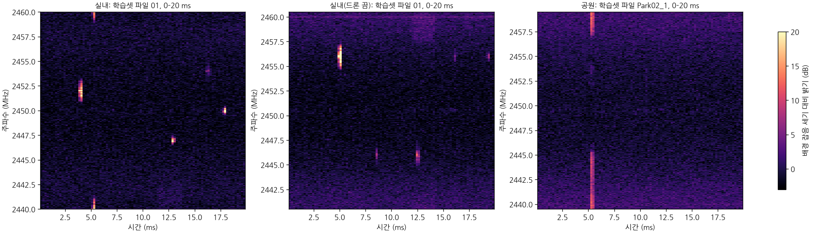

**그림 1. 장소별 배경 스펙트로그램(합성 신호 없음, 각 장소 학습셋 첫 파일의 처음 20 ms).** 가로축은 시간(0–20 ms), 세로축은 주파수이며 위쪽이 높은 주파수이다. 장소마다 중심 주파수가 달라 세로축 범위가 0.5 MHz씩 다르다. 색은 배경 잡음 세기 대비 밝기(dB)이며 검은색은 배경 잡음, 밝을수록 강한 신호이다. 실내 두 장소에는 길이 0.3 ms 안팎의 짧은 세로 막대(실제 블루투스 형태 신호)가 여러 개 보인다. 공원 그림의 2,440–2,445 MHz와 2,455–2,459 MHz에 걸친 세로 줄은 첫 번째 실험에서 원인을 확인하지 못한 짧은 수직 패턴이다.

### 3.2 스펙트로그램과 SNR

스냅샷 생성 절차는 첫 번째 실험과 같다.

1. **IQ 구간 추출:** 20 ms 길이의 복소 IQ 데이터 400,000샘플을 입력으로 사용한다.
2. **STFT:** 길이 8,192샘플의 창을 4,081샘플 간격으로 이동하며 단시간 푸리에 변환을 계산한다.
3. **주파수축 다운샘플링:** 주파수축의 32셀을 평균하여 256 × 97 크기로 축소한다. 셀 하나는 주파수 약 78 kHz, 시간 약 0.2 ms이다.
4. **DC 성분 제거:** 중심 주파수 주변 ±100 kHz를 인접 셀 값으로 대체한다.
5. **이미지 변환:** 배경 잡음 세기 대비 밝기를 고정 스케일(-6 dB → 0, +34 dB → 255)에 매핑하여 8비트 스냅샷으로 저장한다.

**배경 잡음 세기**는 신호가 없을 때 수신기에 들어오는 잡음의 평균 세기이다. 수신기 회로 자체의 잡음과 주변의 약한 잡음이 섞여 있다. 신호가 없는 픽셀도 밝기가 조금씩 변하므로, 가장 낮은 값이 아니라 평균을 기준으로 삼는다. 이 기준으로 맞추면 스펙트로그램에서 신호가 없는 픽셀은 0 dB 근처가 된다. 합성 신호 없이 받은 IQ 데이터에서 모든 픽셀 밝기의 중앙값은 공원 -0.2 dB, 실내 -1.3 dB, 실내(드론 끔) -0.8 dB였다.

**SNR**은 같은 픽셀 안에서 신호의 세기가 배경 잡음 세기보다 몇 dB 센지를 나타낸다. 신호가 있는 픽셀에는 신호와 배경 잡음이 함께 들어 있으므로, 그 픽셀은 배경 픽셀보다 평균 `10 × log10(1 + 10^(SNR/10))` dB 밝다. 신호가 강하면 밝기 차이가 SNR과 거의 같고, 신호가 약하면 밝기 차이가 SNR보다 크다. SNR 0 dB는 신호와 배경 잡음의 세기가 같다는 뜻이며, 그 픽셀은 배경보다 3 dB 밝다.

**표 3. SNR에 따른 신호 픽셀과 배경 픽셀의 밝기 차이 (dB)**

| SNR (dB) | 계산값 | 측정값 (공원 테스트 이상 스냅샷) | 측정에 사용한 스냅샷 (장) |
|---:|---:|---:|---:|
| 0 | 3.0 | 3.0 | 295 |
| 3 | 4.8 | 4.7 | 288 |
| 6 | 7.0 | 6.9 | 290 |
| 9 | 9.5 | 9.5 | 294 |
| 12 | 12.3 | 12.2 | 291 |

측정값은 스냅샷마다 이상 패킷 영역의 평균 밝기에서 합성 신호가 없는 영역의 평균 밝기(실제 신호를 빼기 위해 가장 밝은 1 % 픽셀 제외)를 뺀 값의 중앙값이다. 정상 와이파이·블루투스는 SNR 2–10 dB로 합성했으므로, 배경보다 4.1–10.4 dB 밝다.

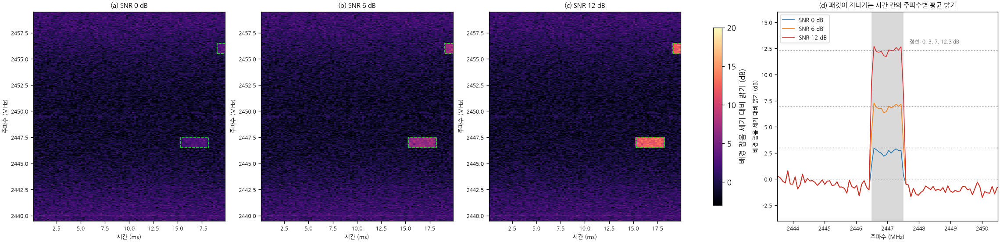

**그림 2. 같은 이상 패킷을 SNR 0·6·12 dB로 넣은 스펙트로그램.** 공원 테스트셋 파일에서 실제 신호가 가장 적은 20 ms(220–240 ms)에 테스트 이상 신호 1(이어폰형)을 넣었다. 패킷 위치는 세 그림이 같고 세기만 다르다. 정상 와이파이·블루투스는 넣지 않았다. (a)–(c)의 연두색 점선은 넣은 패킷 위치를 설명하기 위해 그린 것이며 모델 입력에는 없다. 2,446.5–2,447.5 MHz, 15.3–18.2 ms의 긴 막대가 통째로 보이는 패킷이고, 오른쪽 위 가장자리의 작은 막대는 다음 패킷의 앞부분이다. (d)는 이 패킷이 있는 시간(15.3–18.2 ms)만 골라, 주파수마다 밝기를 평균한 그래프이다. 회색 영역이 패킷의 주파수 범위이며, 가로 점선은 0, 3, 7, 12.3 dB이다. 패킷 안 평균 밝기는 바로 옆 배경보다 SNR 0·6·12 dB에서 각각 3.1·7.3·12.7 dB 높았다. SNR 0 dB의 패킷은 (a)에서 눈으로 겨우 구분된다.

### 3.3 배경 세기 맞추기

모든 IQ 데이터는 장소의 배경 잡음 세기로 나누어 신호가 없는 픽셀이 0 dB 근처가 되도록 맞춘다. 배경 잡음 세기는 학습셋 IQ 데이터에서 샘플마다 전력을 구하고, 그 중앙값으로 추정한다. 중앙값은 잠깐 나타나는 강한 신호에 거의 영향을 받지 않는다. 잡음만 있을 때 평균 전력은 중앙값을 ln 2(약 0.69)로 나눈 값과 같으므로, 이 값을 배경 잡음 세기로 쓴다. 학습셋 파일이 여러 개이면 파일별 값을 평균한다. 학습셋에서 정한 값 하나를 그 장소의 검증셋과 테스트셋에도 그대로 적용한다. 장소에서 미리 취득한 데이터로 기준을 정하고 시험 중에도 그 기준을 쓰는 운용 흐름과 같다.

첫 번째 실험은 데이터셋마다 IQ 데이터의 평균 전력으로 나누었다. 그런데 실내(드론 끔)의 학습셋 파일 2에는 20 MHz 전체를 덮는 아주 강한 신호가 약 120 ms 동안 있다. 이 신호는 배경 잡음보다 35 dB 넘게 강하고, 파일 전체 에너지의 95 %를 차지한다. 평균 전력으로 나누면 이 파일 전체가 약 14 dB 어둡게 표현되므로 중앙값 방식으로 바꾸었다. 이 신호도 그 장소의 정상 신호로 보고 제거하지 않았다. 이 방식은 배경 IQ 파일을 살펴본 뒤 결과를 보기 전에 정했으며, 값은 학습셋 파일로만 계산했다. 공원은 이 변경으로 첫 번째 실험보다 약 0.2 dB 밝게 표현된다.

**표 4. 장소별 실제 배경 신호의 양 (합성 신호 없이 IQ 파일 전체를 20 ms씩 나누어 측정)**

| 장소 | 배경보다 10 dB 넘게 밝은 픽셀 비율 (%) | 배경보다 20 dB 넘게 밝은 픽셀 비율 (%) | 가장 밝은 픽셀 (dB) | 픽셀별 정상 표준편차의 중앙값 (dB) |
|---|---:|---:|---:|---:|
| 실내 | 0.25–0.33 | 0.030–0.058 | 29.5–30.1 | 1.99 |
| 실내(드론 끔) | 0.36–1.20 | 0.102–0.760 | 30.9–45.2 | 2.56 |
| 공원 | 0.02–0.03 | 0.000–0.001 | 15.0–21.7 | 1.73 |

앞의 세 열은 IQ 파일별 값의 범위이다. 실내(드론 끔)의 가장 큰 값(1.20 %, 0.760 %, 45.2 dB)은 모두 강한 광대역 신호가 있는 학습셋 파일 2의 값이다. 마지막 열은 학습셋 정상 스냅샷 10,000장(합성 정상 신호 포함)에서 픽셀마다 구한 표준편차의 중앙값이며, (나)와 CAE의 입력 표준화에 쓰인다. 실내 두 장소의 실제 배경 신호는 공원보다 약 10배 많다.

### 3.4 합성 신호 구성

합성 신호는 첫 번째 실험과 같다. 장소마다 중심 주파수가 다르므로, 수신 대역에 들어오는 와이파이 채널과 블루투스 채널은 장소마다 조금 다르다.

**표 5. 신호 종류별 설정**

| 신호 | 사용 데이터셋 | 대역폭 (MHz) | 지속 시간 (ms) | 개수·전송 주기 | SNR (dB) |
|---|---|---:|---:|---|---|
| 정상 와이파이 | 전체 데이터셋 | 16.6 | 0.1–3 | 스냅샷마다 0–2개 | 2–8 |
| 정상 블루투스 클래식 | 전체 데이터셋 | 1 | 0.366 | 블루투스 0–4개 중 절반 | 3–10 |
| 정상 BLE | 전체 데이터셋 | 2 | 0.08–0.376 | 블루투스 0–4개 중 절반 | 3–10 |
| 평활화 커널 선택용 사각형 패턴 | 검증셋 | 0.3–4 | 0.3–6 | 1–4개 | 0–12 |
| 테스트 이상 1: 블루투스 이어폰 오디오 전송 모사(이어폰형) | 테스트셋 | 1 | 2.87 | 3.75 ms마다 1개, 79개 채널을 옮겨 다님 | 0, 3, 6, 9, 12 |
| 테스트 이상 2: BLE 연속 데이터 전송 모사(BLE형) | 테스트셋 | 2 | 1.06 × 2개 | 7.5 ms마다 한 번, 데이터 채널 37개를 옮겨 다님 | 0, 3, 6, 9, 12 |

사각형 패턴은 이상 점수를 만들 때 몇 개의 셀을 묶어 평균할지(평활화 커널 크기)를 고르는 데만 쓴다. 형태가 정해지지 않은 사각형이며, 모델 가중치 학습에는 사용하지 않는다. 테스트 이상 신호 두 종류는 블루투스 규격의 매개변수로 만든 합성 신호이며 실제 기기에서 취득한 신호가 아니다. 블루투스 기기는 패킷마다 약 79 MHz 범위의 채널을 옮겨 다니는데, 수신기는 그중 20 MHz만 본다. 그래서 기기가 동작해도 20 ms 동안 패킷이 하나도 보이지 않는 스냅샷이 있다. 그 비율은 장소에 따라 이어폰형 15.2–17.5 %, BLE형 36.5–40.2 %였다.

### 3.5 데이터셋 구성과 분할

**표 6. 장소마다 만든 데이터셋 (단위: 장)**

| 데이터셋 | 배경 IQ 파일 | 정상 | 사각형 패턴을 넣은 것 | 이상 신호를 넣은 것 | 합계 | 용도 |
|---|---|---:|---:|---:|---:|---|
| 학습셋 | 학습셋 파일 | 10,000 | 0 | 0 | 10,000 | (나)의 픽셀별 통계 추정, CAE 학습 |
| 검증셋 | 검증셋 파일 | 5,000 | 2,000 | 0 | 7,000 | 정상: 판정 임계값, CAE 체크포인트 선택. 사각형 패턴: 평활화 커널 크기 선택에만 사용 |
| 테스트셋 ① 정상 스트림 | 테스트셋 파일 | 20,000 | 0 | 0 | 20,000 | FPR, 시간당 오경보 수 |
| 테스트셋 ② 이상 이벤트 400개(이벤트마다 기기 켜기 1초 전 1장 + 켠 뒤 10장) | 테스트셋 파일 | 400 | 0 | 4,000 | 4,400 | 켠 뒤 4,000장: 이벤트 재현율, 그중 패킷이 보이는 2,865–2,966장: 스냅샷 재현율. 켜기 1초 전 400장: (가)가 1초 전 스냅샷과 비교하므로 넣은 것이며 평가에는 쓰지 않음 |
| 테스트셋 합계 | | 20,400 | 0 | 4,000 | 24,400 | |
| 전체 | | 35,400 | 2,000 | 4,000 | 41,400 | |

사각형 패턴은 기기 신호가 아니라 모양을 정하지 않은 사각형 덩어리이다. 평활화 커널 크기를 고르는 데만 쓰고, 모델 학습과 판정 임계값에는 쓰지 않는다.

- 각 스냅샷은 배정된 IQ 파일 안에서 무작위 위치의 20 ms를 잘라 만든다. 20 ms가 파일 경계를 넘지 않게 한다.
- 이상 이벤트는 기기를 10초 켠 상황을 이상 종류 2 × SNR 5단계 × 40번 = 400번 만든 것이다. 이벤트 하나는 기기 켜기 1초 전 정상 1장과 켠 뒤 10장, 모두 11장이다. (가)는 지금 스냅샷을 1초 전 스냅샷과 비교하므로, 켠 뒤 첫 장을 판정하려면 켜기 1초 전 장이 있어야 한다. 이 400장은 평가에 쓰지 않는다. FPR은 테스트셋 ① 20,000장으로만, 재현율은 켠 뒤 4,000장으로만 계산한다.
- 합성 난수 규칙은 세 장소가 같다. 장소마다 다른 것은 배경 IQ 데이터와 중심 주파수이다.

**데이터 누출 방지:**

- 학습셋·검증셋·테스트셋은 서로 다른 IQ 파일을 사용한다. 시간이 겹치는 구간은 없다.
- 테스트 이상 신호 두 종류는 학습셋과 검증셋에 넣지 않았다.
- 평활화 커널 크기, CAE 체크포인트, 판정 임계값은 그 장소의 검증셋으로만 정했다. 테스트셋은 결과 측정과 결과 해석(5.5절)에만 사용했다.

### 3.6 폴더 구성

첫 번째 실험의 폴더 구성에 다음 파일과 폴더를 추가했다. 첫 번째 실험의 코드 동작과 결과 파일은 바뀌지 않았다.

```
research/exam_rf/
├── data/
│   ├── background/
│   │   ├── indoor/, indoor_droneoff/   실내 두 장소의 배경 IQ 파일 01–05.npy (.cs8을 변환, 장소당 763 MB)
│   │   └── site_sources.json           원본 IQ 파일 경로, 장소별 배경 잡음 세기
│   └── site/<장소>/                     장소별 합성 스냅샷(장소당 약 1.0 GB)
├── models/site/<장소>/                이 실험의 장소 폴더(CAE 9개, 정상 통계, 배경 잡음 세기, 판정 임계값), src/predict.py --site 로 바로 추론
├── doc/
│   ├── 00_overview_ver2.md             이 문서
│   ├── 00_overview_rev2.md             이 문서의 표현·용어 교정본
│   └── fig/site/                       이 문서의 그림(본문 4장, 부록 12장)
├── results/site/                      GitHub 저장소에 올린 기준 결과(runs/site/의 결과 표·선택한 설정 복사본, site_sources.json)
├── runs/site/
│   ├── <장소>/                          장소별 모델(cae65k·cae21k·cae6k_s0–2.pt), 점수, 선택한 설정, 결과, 실행 기록
│   ├── cross.json                      다른 장소 모델의 오탐률
│   └── results.md                      전체 결과 표(모든 SNR, 판정 임계값 두 가지)
└── src/
    ├── site_setup.py                   장소 정의, 배경 IQ 파일 변환, 배경 세기 맞추기
    ├── run_sites.sh                    장소별 실험 전체 실행
    ├── site_evaluate.py                장소별 테스트셋 평가, 가벼운 정도 측정, 부록 그림
    ├── site_cross.py                   다른 장소 모델의 오탐률
    ├── site_summary.py                 결과 표와 그림 1·3
    ├── site_figures.py                 그림 2(SNR 예시)와 그림 4(실내 오탐 원인)
    ├── site_train.py                   새 장소 학습: 정상 IQ 데이터 → 장소 폴더(모델, 배경 잡음 세기, 판정 임계값)
    ├── export_site_models.py           이 실험의 모델을 장소 폴더 형식으로 내보내기(models/site/)
    └── make_site_demo_iq.py            정상 IQ 파일에 이상 신호를 넣은 시험용 IQ 만들기
```

장소 이름은 폴더와 코드에서 indoor(실내), indoor_droneoff(실내(드론 끔)), park(공원)로 쓴다. common.py, make_data.py, pixeldiff.py, cae.py에는 장소 설정(EXAM_SITE)과 CAE 크기 선택(--size 65k, 21k, 6k)을 추가했다. predict.py에는 장소 폴더로 추론하는 --site를 추가했다(8.1절).

## 4. 방법

모든 방법은 스냅샷마다 이상 점수 한 개를 산출하고, 이 점수가 판정 임계값을 초과하면 이상으로 판정한다. 모든 방법을 장소마다 따로 학습하고 따로 판정 임계값을 정한다.

### 4.1 (가) 직전 스냅샷 차분과 (나) 정상 기준 차분

첫 번째 실험과 같다. (가)는 현재 스냅샷에서 1초 전 스냅샷을 뺀 차분 맵, (나)는 학습셋 정상 10,000장의 픽셀별 평균과 표준편차로 표준화한 z-점수 맵을 만든다. 두 맵에 r × c(주파수 r셀 × 시간 c셀) 평균 필터를 적용하고 최댓값을 이상 점수로 사용한다. 커널은 주파수 1·6·13·26셀과 시간 1·2·5·10·15셀을 조합한 20개 후보 중에서 고른다. 후보마다 검증셋 정상 이상 점수의 상위 1 % 값을 임계값으로 두고, 그 임계값에서 검증셋 사각형 패턴을 가장 많이 잡는 커널을 고른다. 장소별로 고른 커널은 runs/site/results.md 2절에 있으며, 대부분 1셀 × 15셀(0.08 MHz × 3.1 ms)이었다.

### 4.2 CAE 세 종류

CAE는 인코더로 입력을 작은 잠재 표현으로 압축하고, 디코더로 원래 크기의 이미지를 재구성한다. 정상 데이터만으로 학습하므로 정상 패턴은 잘 재구성하고, 학습 분포에서 벗어난 패턴에는 큰 잔차가 남기를 기대한다.

**표 7. CAE 세 종류의 구조**

| 모델 | 인코더 채널 수 | 잠재 표현 크기 (값 개수) | 학습 파라미터 (개) | 첫 번째 실험 모델 대비 크기 | 모델 파일 (KB) |
|---|---|---:|---:|---:|---:|
| CAE, 파라미터 65,265개 | 16·32·64 | 1,792 | 65,265 | 1 | 270 |
| CAE, 파라미터 21,121개 | 8·16·32 | 1,792 | 21,121 | 1/3.09 | 97 |
| CAE, 파라미터 6,489개 | 4·7·14 | 1,792 | 6,489 | 1/10.06 | 38 |

1. **입력:** (나)의 z-점수 맵을 -4–12로 자르고 4로 나눈 1 × 256 × 97 텐서이다.
2. **구조:** 인코더는 스트라이드 2의 3×3 합성곱 4단으로 입력을 16채널 × 16 × 7(값 1,792개)로 압축한다. 디코더는 2배 업샘플링과 3×3 합성곱 4단으로 256 × 97로 재구성한다. 세 모델은 인코더·디코더의 채널 수만 다르고 잠재 표현 크기는 같다. 따라서 성능 차이는 모델 폭의 차이로 해석할 수 있다. 65,265개 모델은 첫 번째 실험의 CAE와 구조가 같다.
3. **학습:** 학습셋 정상 10,000장만 사용하여 입력과 재구성의 평균제곱오차를 최소화한다. AdamW, 20 에포크, 배치 크기 128, 시간축 순환 이동·반전 증강을 적용했다. 시드 0·1·2로 세 번 학습했다.
4. **체크포인트 선택:** 검증셋 정상 5,000장의 재구성 오차가 가장 작은 에포크를 선택했다. 27개 모델(장소 3 × 크기 3 × 시드 3) 중 20개가 20 에포크, 7개가 19 에포크를 선택했다.
5. **이상 점수:** 입력에서 재구성을 뺀 잔차의 양수 부분을 평활화하고 최댓값을 사용한다. 커널 선택 기준은 4.1절과 같다.

### 4.3 판정 임계값과 평가 지표

- **판정 임계값:** 그 장소 검증셋 정상 스냅샷 5,000장의 이상 점수 중 상위 0.1 % 값(5번째로 큰 점수)과 상위 1 % 값(50번째로 큰 점수) 두 가지를 구했다. 본문은 상위 0.1 % 값의 결과를 제시하고, 상위 1 % 값의 결과는 runs/site/results.md 4절에 있다. 테스트셋은 임계값 설정에 사용하지 않았다.
- **오탐률(FPR):** 테스트셋 ① 정상 스냅샷 20,000장 중 이상으로 판정한 비율이다. 검증셋에서 임계값을 넘은 비율은 정의상 0.1 %이다. 테스트셋 FPR이 0.1 % 근처이거나 그보다 낮으면, 같은 장소의 다른 시간 구간에서도 임계값이 그대로 통한다는 뜻이다.
- **스냅샷 재현율:** 이상 패킷이 1개 이상 보이는 스냅샷 중 이상으로 판정한 비율이다. 기기가 켜져 있어도 패킷이 하나도 보이지 않는 스냅샷은 계산에서 뺀다.
- **경보 규칙:** 1초에 한 장씩 판정하다가, 최근 10초(10장) 가운데 2장 이상이 이상으로 판정되면 경보를 울린다.
- **이벤트 재현율:** 기기를 10초 동안 켠 상황(이벤트)을 이상 종류·SNR마다 40번 만들고, 그중 경보가 울린 비율을 잰다. 이벤트 하나는 1초에 한 장씩 찍은 스냅샷 10장이며, 패킷이 보이지 않는 스냅샷도 그대로 포함한다. 10장 중 2장 이상이 이상으로 판정되면 경보가 울린 것으로 본다.
- **시간당 오경보 수:** 기기가 없는 정상 상태에서 경보가 1시간에 몇 번 울리는지 센 값이다. 테스트셋 정상 스냅샷 20,000장을 1초에 한 장씩 이어진 5.56시간으로 보고 경보 규칙을 적용한다. 경보 조건이 몇 초 동안 이어져도 한 번으로 세고, 울린 횟수를 5.56으로 나눈다.
- **다른 장소 모델의 오탐률:** 장소 X에서 학습한 모델, 커널, 임계값, 표준화 통계를 그대로 장소 Y의 테스트셋 ①에 적용한 FPR이다. 장소 Y의 배경 세기만은 장소 Y의 학습셋 파일로 맞추었다. 새 장소에서도 배경 잡음 세기만은 잴 수 있다고 가정했다.
- **가벼운 정도:** 학습 파라미터 수, 모델 파일 크기, GPU 학습 시간, CPU 추론 시간을 측정했다. GPU 학습 시간은 20 에포크에 걸린 시간을 시드 3개와 장소 3곳에 대해 평균했다. CPU 추론 시간은 CPU 코어 1개로 스냅샷 1장의 이상 점수를 계산한 시간이며, 테스트셋 정상 200장의 중앙값이다.

## 5. 결과

이 절의 수치는 별도 명시가 없는 한 테스트셋 측정값이며, 판정 임계값은 그 장소 검증셋 정상 이상 점수의 상위 0.1 % 값이다. CAE는 시드 3개 평균이고 괄호 안은 시드별 최솟값–최댓값이다. SNR 0·3 dB 결과와 AUROC를 포함한 전체 표는 runs/site/results.md에 있다.

### 5.1 장소별 배경

실내 두 장소에는 실제 블루투스 형태의 짧은 신호가 많다(그림 1, 표 4, 부록 A). 그림에서 보이는 크기는 길이 0.2–0.4 ms, 폭 1–3 MHz 안팎이고, 가장 밝은 픽셀은 배경보다 약 30 dB 밝다. 합성 정상 블루투스(SNR 3–10 dB, 배경보다 4.8–10.4 dB 밝음)보다 강하다. 실내(드론 끔)의 학습셋 파일 2에는 20 MHz 전체를 덮는 강한 신호(최대 45.2 dB)가 651–774 ms 사이에 여러 번 나타난다(그림 A-5의 마지막 칸). 공원에는 실제 신호가 거의 없다.

### 5.2 오탐률과 시간당 오경보 수

**표 8. 테스트셋 정상 스트림 20,000장의 오탐률 (FPR, %)**

| 방법 | 실내 | 실내(드론 끔) | 공원 |
|---|---:|---:|---:|
| (가) 직전 스냅샷 차분 | 0.20 | 0.21 | 0.09 |
| (나) 정상 기준 차분 | 0.14 | 0.10 | 0.11 |
| CAE, 파라미터 65,265개 | 1.28 (1.13–1.46) | 0.02 (0.00–0.04) | 0.05 (0.03–0.08) |
| CAE, 파라미터 21,121개 | 1.11 (0.51–1.63) | 0.05 (0.01–0.10) | 0.03 (0.01–0.07) |
| CAE, 파라미터 6,489개 | 1.06 (0.82–1.20) | 0.08 (0.03–0.11) | 0.04 (0.01–0.06) |

**표 9. 시간당 오경보 수 (회, 기기가 없는 정상 상태 5.56시간 동안 경보가 울린 횟수를 1시간당으로 환산)**

| 방법 | 실내 | 실내(드론 끔) | 공원 |
|---|---:|---:|---:|
| (가) 직전 스냅샷 차분 | 0.0 | 0.0 | 0.2 |
| (나) 정상 기준 차분 | 0.2 | 0.0 | 0.2 |
| CAE, 파라미터 65,265개 | 4.5 (2.9–5.4) | 0.0 (0.0–0.0) | 0.0 (0.0–0.0) |
| CAE, 파라미터 21,121개 | 4.1 (1.1–6.7) | 0.0 (0.0–0.0) | 0.0 (0.0–0.0) |
| CAE, 파라미터 6,489개 | 3.6 (2.2–4.5) | 0.1 (0.0–0.2) | 0.0 (0.0–0.0) |

실내(드론 끔)와 공원에서는 모든 방법의 테스트셋 FPR이 0.00–0.21 %로, 검증셋에서 임계값을 넘은 비율(0.1 %)과 비슷하거나 낮았다. 시간당 오경보 수는 0.2회 이하였다. 실내에서는 CAE 세 종류의 FPR이 1.06–1.28 %로 검증셋의 약 10배였고, 시간당 오경보 수는 3.6–4.5회였다. 같은 실내에서 (가)·(나)의 FPR은 0.14–0.20 %였다. 원인은 5.5절에서 분석한다. 임계값을 상위 1 % 값으로 낮추면 실내 CAE의 시간당 오경보 수는 22.9–36.8회, 다른 두 장소의 모든 방법은 0.7–3.1회였다.

### 5.3 스냅샷 단위 재현율

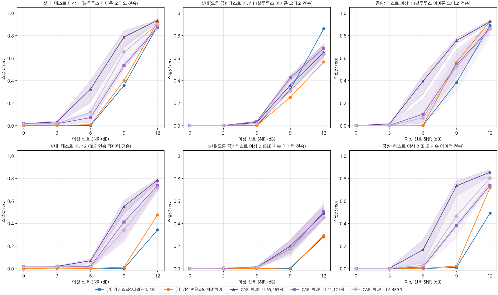

**그림 3. 장소별 이상 신호 SNR에 따른 스냅샷 재현율.** 가로축은 테스트 이상 신호의 SNR, 세로축은 이상 패킷이 1개 이상 관측된 스냅샷의 재현율(0–1)이다. 윗줄은 이어폰형, 아랫줄은 BLE형이고, 왼쪽부터 실내, 실내(드론 끔), 공원이다. 파란 원은 (가), 주황 원은 (나), 진한 보라 삼각형은 CAE(65,265개), 보라 사각형은 CAE(21,121개), 연보라 마름모는 CAE(6,489개)이다. CAE는 시드 3개 평균이고 반투명 띠는 시드별 최솟값–최댓값이다. 판정 임계값은 검증셋 정상 이상 점수의 상위 0.1 % 값이다.

**표 10. 테스트 이상 신호 1(이어폰형)의 스냅샷 재현율 (%)**

| 방법 | 실내, SNR 6 dB | 실내, SNR 9 dB | 실내, SNR 12 dB | 실내(드론 끔), SNR 6 dB | 실내(드론 끔), SNR 9 dB | 실내(드론 끔), SNR 12 dB | 공원, SNR 6 dB | 공원, SNR 9 dB | 공원, SNR 12 dB |
|---|---:|---:|---:|---:|---:|---:|---:|---:|---:|
| (가) 직전 스냅샷 차분 | 0.0 | 35.7 | 88.4 | 0.0 | 32.0 | 85.9 | 0.3 | 38.3 | 89.1 |
| (나) 정상 기준 차분 | 0.9 | 39.9 | 92.2 | 0.0 | 25.2 | 56.6 | 0.3 | 56.2 | 92.6 |
| CAE, 파라미터 65,265개 | 32.4 | 78.7 | 93.4 | 2.9 | 35.9 | 65.2 | 39.5 | 75.5 | 92.3 |
| CAE, 파라미터 21,121개 | 7.1 | 53.3 | 87.3 | 3.7 | 42.5 | 68.7 | 10.1 | 54.0 | 86.4 |
| CAE, 파라미터 6,489개 | 11.9 | 65.4 | 89.8 | 1.7 | 30.6 | 63.0 | 6.9 | 52.4 | 85.7 |
| 평가한 스냅샷 수 (장) | 338 | 333 | 346 | 326 | 325 | 341 | 335 | 329 | 339 |

**표 11. 테스트 이상 신호 2(BLE형)의 스냅샷 재현율 (%)**

| 방법 | 실내, SNR 6 dB | 실내, SNR 9 dB | 실내, SNR 12 dB | 실내(드론 끔), SNR 6 dB | 실내(드론 끔), SNR 9 dB | 실내(드론 끔), SNR 12 dB | 공원, SNR 6 dB | 공원, SNR 9 dB | 공원, SNR 12 dB |
|---|---:|---:|---:|---:|---:|---:|---:|---:|---:|
| (가) 직전 스냅샷 차분 | 0.4 | 0.0 | 34.3 | 0.0 | 0.0 | 28.5 | 0.0 | 0.9 | 49.2 |
| (나) 정상 기준 차분 | 0.0 | 1.3 | 47.7 | 0.0 | 0.5 | 29.3 | 0.0 | 2.3 | 71.7 |
| CAE, 파라미터 65,265개 | 6.9 | 55.1 | 78.6 | 1.0 | 19.9 | 49.1 | 16.6 | 73.4 | 85.5 |
| CAE, 파라미터 21,121개 | 2.0 | 41.3 | 73.6 | 1.1 | 17.6 | 50.4 | 1.4 | 38.3 | 73.8 |
| CAE, 파라미터 6,489개 | 1.0 | 34.2 | 71.6 | 0.8 | 17.3 | 45.1 | 2.9 | 46.4 | 80.2 |
| 평가한 스냅샷 수 (장) | 256 | 234 | 277 | 245 | 218 | 270 | 245 | 222 | 258 |

평가한 스냅샷 수는 이벤트 40개 × 10장 = 400장 중 이상 패킷이 1개 이상 관측된 스냅샷 수이다. SNR 0·3 dB의 재현율은 모든 방법·장소에서 평균 3.3 % 이하였다. 실내 CAE의 SNR 0·3 dB 재현율(1.5–3.3 %)은 같은 장소의 FPR(1.06–1.28 %)과 비슷한 수준으로, 이상 신호를 탐지했다기보다 오탐에 가까운 값이다.

- **CAE와 픽셀 차분:** 실내와 공원에서 CAE(65,265개)는 픽셀 차분보다 약 3 dB 약한 신호부터 재현율이 올라갔다. 첫 번째 실험의 공원 결과와 같은 경향이다.
- **CAE 크기:** 파라미터를 1/3, 1/10로 줄이면 실내와 공원의 SNR 6–9 dB 재현율이 대체로 낮아졌다. 이어폰형 SNR 9 dB에서 65,265개 모델은 75.5–78.7 %, 작은 두 모델은 52.4–65.4 %였다. SNR 12 dB에서는 세 모델의 차이가 12 %p 이하였다. 21,121개 모델과 6,489개 모델 사이에는 일관된 순서가 없었다.
- **실내(드론 끔):** 모든 방법의 재현율이 다른 두 장소보다 낮았고, CAE 크기에 따른 차이도 작았다. (나)도 이어폰형 SNR 12 dB 재현율이 56.6 %로, 다른 장소의 92.2–92.6 %보다 낮았다. 표 4의 픽셀별 정상 표준편차가 가장 큰 장소이며, 같은 이상 신호의 z-점수가 작아진 것으로 해석한다.

### 5.4 이벤트 단위 재현율

**표 12. 이벤트 재현율 (%, 기기를 10초 켠 상황 40번 가운데 경보가 울린 비율)**

| 방법 | 이상 종류 | 실내, SNR 6 dB | 실내, SNR 9 dB | 실내(드론 끔), SNR 6 dB | 실내(드론 끔), SNR 9 dB | 공원, SNR 6 dB | 공원, SNR 9 dB |
|---|---|---:|---:|---:|---:|---:|---:|
| (가) 직전 스냅샷 차분 | 이어폰형 | 0.0 | 82.5 | 0.0 | 80.0 | 0.0 | 90.0 |
| (나) 정상 기준 차분 | 이어폰형 | 2.5 | 87.5 | 0.0 | 57.5 | 0.0 | 97.5 |
| CAE, 파라미터 65,265개 | 이어폰형 | 76.7 | 100.0 | 4.2 | 80.8 | 87.5 | 99.2 |
| CAE, 파라미터 21,121개 | 이어폰형 | 9.2 | 95.8 | 3.3 | 86.7 | 23.3 | 95.8 |
| CAE, 파라미터 6,489개 | 이어폰형 | 25.8 | 96.7 | 1.7 | 71.7 | 12.5 | 94.2 |
| (가) 직전 스냅샷 차분 | BLE형 | 0.0 | 0.0 | 0.0 | 0.0 | 0.0 | 0.0 |
| (나) 정상 기준 차분 | BLE형 | 0.0 | 0.0 | 0.0 | 0.0 | 0.0 | 0.0 |
| CAE, 파라미터 65,265개 | BLE형 | 7.5 | 88.3 | 0.0 | 30.0 | 25.8 | 94.2 |
| CAE, 파라미터 21,121개 | BLE형 | 1.7 | 73.3 | 0.0 | 23.3 | 0.8 | 66.7 |
| CAE, 파라미터 6,489개 | BLE형 | 0.0 | 63.3 | 0.0 | 25.0 | 3.3 | 70.0 |

SNR 12 dB에서는 CAE 세 종류의 이벤트 재현율이 모든 장소·유형에서 89.2–100 %였다. (가)·(나)는 이어폰형 SNR 12 dB에서 100 %, BLE형 SNR 12 dB에서 55.0–100 %였다. 공원과 실내에서 SNR 9 dB 이상의 이상 신호는 CAE(65,265개)가 이벤트 단위로 88.3–100 % 탐지했다. 실내는 같은 조건에서 시간당 오경보도 4.5회였다(표 9).

### 5.5 실내 오탐 원인 분석

실내 CAE의 FPR이 검증셋보다 약 10배 높았던 원인을 확인하기 위해, 임계값을 넘은 정상 스냅샷이 테스트셋 IQ 파일의 어느 위치에서 잘렸는지, 이상 점수의 최댓값이 어디에 있는지 조사했다. 이 분석은 결과를 해석하기 위한 것이며, 분석 후 모델이나 임계값을 바꾸지 않았다.

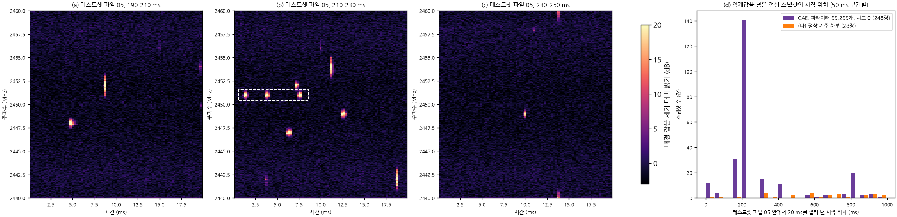

**그림 4. 실내 테스트셋 파일 5의 실제 신호와 오탐 위치.** (a)–(c)는 합성 신호를 넣지 않은 테스트셋 파일 5의 190–250 ms 스펙트로그램이며, 축과 색은 그림 1과 같다. (b)의 흰색 점선은 설명을 위해 그린 것으로, CAE 이상 점수의 최댓값이 가장 많이 나온 위치이다. 이 안에서 실제 짧은 신호가 2,451 MHz에 211·214·217 ms 세 번 되풀이된다. 정상 스냅샷은 1초 파일에서 20 ms를 잘라 만든다. (d)는 임계값을 넘은 정상 스냅샷이 파일의 어느 위치에서 잘렸는지를 50 ms 구간별로 센 막대그래프이다. 보라색은 CAE(65,265개, 시드 0), 주황색은 (나)이다. 범례의 괄호 안은 임계값을 넘은 정상 스냅샷의 총 수이다.

- CAE(65,265개)가 임계값을 넘은 정상 스냅샷은 시드 0·1·2에서 248·226·291장이었다. 그중 파일의 210–230 ms와 겹치게 잘린 스냅샷이 69·74·62 %였다.
- 시드 0의 248장 중 171장(69 %)은 이상 점수의 최댓값이 2,451 MHz, 파일 안 210 ms 부근에 있었다. 이 주파수에는 실제 짧은 신호(길이 0.2–0.5 ms, 배경보다 22–23 dB 밝음)가 2.5–3.6 ms 간격으로 세 번 나타났다. CAE 점수의 평활화 커널은 한 주파수 줄에서 3.1 ms를 평균하므로, 같은 주파수에 되풀이된 짧은 신호는 긴 협대역 패킷과 비슷하게 보일 수 있다. 테스트 이상 신호 1(길이 2.87 ms의 협대역 패킷)과 겉모양이 비슷한 정상 장면이다.
- 다만 학습셋 20 ms 구간 150개 중 28개(19 %)에도 한 주파수 줄에서 3.1 ms 안에 배경보다 10 dB 넘게 밝은 신호가 두 번 이상 시작하는 장면이 있었다. 따라서 이 장면이 학습셋에 없어서 오탐이 되었다고 단정할 수 없으며, 이 장면만 높은 점수를 받은 이유는 확인하지 못했다.
- (나)가 임계값을 넘은 정상 스냅샷 28장은 파일 전체에 흩어져 있었고, 210–230 ms와 겹치는 스냅샷은 없었다.
- 테스트셋 정상 20,000장은 1초 파일에서 20 ms를 반복해 잘라 만들었으므로, 실제 장면 하나가 수백 장의 스냅샷에 들어간다. 실내 CAE의 FPR 1.06–1.28 %는 사실상 이 장면 하나에 좌우된 값이다.

이 결과는 장소별 학습에서도 정상 데이터의 길이가 중요하다는 것을 보여 준다. 정상 데이터가 몇 초뿐이면 그 장소에서 가끔 생기는 정상 장면이 학습·검증에 충분히 들어가지 않고, 오탐률 추정도 장면 몇 개에 크게 흔들린다. 실측에서는 정상 IQ 데이터를 수 분 이상 취득하여 학습셋, 검증셋, 테스트셋을 시간 순서로 나누어야 한다(7장).

### 5.6 다른 장소에서 학습한 모델의 오탐률

**표 13. 다른 장소에서 학습한 모델을 그대로 사용했을 때의 테스트셋 오탐률 (%)**

| 방법 | 모델을 학습한 장소 | 시험한 장소: 실내 | 시험한 장소: 실내(드론 끔) | 시험한 장소: 공원 |
|---|---|---:|---:|---:|
| (가) 직전 스냅샷 차분 | 실내 | 0.20 | 0.18 | 0.02 |
| (가) 직전 스냅샷 차분 | 실내(드론 끔) | 0.27 | 0.21 | 0.02 |
| (가) 직전 스냅샷 차분 | 공원 | 1.04 | 0.85 | 0.09 |
| (나) 정상 기준 차분 | 실내 | 0.14 | 0.56 | 0.24 |
| (나) 정상 기준 차분 | 실내(드론 끔) | 0.29 | 0.10 | 0.14 |
| (나) 정상 기준 차분 | 공원 | 0.46 | 0.41 | 0.11 |
| CAE, 파라미터 65,265개 | 실내 | 1.27 | 7.44 | 0.47 |
| CAE, 파라미터 65,265개 | 실내(드론 끔) | 2.68 | 0.02 | 0.30 |
| CAE, 파라미터 65,265개 | 공원 | 16.90 | 12.46 | 0.05 |
| CAE, 파라미터 21,121개 | 실내 | 1.11 | 2.45 | 0.16 |
| CAE, 파라미터 21,121개 | 실내(드론 끔) | 2.25 | 0.05 | 0.55 |
| CAE, 파라미터 21,121개 | 공원 | 6.29 | 2.65 | 0.03 |
| CAE, 파라미터 6,489개 | 실내 | 1.06 | 2.37 | 0.19 |
| CAE, 파라미터 6,489개 | 실내(드론 끔) | 1.89 | 0.08 | 0.14 |
| CAE, 파라미터 6,489개 | 공원 | 8.34 | 4.68 | 0.04 |

시험한 장소와 모델을 학습한 장소가 같은 칸은 표 8과 같은 조건이다. 점수를 다시 계산했으므로 표 8과 0.01 %p 이내의 차이가 있다.

- **CAE:** 신호가 적은 공원에서 학습한 모델을 신호가 많은 실내 두 곳에 쓰면 FPR이 2.65–16.90 %로 크게 올랐다. 반대로 실내 모델을 공원에 쓰면 FPR은 0.14–0.55 %였다. 공원 테스트 데이터에는 실제 신호가 거의 없어 어떤 모델도 오탐이 적었지만, 공원 자체 모델(0.03–0.05 %)보다는 높았다.
- **실내 두 장소 사이:** 같은 방이지만 날짜와 수신 설정이 다른 두 장소끼리 바꿔 써도 CAE의 FPR은 1.89–7.44 %였다.
- **픽셀 차분:** (가)·(나)도 다른 장소 모델의 FPR이 최대 1.04 %로 올랐지만, CAE보다 변화가 작았다.
- CAE는 학습 장소의 배경을 가장 세밀하게 학습하므로, 장소가 바뀌면 오탐도 가장 크게 늘었다. 장소마다 따로 학습한다는 이번 설계와 맞는 결과이다.

### 5.7 가벼운 정도

**표 14. 모델 크기와 계산 시간**

| 방법 | 학습 파라미터 (개) | 모델 파일 (KB) | GPU 학습 시간, 20 에포크 (초) | CPU 코어 1개에서 스냅샷 1장 이상 점수 계산 (ms) |
|---|---:|---:|---:|---:|
| (가) 직전 스냅샷 차분 | 0 | 없음 | 학습 없음 | 0.1 미만 |
| (나) 정상 기준 차분 | 0 | 없음 | 평균·표준편차 계산만 | 0.1 미만 |
| CAE, 파라미터 65,265개 | 65,265 | 270 | 87 | 8.3 |
| CAE, 파라미터 21,121개 | 21,121 | 97 | 47 | 6.6 |
| CAE, 파라미터 6,489개 | 6,489 | 38 | 27 | 4.9 |

학습 시간과 CPU 시간은 장소 3곳의 평균이며, 측정 장비는 NVIDIA DGX Spark(GB10 GPU, ARM CPU)이다. 학습 시간에는 에포크마다 검증셋 재구성 오차를 계산하는 시간이 포함되고, 학습 데이터 합성 시간(장소당 약 1분 40초, CPU 16개 사용)은 포함되지 않는다. CPU 시간에는 스냅샷을 z-점수로 바꾸는 단계, CAE 추론, 잔차 평활화가 포함되고, IQ 데이터를 스펙트로그램으로 바꾸는 시간은 포함되지 않는다. 1초에 한 장을 판정하면 CAE(65,265개)도 CPU 코어 1개 시간의 1 % 미만을 사용한다.

### 5.8 첫 번째 실험의 공원 결과와 비교

**표 15. 공원에서의 첫 번째 실험과 두 번째 실험 결과 비교 (판정 임계값은 검증셋 정상 이상 점수의 상위 0.1 % 값)**

| 지표 | 첫 번째 실험 CAE | 두 번째 실험 CAE, 파라미터 65,265개 | 첫 번째 실험 (나) | 두 번째 실험 (나) |
|---|---:|---:|---:|---:|
| 테스트셋 FPR (%) | 0.05 | 0.05 | 0.11 | 0.11 |
| 이어폰형 스냅샷 재현율, SNR 6 dB (%) | 41.2 | 39.5 | 0.3 | 0.3 |
| 이어폰형 스냅샷 재현율, SNR 9 dB (%) | 76.8 | 75.5 | 56.5 | 56.2 |
| 이어폰형 스냅샷 재현율, SNR 12 dB (%) | 91.9 | 92.3 | 92.6 | 92.6 |
| BLE형 스냅샷 재현율, SNR 6 dB (%) | 18.4 | 16.6 | 0.0 | 0.0 |
| BLE형 스냅샷 재현율, SNR 9 dB (%) | 73.9 | 73.4 | 2.7 | 2.3 |
| BLE형 스냅샷 재현율, SNR 12 dB (%) | 85.4 | 85.5 | 70.9 | 71.7 |

첫 번째 실험의 CAE는 두 번째 실험의 CAE(65,265개)와 구조가 같다. 두 번째 실험은 배경 세기 맞추기 방식을 바꾸었고(3.3절), 배경에서 20 ms를 고르는 난수 사용 방식도 달라졌으며, CAE를 다시 학습했다. 그래도 재현율 차이는 1.8 %p 이하, FPR 차이는 0.01 %p 이하였다.

## 6. 실현 가능성 평가와 한계

장소별 정상 데이터로 학습한 결과는 다음과 같다.

1. **장소별 학습은 필요하다.** 다른 장소의 CAE를 그대로 쓰면 FPR이 최대 16.90 %까지 올랐고, 같은 장소에서 학습하면 공원과 실내(드론 끔)에서 0.02–0.08 %였다.
2. **CAE(65,265개)가 가장 균형이 좋았다.** 실내와 공원에서 SNR 9 dB 이상의 이벤트 재현율은 88.3–100 %였다. 작은 CAE 두 종류는 SNR 6–9 dB의 재현율이 낮았다. 세 모델 모두 파일 270 KB 이하, CPU 1장 8.3 ms 이하로 가벼워서, 크기를 줄여 얻는 이득은 성능 손실보다 작았다.
3. **정상 데이터가 짧으면 같은 장소에서도 실제 장면 하나가 오탐을 만든다.** 실내에서는 2,451 MHz에 짧은 신호가 되풀이된 장면 하나가 CAE FPR 1.06–1.28 %, 시간당 오경보 3.6–4.5회의 대부분을 만들었다.
4. **배경 신호가 많은 장소에서는 약한 신호 탐지가 어려워진다.** 강한 광대역 신호가 학습 데이터에 섞인 실내(드론 끔)에서는 SNR 9 dB 이벤트 재현율이 CAE 세 종류 모두 23.3–86.7 %로 낮아졌다.
5. **SNR 6 dB 이하의 약한 신호는 여전히 어렵다.** 정상 데이터만 쓰는 방법들은 정상 블루투스(SNR 3–10 dB)와 비슷하거나 약한 이상 신호를 대부분 놓쳤다. 공원과 실내 CAE(65,265개)의 이어폰형 SNR 6 dB 이벤트 재현율 76.7–87.5 %가 가장 높은 값이었다.

평가 범위의 한계와 미검증 항목은 다음과 같다.

1. **정상 데이터 길이:** 장소마다 배경 IQ 데이터가 3–5초뿐이다. 운용 계획의 10분 취득과 차이가 크며, 실내 오탐(5.5절)은 이 한계에서 나왔다.
2. **표본 독립성:** 테스트셋 정상 20,000장은 1초 파일에서 반복 추출했으므로 서로 겹친다. FPR은 그 1초에 들어 있는 실제 장면 몇 개에 좌우되며, 독립적인 현장 관측 20,000장과 같게 해석할 수 없다.
3. **장소 차이와 수신 설정 차이:** 실내 두 장소는 같은 방이지만 날짜, 중심 주파수, 기저대역 필터(15·20 MHz), 수집 프로그램이 다르다. 5.6절의 실내 두 장소 사이 결과에는 이 차이가 섞여 있다. 실내의 15 MHz 필터에서도 스펙트로그램 가장자리가 어두워지지는 않았지만, 합성 신호는 필터를 거치지 않고 더해졌다.
4. **이상 신호:** 두 이상 신호는 블루투스 규격으로 만든 합성 신호이다. 실제 AI 안경과 핸드폰 사이의 통신은 블루투스 외에 와이파이를 함께 쓸 수 있으며, 그 형태는 확인하지 않았다.
5. **다른 장소 모델 평가의 가정:** 다른 장소 모델을 쓸 때도 시험한 장소의 배경 잡음 세기로 데이터를 맞추었다. 이 단계 없이 쓰면 결과가 달라질 수 있다.
6. **CAE 설정:** 모델 크기 외의 설정(20 에포크, 잠재 표현 크기, 커널 후보)은 고정했다. 27개 모델 중 20개가 마지막 에포크를 선택했으므로, 작은 모델은 학습을 늘리면 개선될 가능성이 있으나 확인하지 않았다.
7. **정상 합성 신호:** 약한 와이파이·블루투스 합성은 첫 번째 실험과 같으며, 실제 시험장의 정상 신호 분포는 확인하지 않았다.

## 7. 후속 실험 제안 (진행 전 합의 필요)

1. **실측 1, 스터디카페:** 정상 IQ 데이터를 10분 이상 취득하고, 앞부분으로 학습, 다음 부분으로 임계값 설정, 마지막 부분으로 FPR을 측정한다. 이어서 AI 안경과 핸드폰 사이 통신을 켠 구간과 끈 구간을 시각과 함께 기록하며 취득하여 테스트셋으로만 사용한다.
2. **실측 2, 조용한 카페:** 같은 절차를 반복하고 손님 수와 시각을 기록한다. 손님 기기의 새 통신이 오탐에 미치는 영향을 스터디카페와 비교한다.
3. **정상 데이터 길이의 영향:** 실측 데이터에서 학습·검증에 쓰는 시간을 1분, 3분, 10분으로 바꾸어 FPR과 시간당 오경보 수의 변화를 측정한다. 5.5절의 실내 오탐이 정상 데이터 길이를 늘려 줄어드는지 확인한다.
4. **작은 CAE의 학습 연장:** 21,121개와 6,489개 모델을 40–60 에포크로 학습하여 SNR 6–9 dB 재현율이 65,265개 모델에 가까워지는지 확인한다.
5. **수신 대역 확장:** 20 MHz 수신으로 이어폰형 15.2–17.5 %, BLE형 36.5–40.2 %의 스냅샷에서 패킷이 보이지 않았다. 2.4 GHz 대역 전체를 여러 구간으로 나누어 순차 스캔하는 방식을 검토한다.

## 8. 실험 재현

두 번째 실험은 다음 순서로 재현한다. 저장소 맨 위 폴더에서 실행하며, 경로는 모두 상대 경로이다.

```
python src/site_setup.py            # 실내 두 장소의 .cs8 파일을 data/background/<장소>/01–05.npy로 변환(D4D 원본 IQ 데이터 필요)
bash src/run_sites.sh               # 장소 3곳의 합성·학습·평가, 다른 장소 모델 평가, 결과 표(약 35분)
EXAM_SITE=park python src/site_figures.py snr        # 그림 2
EXAM_SITE=indoor python src/site_figures.py dense    # 그림 4
```

run_sites.sh는 장소마다 네 단계를 차례로 실행한다. 데이터 합성은 CPU로 약 1분 40초, (가)·(나)는 약 20초, CAE 세 종류 × 시드 3개 학습은 GPU 1개로 약 9분, 평가와 부록 그림은 약 10초가 걸린다. 세 장소가 끝나면 다른 장소 모델 평가(약 2분 30초)와 결과 표 작성을 실행한다. 이번 실행은 2026-11-19 18:13–18:48에 이루어졌다. 이미 끝난 단계는 다시 실행하지 않는다. 실험 환경은 Python 3.11, PyTorch 2.14(CUDA 13)이며, NVIDIA DGX Spark(GB10, ARM CPU) 한 대에서 수행했다. GPU 학습은 시드를 고정해도 실행마다 조금 달라질 수 있다.

### 8.1 새 장소에 적용

이 실험의 학습·임계값·추론 절차를 실제 장소에 그대로 쓰도록 두 명령으로 묶었다. src/site_train.py는 그 장소에서 기기 없이 취득한 정상 IQ 데이터를 받아, 시간 순서로 학습셋(앞 75 %)과 검증셋(뒤 25 %)을 나눈다. 이어서 배경 잡음 세기 측정, 스냅샷 변환, (나)의 통계와 커널, CAE 학습과 체크포인트·커널 선택, 판정 임계값(검증셋 정상 이상 점수의 상위 0.1 %와 1 % 값) 저장까지 한 번에 수행한다. 실제 장소 데이터에는 그 장소의 정상 신호가 이미 들어 있으므로 합성 정상 신호는 넣지 않는다. 결과는 장소 폴더 하나(site.json, pixel_stats.npz, CAE 가중치)에 저장된다. src/predict.py --site는 새 IQ 데이터를 그 폴더의 배경 잡음 세기로 나누어 학습 때와 같게 전처리한 뒤 판정과 경보를 낸다.

```
python src/site_train.py --out sites/<장소> --normal <정상 IQ 파일> [--layout continuous] [--sizes 65k 21k 6k]
python src/predict.py --site sites/<장소> --iq <시험 중 받은 IQ 파일>
```

실내(10-07) 1초 파일 1–4로 학습하고, 학습에 쓰지 않은 파일 5로 추론해 전 과정을 확인했다. CAE 세 크기의 학습은 스냅샷 만들기 44초를 포함해 217초가 걸렸다.

**표 16. 실제 실내 IQ 데이터로 확인한 학습·추론 결과 (판정 임계값은 검증셋 정상 이상 점수의 상위 0.1 % 값)**

| 시험 | CAE, 파라미터 65,265개 | (나) 정상 기준 차분 |
|---|---|---|
| 파일 5 그대로(정상 20 ms 조각 50개) | 이상 판정 3개, 경보 1번 | 이상 판정 2개, 경보 1번 |
| 파일 5에서 만든 1분(60조각)의 20–29번에 이어폰형 이상 신호(SNR 9 dB)를 넣음 | 이상 구간 경보 21–37초, 정상 구간 오경보 1번(45–50초) | 이상 구간 경보 21–37초, 정상 구간 오경보 2번(9–18초, 46–52초) |

경보는 마지막 이상 판정 뒤 10장이 지나야 꺼지므로 37초까지 이어진다. 정상 구간의 오경보는 학습 데이터가 3초뿐이어서 생긴 것으로, 5.5절과 같은 한계이다. 정상 데이터는 약 30분(최소 10분) 취득한다. 20 ms 조각을 0.1초마다 받으면 30분에 약 18,000장(HackRF .cs8 파일로 약 14 GB), 10분에 6,000장(약 4.8 GB)이 된다. 1초에 한 번만 받으면 판정 임계값을 정할 검증 스냅샷(뒤 25 %, 1,000장 이상 필요)이 모자란다. 이 실험의 모델 27개는 같은 장소 폴더 형식으로 models/site/에 있으며, 실험 결과와 같은 판정을 내는 것을 확인했다(실내 CAE 시드 0의 테스트셋 정상 오탐 248장, (나) 28장).

## 부록 A. 장소별 스펙트로그램 예시

장소마다 그림 4장, 그림마다 스펙트로그램 9개를 실었다. 모든 그림의 가로축은 시간(0–20 ms), 세로축은 주파수이며 위쪽이 높은 주파수이다. 색은 배경 잡음 세기 대비 밝기(dB)로, 검은색이 배경 잡음, 밝을수록 강한 신호이다. 하늘색 점선은 합성한 정상 와이파이·블루투스, 연두색 점선은 합성한 이상 패킷의 위치이며, 설명을 위해 그린 것으로 모델 입력에는 없다. 표시가 없는 밝은 신호는 그 장소에서 실제로 취득된 신호이다.

- **배경 그림(A-1, A-5, A-9):** 합성 신호 없이 받은 IQ 데이터 그대로이다. 장소의 모든 IQ 파일에 걸쳐 시간 간격이 고르게 8개를 고르고, 마지막 칸에는 그 장소에서 가장 강한 신호가 있는 20 ms를 넣었다. 제목은 데이터셋, 파일, 파일 안 시간 구간이다.
- **정상 그림(A-2, A-6, A-10):** 테스트셋 정상 스트림에서 무작위로 고른 9장이다. 제목의 개수는 합성한 정상 와이파이·블루투스 개수이다.
- **이상 그림(A-3, A-4, A-7, A-8, A-11, A-12):** 윗줄부터 SNR 12, 6, 0 dB이며, 줄마다 서로 다른 이벤트 3개에서 패킷이 처음 보이는 스냅샷을 골랐다. 제목의 "보이는 패킷"은 수신 대역 안에 들어온 이상 패킷 수이다.

### A.1 실내

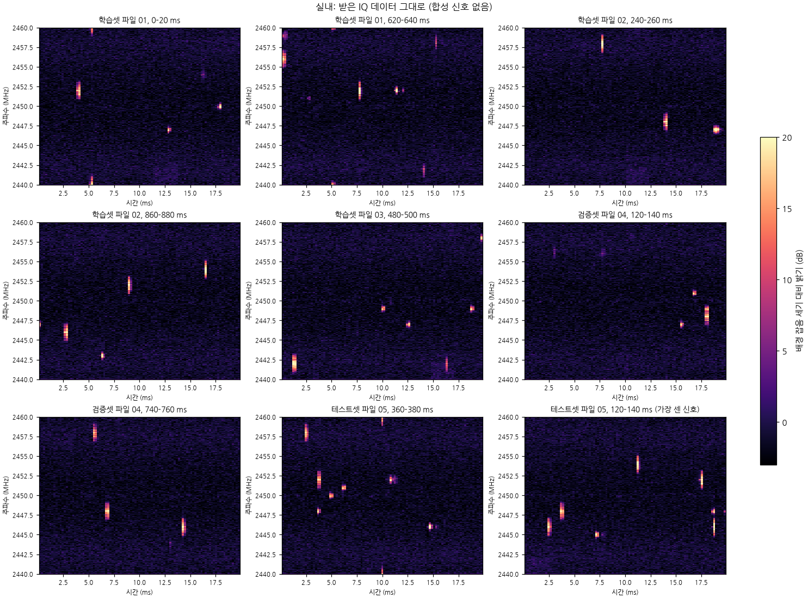

**그림 A-1. 실내: 받은 IQ 데이터 그대로(합성 신호 없음).** 모든 칸에 짧은 세로 막대가 여러 개 있다. 실제 블루투스 형태의 신호이며, 많은 막대가 색 범위의 끝(20 dB)을 넘어 밝게 표시되었다.

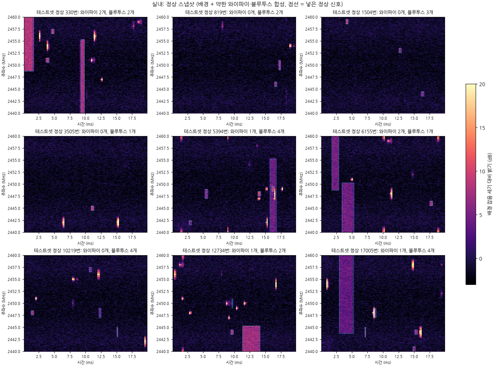

**그림 A-2. 실내: 테스트셋 정상 스냅샷.** 합성 정상 신호(하늘색 점선)는 실제 신호보다 약하다(SNR 2–10 dB, 배경보다 4.1–10.4 dB 밝음). 와이파이는 주파수 방향으로 긴 막대, 블루투스는 짧은 막대이다.

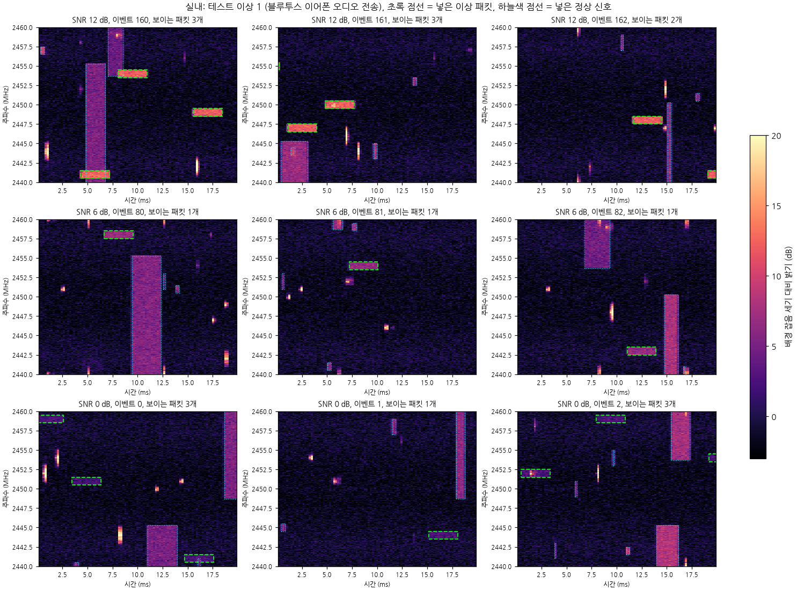

**그림 A-3. 실내: 테스트 이상 신호 1(이어폰형).** 이상 패킷은 폭 1 MHz, 길이 2.87 ms의 가로 막대이다. SNR 12 dB(윗줄)에서는 뚜렷하고, SNR 0 dB(아랫줄)에서는 눈으로 구분하기 어렵다.

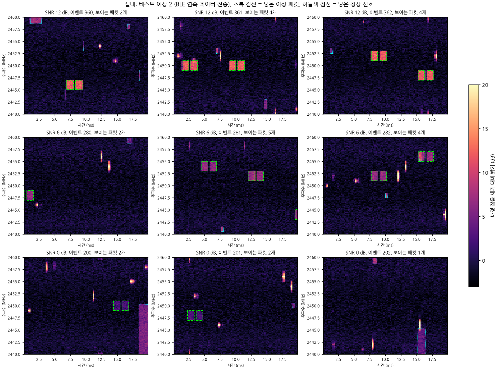

**그림 A-4. 실내: 테스트 이상 신호 2(BLE형).** 이상 패킷은 폭 2 MHz, 길이 1.06 ms인 두 패킷이 0.33 ms 간격으로 붙은 모양이다.

### A.2 실내(드론 끔)

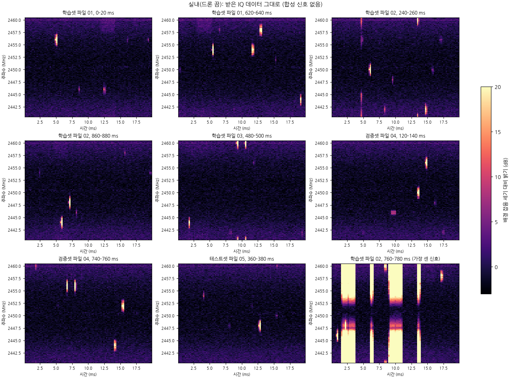

**그림 A-5. 실내(드론 끔): 받은 IQ 데이터 그대로(합성 신호 없음).** 실내와 같은 짧은 세로 막대가 보인다. 마지막 칸(학습셋 파일 2, 760–780 ms)은 20 MHz 전체를 덮는 강한 신호로, 색 범위(20 dB)를 넘어 흰색으로 표시되었다. 맨 위(2,460 MHz 부근)에는 모든 칸에서 시간 내내 이어지는 얇은 가로 줄이 있으며, 원인은 확인하지 않았다.


**그림 A-6. 실내(드론 끔): 테스트셋 정상 스냅샷.**

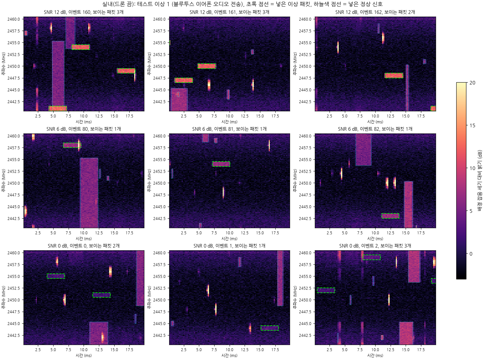

**그림 A-7. 실내(드론 끔): 테스트 이상 신호 1(이어폰형).**

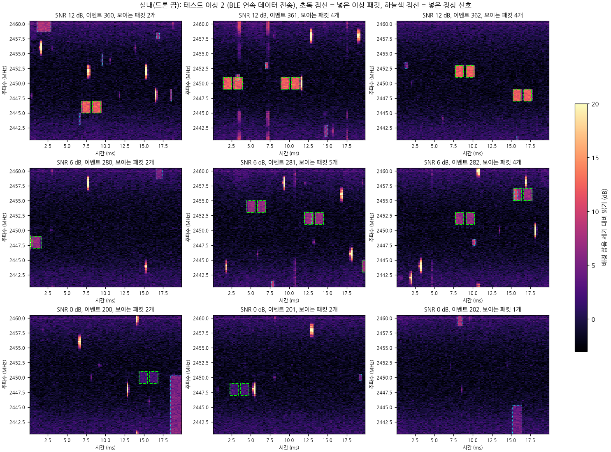

**그림 A-8. 실내(드론 끔): 테스트 이상 신호 2(BLE형).**

### A.3 공원

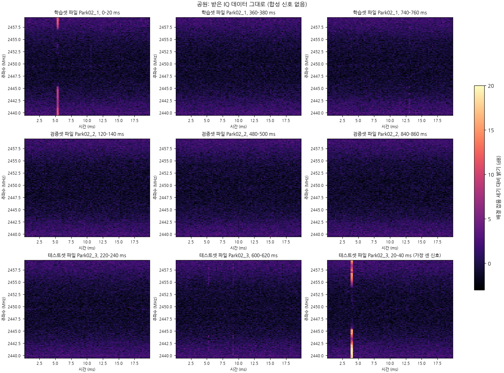

**그림 A-9. 공원: 받은 IQ 데이터 그대로(합성 신호 없음).** 실제 신호가 거의 없다. 첫 칸과 마지막 칸에서 대역 대부분을 덮는 얇은 세로 줄은 첫 번째 실험에서 원인을 확인하지 못한 짧은 수직 패턴이다. 주파수 위·아래 끝 0.6 MHz는 가운데보다 2.6–2.9 dB 밝다.

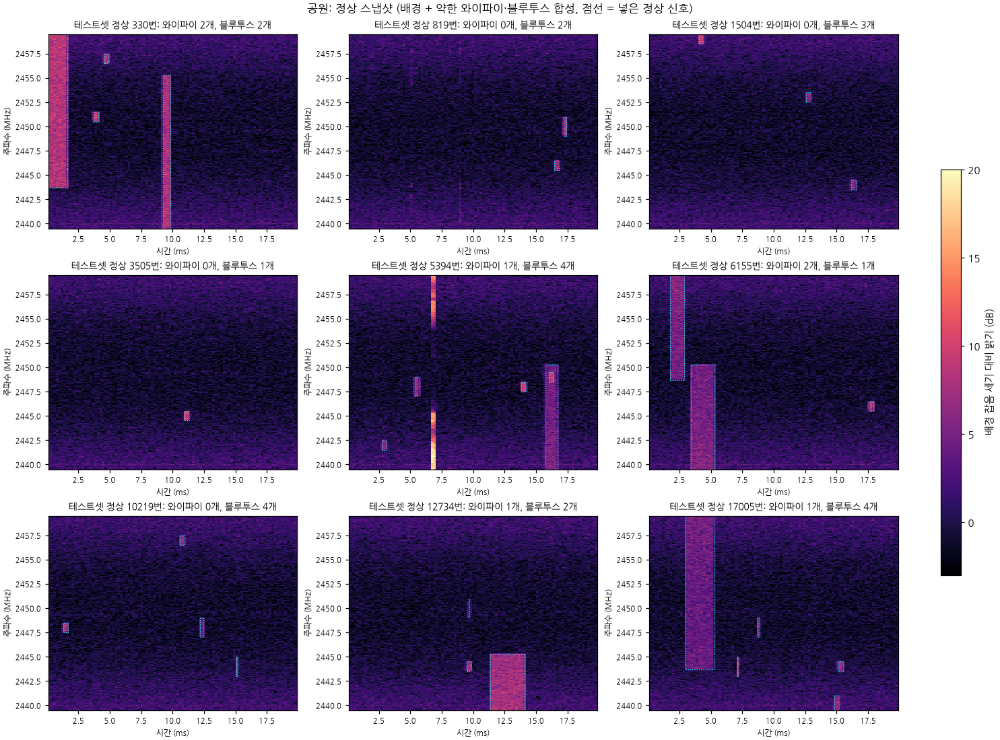

**그림 A-10. 공원: 테스트셋 정상 스냅샷.**

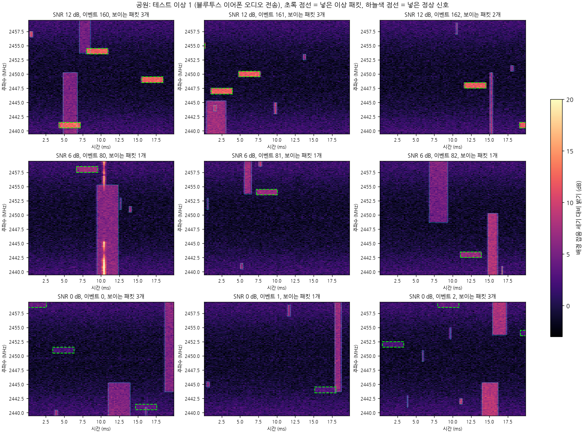

**그림 A-11. 공원: 테스트 이상 신호 1(이어폰형).**

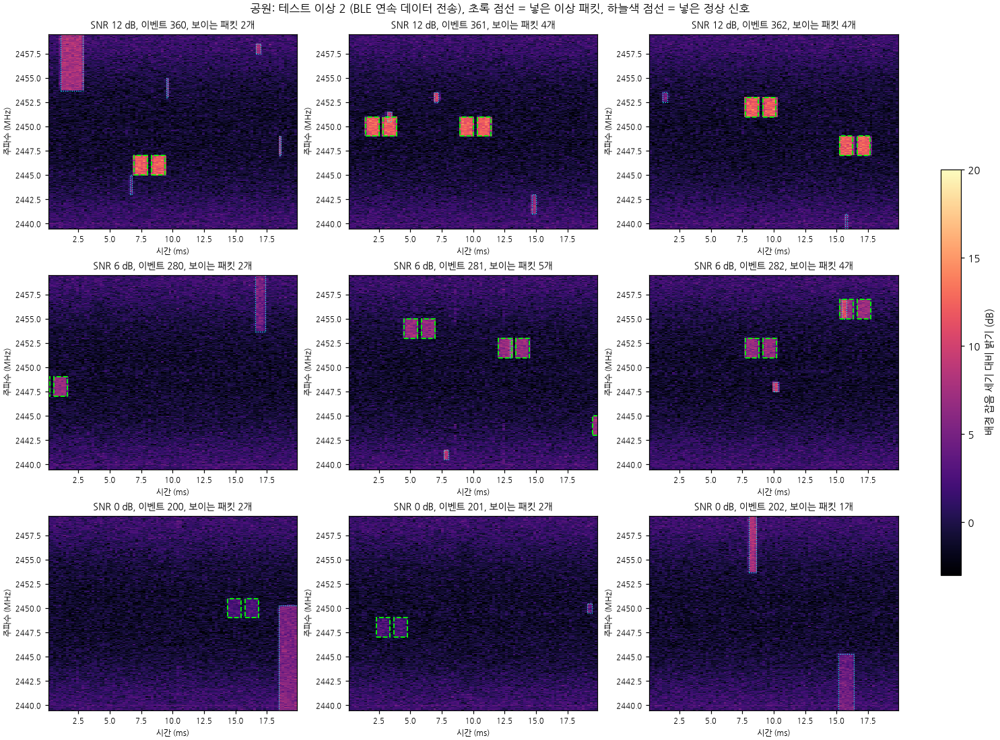

**그림 A-12. 공원: 테스트 이상 신호 2(BLE형).**
